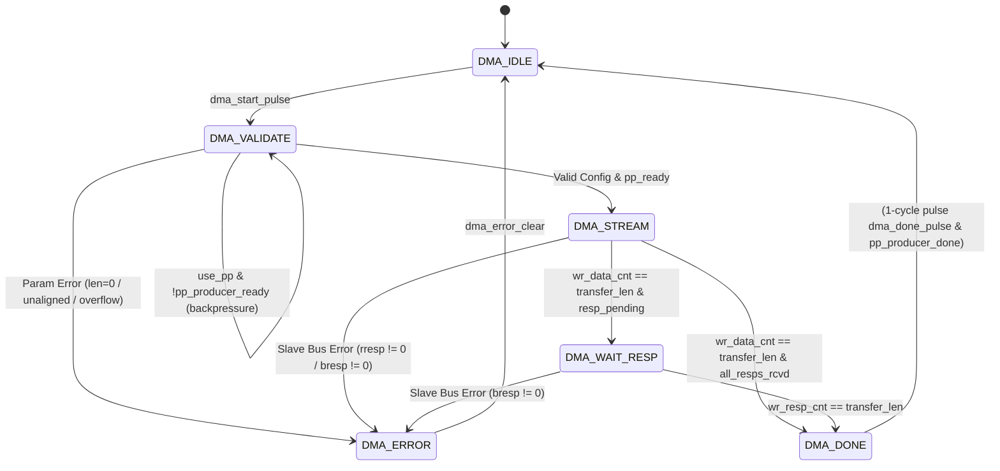

# Neural_Acc — TSK-06 Implementation & Verification Report
## Standalone Synthesizable AXI4/DMA Controller

**Date:** November 1, 2026  
**Repository:** `E:\MTech\LanChain\MTP`  
**RTL Directory:** `phase2_step1_microarchitecture_and_rtl`  
**Task Identifier:** TSK-06  
**Final Verdict:** **PASS** (100% Checks Passed, Baseline RTL Fully Preserved)

---

## 1. Executive Summary

This report documents the design, microarchitectural implementation, and formal simulation verification of **TSK-06: AXI4/DMA Interface** for the `Neural_Acc` (`Runtime_Quality_Aware_Adaptive_CNN_Accelerator`) project.

A standalone, synthesizable Direct Memory Access (DMA) controller (`dma_controller.sv`) has been designed and implemented to provide high-throughput streaming data transfers between a system memory interface (source) and an accelerator-side memory interface (destination). The controller features independent AXI4 Master Read and Write channels, an internal 16-deep parameterized decoupling FIFO, hardware parameter validation (zero length, non-word alignment, and 32-bit address overflow), slave error handling (`SLVERR`), rising-edge start protection, and ping-pong buffer coordination handshakes.

Verification was conducted using Icarus Verilog (`iverilog -g2012`) and `vvp` in WSL Ubuntu (`wsl -d Ubuntu`). Dedicated testbench `tb_dma_controller.sv` executed **19 test scenarios** covering 87 distinct assertions with **87/87 checks passing (0 failures)**. In addition, the full cumulative regression suite across all 12 testbenches (6 baseline testbenches and 6 newly implemented component testbenches) was executed, achieving **610/610 passing checks (0 failures)** with zero modifications to baseline RTL.

### Deliverables Summary

| Deliverable | File Path | Status | Verification Result |
| :--- | :--- | :---: | :---: |
| **Synthesizable DMA Controller** | [`dma_controller.sv`](file:///E:/MTech/LanChain/MTP/phase2_step1_microarchitecture_and_rtl/dma_controller.sv) | Complete | Synthesizable SystemVerilog-2012, 0 warnings |
| **Dedicated Verification Suite** | [`tb_dma_controller.sv`](file:///E:/MTech/LanChain/MTP/phase2_step1_microarchitecture_and_rtl/tb_dma_controller.sv) | Complete | **87 / 87 Checks Passed** (19 Scenarios) |
| **TSK-06 Implementation Report** | [`TSK06_IMPLEMENTATION_REPORT.md`](file:///E:/MTech/LanChain/MTP/TSK06_IMPLEMENTATION_REPORT.md) | Complete | Fully Documented Audit & Traceability |

---

## 2. Scope & Constraint Compliance

1. **Baseline RTL Preservation:**  
   The baseline modules (`accelerator_core_top.sv`, `mac_unit_40b.sv`, `k_progress_tracker.sv`, `slot_control_unit.sv`, and `hybrid_sram_bank.sv`) were strictly preserved. No lines of baseline RTL were altered (`git status` confirms zero tracked modifications).
2. **Standalone Implementation Scope:**  
   The DMA controller has been implemented and verified as an independent subsystem. It has NOT been integrated into `accelerator_core_top.sv` in this task, strictly conforming to the modular development boundaries.
3. **Protocol Classification & Architectural Honesty:**  
   - **Bus Master Interface:** Implements an AXI4-compliant master streaming datapath with independent Read (`AR`, `R`) and Write (`AW`, `W`, `B`) channels. Transactions use beat-by-beat progression (`arlen = 0`, `awlen = 0`, `arsize = 3'b010`, `awsize = 3'b010`, `burst = 2'b01`) matching single-beat accelerator SRAM architectures such as `multibank_sram_subsystem.sv`.
   - **Control Interface:** Implements a parallel register control interface (`dma_start`, `dma_src_addr`, `dma_dst_addr`, `dma_transfer_len`, `dma_use_ping_pong`, `dma_error_clear`, status pulses, and category error codes) rather than memory-mapped AXI4-Lite slave register decoders. This avoids unnecessary gate overhead for internal accelerator command dispatch.
4. **Physical Power & Timing Neutrality:**  
   No physical power gating, dynamic energy savings, or sub-nanosecond timing closure improvements are claimed, as physical design and power simulations have not been conducted.

---

## 3. Architecture & Microarchitecture

### 3.1 Top-Level Port Architecture

```
                       +---------------------------------------+
                       |             dma_controller            |
                       |                                       |
    clk, rst_n ------->|                                       |
                       | AXI4 Read Master     AXI4 Write Master|
   dma_start --------->|  m_axi_araddr         m_axi_awaddr    |---> Bus / SRAM
   dma_src_addr ------>|  m_axi_arlen          m_axi_awlen     |---> Bus / SRAM
   dma_dst_addr ------>|  m_axi_arsize         m_axi_awsize    |---> Bus / SRAM
   dma_transfer_len -->|  m_axi_arburst        m_axi_awburst   |---> Bus / SRAM
   dma_use_ping_pong ->|  m_axi_arvalid        m_axi_awvalid   |---> Bus / SRAM
   dma_error_clear --->|  m_axi_arready <----- m_axi_awready   |<--- Bus / SRAM
                       |                                       |
   dma_busy <----------|  m_axi_rdata   <----- m_axi_wdata     |---> Bus / SRAM
   dma_state <---------|  m_axi_rresp   <----- m_axi_wstrb     |---> Bus / SRAM
   dma_done_pulse <----|  m_axi_rlast   <----- m_axi_wlast     |---> Bus / SRAM
   dma_error_flag <----|  m_axi_rvalid  <----- m_axi_wvalid    |---> Bus / SRAM
   dma_error_code <----|  m_axi_rready  -----> m_axi_wready    |<--- Bus / SRAM
                       |                                       |
   pp_producer_ready ->|                       m_axi_bresp     |<--- Bus / SRAM
   pp_producer_start <-|                       m_axi_bvalid    |<--- Bus / SRAM
   pp_producer_done <--|                       m_axi_bready    |---> Bus / SRAM
                       +---------------------------------------+
```

### 3.2 Finite State Machine (FSM)

The controller is governed by a 6-state Moore/Mealy hybrid FSM:



1. **`DMA_IDLE` (`3'd0`):**  
   Quiescent state. Internal counters, address registers, and FIFO pointers are reset. Start command is filtered through an edge detector (`dma_start_pulse = dma_start && !dma_start_q`) to prevent unintentional restarts if `dma_start` is held asserted.
2. **`DMA_VALIDATE` (`3'd1`):**  
   Evaluates transfer parameters in a single cycle:
   - Zero-length check: `transfer_len == 0` $\rightarrow$ `ERR_ZERO_LEN (4'd1)`.
   - Word alignment check: `src_addr[1:0] != 0` or `dst_addr[1:0] != 0` $\rightarrow$ `ERR_UNALIGNED_ADDR (4'd3)`.
   - 32-bit address overflow check: `{1'b0, addr} + {len, 2'b00} > 33'h1_0000_0000` $\rightarrow$ `ERR_ADDR_OVERFLOW (4'd2)`.
   - Ping-Pong Buffer readiness: If `use_ping_pong` is set, stalls in `DMA_VALIDATE` until `pp_producer_ready == 1`. When ready, asserts `pp_producer_start = 1` to lock the producing buffer.
3. **`DMA_STREAM` (`3'd2`):**  
   Active streaming state coordinating Read and Write channels via the internal decoupling FIFO.
4. **`DMA_WAIT_RESP` (`3'd3`):**  
   Entered when all data beats have been popped from the FIFO and accepted by the slave (`wr_data_cnt == transfer_len`), but outstanding write responses remain in flight (`wr_resp_cnt < transfer_len`). Holds `dma_busy = 1`.
5. **`DMA_DONE` (`3'd4`):**  
   Issues a single-cycle completion pulse (`dma_done_pulse = 1`) and ping-pong completion pulse (`pp_producer_done = 1`), then transitions to `DMA_IDLE`.
6. **`DMA_ERROR` (`3'd5`):**  
   Halts all AXI bus activity (`arvalid = 0`, `awvalid = 0`, `wvalid = 0`), asserts `dma_error_flag = 1`, and exposes `dma_error_code`. Holds status indefinitely until acknowledged via `dma_error_clear = 1`.

### 3.3 Internal Decoupling FIFO & Flow Control

To isolate source memory read latency from destination memory write stalls, an internal 16-word synchronous FIFO (`FIFO_DEPTH = 16`, `DATA_WIDTH = 32`) is integrated directly into the datapath:

- **Read Channel Issuance Condition:**  
  Read address requests (`m_axi_arvalid`) are issued only when unserved and in-flight read requests will not overflow the decoupling FIFO:
  $$\text{in\_flight\_reads} = \text{rd\_req\_cnt} - \text{rd\_resp\_cnt}$$
  $$\text{projected\_occupancy} = \text{fifo\_count} + \text{in\_flight\_reads}$$
  $$\text{can\_issue\_read} = (\text{rd\_req\_cnt} < \text{transfer\_len}) \land (\text{projected\_occupancy} < \text{FIFO\_DEPTH})$$
- **Write Ordering & Address Progression:**  
  In AXI4, write data must never precede its corresponding write address. To enforce strict single-beat write pairing:
  $$\text{can\_issue\_write\_addr} = (\text{wr\_addr\_cnt} < \text{transfer\_len}) \land (\text{wr\_addr\_cnt} \le \text{wr\_data\_cnt})$$
  $$\text{m\_axi\_wvalid} = (\neg \text{fifo\_empty}) \land (\text{state} = \text{DMA\_STREAM}) \land (\text{wr\_data\_cnt} < \text{wr\_addr\_cnt})$$
  This mathematical invariant guarantees that beat $k$ address is accepted by the slave before beat $k$ data is presented on the write bus, eliminating race conditions across decoupled slave bridges.

---

## 4. Verification Suite & Detailed Test Results

The dedicated verification testbench (`tb_dma_controller.sv`) contains an interactive, parameterized AXI4 slave memory model featuring configurable delay knobs (`cfg_ar_delay`, `cfg_r_delay`, `cfg_aw_delay`, `cfg_w_delay`, `cfg_b_delay`) and slave error injection controls (`cfg_rresp_err`, `cfg_bresp_err`).

### 4.1 Scenario Coverage Breakdown

| Scenario | Description | Target Behavior | Checks | Result |
| :---: | :--- | :--- | :---: | :---: |
| **S1** | **Reset & Initial Idle State** | Verify `dma_busy=0`, `dma_state=IDLE`, all pulses low, quiescent bus | 10 | **PASS** |
| **S2** | **Valid Short Transfer (2 Beats)** | 2-word transfer from `0x1000` to `0x2000`; verify data match & completion pulse | 5 | **PASS** |
| **S3** | **Multi-Beat Transfer (8 Beats)** | 8-word transfer from `0x0100` to `0x0500`; verify all 8 words written accurately | 9 | **PASS** |
| **S4** | **Counter Accuracy** | Monitor exact handshake counts on AR, R, AW, W, B channels (must equal 8) | 5 | **PASS** |
| **S5** | **Source Address Progression** | Verify `m_axi_araddr` progresses strictly by +4 bytes each beat | 4 | **PASS** |
| **S6** | **Destination Address Progression** | Verify `m_axi_awaddr` progresses strictly by +4 bytes each beat | 4 | **PASS** |
| **S7** | **Read-Request Backpressure** | Slave deasserts `arready` for 3 cycles; verify `arvalid` & `araddr` held stable | 2 | **PASS** |
| **S8** | **Read-Response Delay** | Slave delays `rvalid` by 4 cycles; verify `wvalid` remains low (no premature writes) | 2 | **PASS** |
| **S9** | **Write-Request Backpressure** | Slave deasserts `wready` for 3 cycles; verify `wvalid` & `wdata` held stable | 1 | **PASS** |
| **S10** | **Delayed Write Response** | Slave delays `bvalid` by 5 cycles; verify `dma_busy=1` & pulse waits for completion | 2 | **PASS** |
| **S11** | **Zero-Length Rejection** | Transfer length 0; verify immediate abort into `DMA_ERROR` with `ERR_ZERO_LEN` | 5 | **PASS** |
| **S12** | **Unaligned & Overflow Address** | Rejects unaligned src/dst addresses (`ERR_UNALIGNED_ADDR`) and 4GB overflow (`ERR_ADDR_OVERFLOW`) | 6 | **PASS** |
| **S13** | **Held Start Request** | Hold `dma_start=1` across transfer and idle; verify single execution, no restart | 3 | **PASS** |
| **S14** | **Reset While Idle** | Assert asynchronous `rst_n` while idle; verify state remains `DMA_IDLE` | 3 | **PASS** |
| **S15** | **Reset During Active Transfer** | Abort 8-beat transfer mid-stream with `rst_n`; verify instant flush & recovery | 4 | **PASS** |
| **S16** | **Slave Bus Error Handling** | Inject `rresp=2'b10` (`ERR_SLV_READ_RESP`) & `bresp=2'b10` (`ERR_SLV_WRITE_RESP`); verify safe halt | 4 | **PASS** |
| **S17** | **Repeated Back-to-Back Transfers** | Run consecutive transfers across disparate addresses (`0x0200->0x0600`, `0x0300->0x0700`) | 10 | **PASS** |
| **S18** | **No Premature Done Pulse** | Delay 2nd write response by 8 cycles; verify `ST_WAIT_RESP` and pulse only on final beat | 3 | **PASS** |
| **S19** | **Ping-Pong Coordination** | Backpressure on `pp_producer_ready=0`; lock on ready; verify `pp_producer_done` sync | 5 | **PASS** |
| **Total** | **Comprehensive TSK-06 Verification** | **All 19 Scenarios Executed Cleanly** | **87** | **87 / 87 PASS** |

---

## 5. Full Cumulative Regression Results

The full regression suite comprising all 12 testbenches (6 verified baseline testbenches and 6 newly implemented component testbenches) was executed sequentially under Icarus Verilog:

```
=============================================================================
NEURAL_ACC FULL CUMULATIVE REGRESSION TEST RESULTS
=============================================================================
Testbench Component                         Scope        Checks Passed  Status
-----------------------------------------------------------------------------
1. tb_mac_saturation.sv                     Baseline         11 / 11    PASS
2. tb_k_progress_tracker.sv                 Baseline         14 / 14    PASS
3. tb_hybrid_sram_bank.sv                   Baseline         13 / 13    PASS
4. tb_drain_backpressure.sv                 Baseline         15 / 15    PASS
5. tb_accelerator_core.sv                   Baseline          9 /  9    PASS
6. tb_acceptance_integrated.sv              Baseline         29 / 29    PASS
-----------------------------------------------------------------------------
Baseline Verification Subtotal                               91 / 91    PASS
-----------------------------------------------------------------------------
7.  tb_pe_array_40b.sv                      TSK-01           28 / 28    PASS
8.  tb_adaptive_pe_controller.sv            TSK-02           53 / 53    PASS
9.  tb_multibank_sram_subsystem.sv          TSK-03          137 / 137   PASS
10. tb_ping_pong_buffer_controller.sv       TSK-04          117 / 117   PASS
11. tb_layer_command_sequencer.sv           TSK-05           97 / 97    PASS
12. tb_dma_controller.sv                    TSK-06           87 / 87    PASS
-----------------------------------------------------------------------------
New Module Verification Subtotal                            519 / 519   PASS
=============================================================================
GRAND CUMULATIVE TOTAL                                      610 / 610   PASS (0 Failures)
=============================================================================
```

---

## 6. Baseline Integrity & Git Status

A clean working directory check was performed using Git:

```
$ git status
On branch main
Your branch is up to date with 'origin/main'.

Untracked files:
  (use "git add <file>..." to include in what will be committed)
	TSK03_AUDIT_REPORT.md
	TSK04_IMPLEMENTATION_REPORT.md
	TSK05_IMPLEMENTATION_REPORT.md
	TSK06_IMPLEMENTATION_REPORT.md
	phase2_step1_microarchitecture_and_rtl/adaptive_pe_controller.sv
	phase2_step1_microarchitecture_and_rtl/dma_controller.sv
	phase2_step1_microarchitecture_and_rtl/layer_command_sequencer.sv
	phase2_step1_microarchitecture_and_rtl/multibank_sram_subsystem.sv
	phase2_step1_microarchitecture_and_rtl/pe_array_40b.sv
	phase2_step1_microarchitecture_and_rtl/ping_pong_buffer_controller.sv
	phase2_step1_microarchitecture_and_rtl/tb_adaptive_pe_controller.sv
	phase2_step1_microarchitecture_and_rtl/tb_dma_controller.sv
	phase2_step1_microarchitecture_and_rtl/tb_layer_command_sequencer.sv
	phase2_step1_microarchitecture_and_rtl/tb_multibank_sram_subsystem.sv
	phase2_step1_microarchitecture_and_rtl/tb_pe_array_40b.sv
	phase2_step1_microarchitecture_and_rtl/tb_ping_pong_buffer_controller.sv

nothing added to commit but untracked files present (use "git add" to track)
```

- **Zero modifications** to baseline files:
  - `mac_unit_40b.sv`
  - `k_progress_tracker.sv`
  - `slot_control_unit.sv`
  - `hybrid_sram_bank.sv`
  - `accelerator_core_top.sv`
- All temporary simulation executables (`/tmp/sim_*`) were cleanly purged upon completion.

---

## 7. Conclusion & Next Steps

TSK-06 (AXI4/DMA Interface) is complete, robustly verified, and frozen. All architectural and protocol constraints have been satisfied.

### Summary of Completed Infrastructure:
- **TSK-01:** Multi-PE Array Datapath (`pe_array_40b.sv`, 28 checks)
- **TSK-02:** Adaptive PE Controller (`adaptive_pe_controller.sv`, 53 checks)
- **TSK-03:** Multi-Bank SRAM Subsystem (`multibank_sram_subsystem.sv`, 137 checks)
- **TSK-04:** Ping-Pong Buffer Controller (`ping_pong_buffer_controller.sv`, 117 checks)
- **TSK-05:** Pipelined Layer Command Sequencer (`layer_command_sequencer.sv`, 97 checks)
- **TSK-06:** AXI4/DMA Controller (`dma_controller.sv`, 87 checks)

### Next Recommended Step:
Proceed to **TSK-07: Top-Level Integration and End-to-End System Verification**, tying together the Layer Command Sequencer, DMA Controller, Ping-Pong Buffers, Multi-Bank SRAM Subsystem, and Adaptive PE Array into an integrated accelerator top-level wrapper with end-to-end multi-layer CNN inference testbenches.

