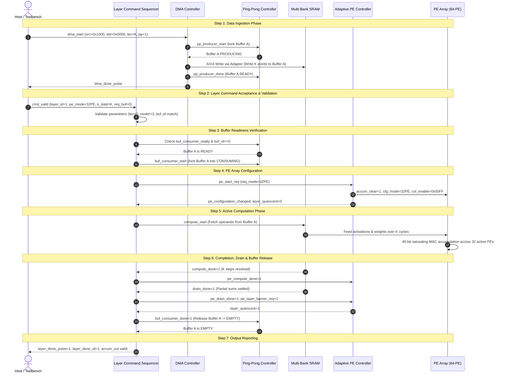

# Neural_Acc — TSK-07 Interface & Compatibility Audit Report
## Top-Level System Integration & End-to-End Verification

**Date:** November 1, 2026  
**Repository:** `E:\MTech\LanChain\MTP`  
**RTL Directory:** `phase2_step1_microarchitecture_and_rtl`  
**Task Identifier:** TSK-07 (Phase 1 Audit & Integration Contract)  
**Status:** **AUDIT COMPLETE** (All 6 Subsystems Inspected; Interfaces Characterized)

---

## 1. Executive Summary & Audit Scope

This document provides a comprehensive interface, timing, and compatibility audit for the top-level integration of the `Neural_Acc` (`Runtime_Quality_Aware_Adaptive_CNN_Accelerator`) architecture.

Six independently developed and verified synthesizable RTL modules are evaluated for direct interconnection and end-to-end operational compatibility:
1. **`layer_command_sequencer.sv`** (TSK-05: Pipelined Layer Command Sequencer)
2. **`adaptive_pe_controller.sv`** (TSK-02: Adaptive Processing Element Controller)
3. **`ping_pong_buffer_controller.sv`** (TSK-04: Dual-Buffer Coordination Controller)
4. **`multibank_sram_subsystem.sv`** (TSK-03: Multi-Bank Interleaved SRAM Subsystem)
5. **`dma_controller.sv`** (TSK-06: AXI4/DMA Controller)
6. **`pe_array_40b.sv`** (TSK-01: 64-PE Saturating Multi-PE Datapath)

Additionally, baseline modules (`accelerator_core_top.sv`, `mac_unit_40b.sv`, `k_progress_tracker.sv`, `slot_control_unit.sv`, and `hybrid_sram_bank.sv`) were audited to ensure complete architectural preservation.

---

## 2. Clock & Reset Polarity Audit

| Parameter | Governing Standard | Compliance Across All 6 Modules | Notes |
| :--- | :--- | :---: | :--- |
| **Clock Signal** | `clk` | **100% UNIFORM** | All sequential logic registers on `posedge clk`. Single clock domain. |
| **Reset Signal** | `rst_n` | **100% UNIFORM** | Asynchronous, active-low reset (`negedge rst_n`). All state registers and counters reset to `0` / quiescent states. |
| **Drive Convention** | Synchronous Drive | **VERIFIED** | All inputs driven on `negedge clk` in verification; sampled on `posedge clk`. |

---

## 3. Module-by-Module Interface Characterization

### 3.1 `layer_command_sequencer.sv`

- **Role:** High-level coordinator that manages layer execution, decodes commands, negotiates ping-pong buffer consumption, configures the PE controller, triggers computation, monitors drain, and signals completion.
- **Clock / Reset:** `clk`, `rst_n` (active-low asynchronous).

| Interface Group | Port Name | Dir | Width | Protocol / Timing Semantics |
| :--- | :--- | :---: | :---: | :--- |
| **Upstream Command** | `cmd_valid` | In | 1 | Ready/Valid handshake. Validates on `cmd_valid && cmd_ready`. |
| | `cmd_ready` | Out | 1 | High in `ST_IDLE`. Deasserted when busy. |
| | `cmd_layer_id` | In | 16 | Latched layer identifier. |
| | `cmd_pe_mode` | In | 2 | `2'b00` (16-PE), `2'b01` (32-PE), `2'b10` (64-PE), `2'b11` (Invalid). |
| | `cmd_adaptive_en` | In | 1 | Enable degradation-based adaptive PE selection. |
| | `cmd_degradation_hat_*` | In | 32 | Q16.16 predicted degradation metrics for 16, 32, 64 PE modes. |
| | `cmd_use_ping_pong` | In | 1 | 1 = Synchronize with ping-pong buffer controller; 0 = bypass. |
| | `cmd_req_buf_id` | In | 1 | Expected buffer ID (0: Buffer A, 1: Buffer B). |
| | `cmd_k_total` | In | 16 | Total reduction steps for layer ($>0$). |
| **PE Controller** | `pe_start_req` | Out | 1 | Level/pulse asserted in `ST_CONFIGURE` to trigger configuration. |
| | `pe_req_mode` | Out | 2 | Forwarded requested mode. |
| | `pe_adaptive_policy_en` | Out | 1 | Forwarded adaptive policy enable. |
| | `pe_degradation_hat_*` | Out | 32 | Forwarded degradation thresholds. |
| | `pe_controller_busy` | In | 1 | High when PE controller is managing computation. |
| | `pe_layer_quiescent` | In | 1 | High when PE array is completely quiescent. |
| | `pe_configuration_changed` | In | 1 | 1-cycle pulse from PE controller upon mode change. |
| | `pe_invalid_configuration`| In | 1 | Asserted if mode `2'b11` was requested. |
| | `pe_compute_done` | Out | 1 | Pulse notifying PE controller compute complete. |
| | `pe_drain_done` | Out | 1 | Pulse notifying PE controller drain complete. |
| | `pe_layer_barrier_req` | Out | 1 | Barrier synchronization request at layer completion. |
| **Ping-Pong Buffer** | `buf_consumer_ready` | In | 1 | High when target buffer has valid data (`BUF_READY`). |
| | `buf_consumer_buf_id` | In | 1 | ID of ready buffer (0: Buffer A, 1: Buffer B). |
| | `buf_consumer_start` | Out | 1 | 1-cycle pulse to lock buffer into `BUF_CONSUMING`. |
| | `buf_consumer_done` | Out | 1 | 1-cycle pulse to release buffer into `BUF_EMPTY`. |
| | `buf_consumer_active` | In | 1 | Buffer is actively in `BUF_CONSUMING` state. |
| **Datapath Execution** | `compute_start` | Out | 1 | 1-cycle pulse to initiate datapath computation. |
| | `compute_k_total` | Out | 16 | Latched reduction length forwarded to datapath. |
| | `compute_done` | In | 1 | Pulse or level indicating datapath computation finished. |
| | `drain_done` | In | 1 | Pulse or level indicating partial sum drain finished. |
| **Status / Reporting** | `layer_done_pulse` | Out | 1 | 1-cycle pulse upon successful layer completion. |
| | `layer_done_id` | Out | 16 | Latched layer ID of completed layer. |
| | `sequencer_busy` | Out | 1 | High while processing any command (`state != ST_IDLE`). |
| | `sequencer_state` | Out | 4 | Current FSM state (`ST_IDLE`..`ST_COMPLETE`). |
| | `error_flag` | Out | 1 | Latched error flag. |
| | `error_code` | Out | 4 | Error categorization (`ERR_NONE`..`ERR_BUFFER_MISMATCH`). |
| | `error_clear` | In | 1 | Upstream pulse to clear error state back to `ST_IDLE`. |

---

### 3.2 `adaptive_pe_controller.sv`

- **Role:** Manages dynamic PE mode configuration (16, 32, 64 PEs), evaluates degradation policy, enforces atomic accumulator clearing, and synchronizes layer barriers.
- **Clock / Reset:** `clk`, `rst_n` (active-low asynchronous).

| Interface Group | Port Name | Dir | Width | Protocol / Timing Semantics |
| :--- | :--- | :---: | :---: | :--- |
| **Sequencer Control** | `start_req` | In | 1 | Triggers configuration evaluation and enters `ST_CLEAR`. |
| | `req_mode` | In | 2 | Requested mode. |
| | `adaptive_policy_en`| In | 1 | 1 = Evaluate degradation metrics against `D_MAX_Q16`. |
| | `degradation_hat_*` | In | 32 | Q16.16 metrics for 16, 32, 64 PE modes. |
| | `compute_enable_in` | In | 1 | Compute trigger from datapath / sequencer. |
| | `compute_done` | In | 1 | Enters `ST_DRAIN`. |
| | `layer_barrier_req` | In | 1 | Barrier synchronization request. |
| | `drain_done` | In | 1 | Enters `ST_QUIESCENT` upon drain completion. |
| | `col_mask_in` | In | 16 | Column qualification mask (default `'1`). |
| **PE Array Control** | `cfg_mode` | Out | 2 | Latched configuration mode driving `pe_array_40b`. |
| | `enable` | Out | 1 | Active compute enable (gated low during non-compute). |
| | `accum_clear` | Out | 1 | 1-cycle pulse in `ST_CLEAR` clearing PE accumulators. |
| | `sat_clear` | Out | 1 | Clears sticky saturation flags. |
| | `col_enable` | Out | 16 | Qualified active column bitmask driving `pe_array_40b`. |
| **Status / Handshake** | `controller_busy` | Out | 1 | High when not in `ST_IDLE` or `ST_QUIESCENT`. |
| | `layer_quiescent` | Out | 1 | High when in `ST_IDLE` or `ST_QUIESCENT`. |
| | `configuration_changed` | Out | 1 | 1-cycle pulse upon mode change. |
| | `invalid_configuration` | Out | 1 | High if mode `2'b11` requested. |
| | `controller_state` | Out | 3 | FSM state diagnostics (`ST_IDLE`..`ST_ERROR`). |

---

### 3.3 `ping_pong_buffer_controller.sv`

- **Role:** Coordinates mutual exclusion, ownership transitions, and backpressure for two logical buffers (Buffer A: `0`, Buffer B: `1`) through a 4-state lifecycle: `BUF_EMPTY (00)` $\rightarrow$ `BUF_PRODUCING (01)` $\rightarrow$ `BUF_READY (10)` $\rightarrow$ `BUF_CONSUMING (11)` $\rightarrow$ `BUF_EMPTY (00)`.
- **Clock / Reset:** `clk`, `rst_n` (active-low asynchronous).

| Interface Group | Port Name | Dir | Width | Protocol / Timing Semantics |
| :--- | :--- | :---: | :---: | :--- |
| **Producer (DMA)** | `producer_ready` | Out | 1 | Target buffer is in `BUF_EMPTY` state. |
| | `producer_start` | In | 1 | Locks target buffer into `BUF_PRODUCING`. |
| | `producer_done` | In | 1 | Marks buffer filled, moving to `BUF_READY`. |
| | `producer_buf_id`| Out | 1 | Current target buffer for production (0: A, 1: B). |
| | `producer_active`| Out | 1 | High while a buffer is being produced. |
| | `producer_stall` | Out | 1 | High if `producer_start` arrives while buffer is unavailable. |
| **Consumer (Seq)** | `consumer_ready` | Out | 1 | Target buffer has valid data (`BUF_READY`). |
| | `consumer_start` | In | 1 | Locks target buffer into `BUF_CONSUMING`. |
| | `consumer_done` | In | 1 | Releases consumed buffer, moving to `BUF_EMPTY`. |
| | `consumer_buf_id`| Out | 1 | Current target buffer for consumption (0: A, 1: B). |
| | `consumer_active`| Out | 1 | High while a buffer is being consumed. |
| | `consumer_stall` | Out | 1 | High if `consumer_start` arrives while buffer is not ready. |
| **Diagnostics** | `buf_state_a` | Out | 2 | Lifecycle state of Buffer A. |
| | `buf_state_b` | Out | 2 | Lifecycle state of Buffer B. |
| | `switch_event_pulse` | Out | 1 | 1-cycle pulse upon buffer state change. |
| | `total_produced_count` | Out | 32 | Total buffers successfully produced. |
| | `total_consumed_count` | Out | 32 | Total buffers successfully consumed. |

---

### 3.4 `dma_controller.sv`

- **Role:** AXI4 streaming master with independent Read (`AR`, `R`) and Write (`AW`, `W`, `B`) channels, internal 16-deep decoupling FIFO, and parallel register control.
- **Clock / Reset:** `clk`, `rst_n` (active-low asynchronous).

| Interface Group | Port Name | Dir | Width | Protocol / Timing Semantics |
| :--- | :--- | :---: | :---: | :--- |
| **Control Registers**| `dma_start` | In | 1 | Start trigger (filtered by rising-edge detector). |
| | `dma_src_addr` | In | 32 | Source byte address in system memory. |
| | `dma_dst_addr` | In | 32 | Destination byte address in accelerator memory. |
| | `dma_transfer_len`| In | 16 | Number of 32-bit words ($>0$). |
| | `dma_use_ping_pong`| In | 1 | 1 = Synchronize with ping-pong buffer controller. |
| | `dma_error_clear`| In | 1 | Clear latched error status. |
| | `dma_busy` | Out | 1 | High while transfer is active. |
| | `dma_state` | Out | 3 | FSM state (`IDLE`, `VALIDATE`, `STREAM`, `WAIT_RESP`, `DONE`, `ERROR`). |
| | `dma_done_pulse` | Out | 1 | 1-cycle completion pulse upon write response arrival. |
| | `dma_error_flag` | Out | 1 | Latched error indicator. |
| | `dma_error_code` | Out | 4 | Error code (`ERR_NONE`..`ERR_SLV_WRITE_RESP`). |
| **Ping-Pong Handshake**| `pp_producer_ready` | In | 1 | Connected to `ping_pong_buffer_controller.producer_ready`. |
| | `pp_producer_start` | Out | 1 | Connected to `ping_pong_buffer_controller.producer_start`. |
| | `pp_producer_done` | Out | 1 | Connected to `ping_pong_buffer_controller.producer_done`. |
| **AXI4 Read Master** | `m_axi_araddr` | Out | 32 | Source byte address. Advances by +4 each beat. |
| | `m_axi_arlen` | Out | 8 | `8'd0` (1 beat per request). |
| | `m_axi_arsize` | Out | 3 | `3'b010` (4 bytes = 32 bits). |
| | `m_axi_arburst` | Out | 2 | `2'b01` (INCR). |
| | `m_axi_arvalid` | Out | 1 | Read address request valid. |
| | `m_axi_arready` | In | 1 | Read address acknowledge from system memory. |
| | `m_axi_rdata` | In | 32 | Read data word. |
| | `m_axi_rresp` | In | 2 | Read response (`2'b00`: OKAY, `2'b10`: SLVERR). |
| | `m_axi_rlast` | In | 1 | Read last beat. |
| | `m_axi_rvalid` | In | 1 | Read data valid. |
| | `m_axi_rready` | Out | 1 | Read data accept (asserted when FIFO is not full). |
| **AXI4 Write Master**| `m_axi_awaddr` | Out | 32 | Destination byte address. Advances by +4 each beat. |
| | `m_axi_awlen` | Out | 8 | `8'd0` (1 beat per request). |
| | `m_axi_awsize` | Out | 3 | `3'b010` (4 bytes = 32 bits). |
| | `m_axi_awburst` | Out | 2 | `2'b01` (INCR). |
| | `m_axi_awvalid` | Out | 1 | Write address request valid. |
| | `m_axi_awready` | In | 1 | Write address acknowledge from memory subsystem. |
| | `m_axi_wdata` | Out | 32 | Write data word from decoupling FIFO. |
| | `m_axi_wstrb` | Out | 4 | `4'b1111` (full word write). |
| | `m_axi_wlast` | Out | 1 | Write last beat flag. |
| | `m_axi_wvalid` | Out | 1 | Write data valid (asserted when address accepted & FIFO valid). |
| | `m_axi_wready` | In | 1 | Write data acknowledge from memory subsystem. |
| | `m_axi_bresp` | In | 2 | Write response (`2'b00`: OKAY, `2'b10`: SLVERR). |
| | `m_axi_bvalid` | In | 1 | Write response valid. |
| | `m_axi_bready` | Out | 1 | Write response accept (`1'b1`). |

---

### 3.5 `multibank_sram_subsystem.sv`

- **Role:** Physical memory array composed of 8 low-order interleaved hybrid SRAM banks. Total capacity = 41,472 bytes (10,368 words of 32 bits). Provides 8 independent write ports (Port A) and 8 independent read ports (Port B) with internal conflict arbitration and crossbar routing.
- **Clock / Reset:** `clk`, `rst_n` (active-low asynchronous).

| Interface Group | Port Name | Dir | Width | Protocol / Timing Semantics |
| :--- | :--- | :---: | :---: | :--- |
| **Global Control** | `bank_enable` | In | 8 | Bitmask enabling individual physical banks (default `'1`). |
| **Port A Write Ports**| `wr_req` | In | 8 | Write request strobes for 8 write ports. |
| | `wr_addr` | In | 14 [0:7] | 14-bit word addresses (`wr_addr[2:0]` = bank, `wr_addr[13:3]` = word). |
| | `wr_din` | In | 32 [0:7] | 32-bit write data words. |
| | `wr_byte_we` | In | 4 [0:7] | Byte write enables (`4'b1111` = full word). |
| | `wr_ready` | Out | 8 | High when target bank is ready to accept write. |
| | `wr_ack` | Out | 8 | 1-cycle acknowledge indicating write was committed. |
| | `wr_conflict_stall`| Out | 8 | High if request was stalled due to multi-port bank conflict. |
| **Port B Read Ports** | `rd_req` | In | 8 | Read request strobes for 8 read ports. |
| | `rd_addr` | In | 14 [0:7] | 14-bit word addresses. |
| | `rd_ready` | Out | 8 | High when target bank is ready to accept read. |
| | `rd_rvalid` | Out | 8 | Synchronous 1-cycle latency read valid flag. |
| | `rd_dout` | Out | 32 [0:7] | Synchronous 1-cycle latency read data word. |
| | `rd_conflict_stall`| Out | 8 | High if read request was stalled. |
| **Diagnostics** | `bank_conflict_flags`| Out | 8 | Bank conflict indicator flags. |
| | `bank_oob_err` | Out | 8 | Out-of-bounds error flags ($> 1295$ words per bank). |
| | `total_conflicts_count`| Out | 32 | Cumulative conflicts counter. |
| | `total_read_accesses` | Out | 32 | Cumulative reads counter. |
| | `total_write_accesses`| Out | 32 | Cumulative writes counter. |

---

### 3.6 `pe_array_40b.sv`

- **Role:** 64-PE computational core arranged as 4 Rows $\times$ 16 Columns using the verified 40-bit saturating MAC unit (`mac_unit_40b`).
- **Clock / Reset:** `clk`, `rst_n` (active-low asynchronous).

| Interface Group | Port Name | Dir | Width | Protocol / Timing Semantics |
| :--- | :--- | :---: | :---: | :--- |
| **Configuration** | `cfg_mode` | In | 2 | `2'b00` (16 PEs), `2'b01` (32 PEs), `2'b10` (64 PEs). |
| | `cfg_invalid` | Out | 1 | Asserted if mode `2'b11` is presented. |
| | `active_pe_count`| Out | 7 | Active PEs count (16, 32, 64, or 0). |
| | `col_active` | Out | 16 | Bitmask of currently active columns. |
| **Execution Control**| `enable` | In | 1 | Master compute enable (drives MAC units). |
| | `col_enable` | In | 16 | Per-column enable mask from PE controller. |
| | `accum_clear` | In | 1 | Synchronous clear resetting accumulators to 0. |
| | `sat_clear` | In | 1 | Synchronous clear resetting sticky saturation flags. |
| **Operand Inputs** | `broadcast_act` | In | 1 | 1 = Broadcast `act_data_row[r]` across all columns; 0 = per-PE. |
| | `act_data_row` | In | 16 [0:3] | 16-bit signed activations for rows 0..3. |
| | `act_mask_row` | In | 1 [0:3] | 1-bit zero token for rows 0..3 (1 = non-zero, 0 = exact zero). |
| | `act_data` | In | 16 [0:3][0:15]| Per-PE 16-bit activations (used when `broadcast_act=0`). |
| | `act_mask` | In | 1 [0:3][0:15] | Per-PE zero token mask. |
| | `weight_data` | In | 16 [0:3][0:15]| Per-PE 16-bit signed weights. |
| **Datapath Outputs** | `accum_out` | Out | 40 [0:3][0:15]| 40-bit signed accumulators (inactive PEs drive 0). |
| | `sticky_saturation`| Out | 1 [0:3][0:15] | Sticky saturation flags per PE. |
| | `cycle_skipped` | Out | 1 [0:3][0:15] | Cycle skipped status per PE. |
| | `col_sticky_saturation`| Out | 16 | Per-column sticky saturation OR reduction. |
| | `array_sticky_saturation`| Out | 1 | Array-wide sticky saturation OR reduction. |

---

## 4. Interface Compatibility & Mismatch Analysis

### 4.1 Compatibility Matrix

| Source Module | Target Module | Interconnection Status | Adaptation Required |
| :--- | :--- | :---: | :--- |
| `layer_command_sequencer` | `adaptive_pe_controller` | **100% DIRECT MATCH** | None. Signal names, widths, and pulse semantics align identically. |
| `layer_command_sequencer` | `ping_pong_buffer_controller` | **100% DIRECT MATCH** | None. Consumer handshake (`ready`, `start`, `done`, `buf_id`) is identical. |
| `dma_controller` | `ping_pong_buffer_controller` | **100% DIRECT MATCH** | None. Producer handshake (`ready`, `start`, `done`) is identical. |
| `adaptive_pe_controller` | `pe_array_40b` | **100% DIRECT MATCH** | None. Mode, enable, clear, and column masks map 1:1. |
| `dma_controller` (AXI4 Write) | `multibank_sram_subsystem` (Port A) | **PROTOCOL MISMATCH** | **Requires `dma_to_sram_write_adapter`** (AXI4 Write $\rightarrow$ SRAM Write Port). |
| `ping_pong_buffer_controller` | `multibank_sram_subsystem` | **SEMANTIC MISMATCH** | **Requires Buffer Zone Address Mapping** (Buffer A vs Buffer B in physical SRAM). |
| `multibank_sram_subsystem` (Port B) | `pe_array_40b` | **DATAPATH MISMATCH** | **Requires Compute Buffer Feeder** (reads SRAM data words to drive activation/weight inputs). |

---

### 4.2 Detailed Mismatch Descriptions & Adapter Specifications

#### Mismatch 1: DMA AXI4 Write Master $\longleftrightarrow$ Multi-Bank SRAM Port A Write
- **Nature of Mismatch:**
  - `dma_controller.sv` operates as an AXI4 Write Master issuing 3-phase handshakes: Write Address (`AW`), Write Data (`W`), and Write Response (`B`) with 32-bit byte addresses (`m_axi_awaddr`).
  - `multibank_sram_subsystem.sv` provides 8 parallel SRAM write ports accepting 14-bit word addresses (`wr_addr`), 32-bit write data (`wr_din`), 4-bit byte enables (`wr_byte_we`), a request strobe (`wr_req`), and returning a 1-cycle acknowledge (`wr_ack`).
- **Adapter Design (`dma_to_sram_write_adapter`):**
  A dedicated synthesizable bridge translating AXI4 single-beat write requests to SRAM Port A:
  1. **Address Phase:** Latches byte address on `m_axi_awvalid && m_axi_awready`. Converts byte address to 14-bit word address:
     $$\text{sram\_wr\_addr} = \text{m\_axi\_awaddr}[15:2]$$
  2. **Data Phase:** When `m_axi_wvalid` is asserted, drives SRAM port 0 with `wr_req = 1`, `wr_din = m_axi_wdata`, and `wr_byte_we = m_axi_wstrb`.
  3. **Response Phase:** Upon SRAM write acceptance (`wr_ready` / `wr_ack`), asserts `m_axi_wready = 1` and subsequently asserts `m_axi_bvalid = 1` with `m_axi_bresp = 2'b00` (OKAY).
  4. **Backpressure:** If SRAM indicates conflict or unready (`!wr_ready`), deasserts `m_axi_wready` to stall the DMA pipeline safely.

#### Mismatch 2: Ping-Pong Buffer Ownership $\longleftrightarrow$ Physical SRAM Address Partitioning
- **Nature of Mismatch:**
  - `ping_pong_buffer_controller.sv` tracks logical buffer ownership (`0: Buffer A`, `1: Buffer B`), but does not contain physical storage or address decoders.
  - `multibank_sram_subsystem.sv` contains 41,472 bytes (10,368 words), with low-order interleaving across 8 physical banks.
- **Contract Definition & Address Mapping:**
  The SRAM space is partitioned into two symmetrical, non-overlapping ping-pong buffer zones:
  - **Buffer A Zone:** Word addresses `14'h0000` to `14'h0FFF` (4,096 words = 16,384 bytes). Base Byte Address: `32'h0000_0000`.
  - **Buffer B Zone:** Word addresses `14'h1000` to `14'h1FFF` (4,096 words = 16,384 bytes). Base Byte Address: `32'h0000_4000`.
  - **Routing Policy:**
    - When DMA produces to Buffer A, `dma_dst_addr` targets `32'h0000_0000`.
    - When DMA produces to Buffer B, `dma_dst_addr` targets `32'h0000_4000`.
    - When Layer Command Sequencer consumes Buffer A, datapath reads from base word `14'h0000`.
    - When Layer Command Sequencer consumes Buffer B, datapath reads from base word `14'h1000`.

#### Mismatch 3: Compute Control $\longleftrightarrow$ Multi-Bank SRAM Read Ports & PE Array
- **Nature of Mismatch:**
  - `layer_command_sequencer.sv` coordinates layer execution via handshake signals: `compute_start`, `compute_k_total`, `compute_done`, and `drain_done`.
  - `pe_array_40b.sv` provides 64 physical MAC datapaths awaiting operand inputs: `act_data_row [0:3]`, `weight_data [0:3][0:15]`.
  - `multibank_sram_subsystem.sv` provides 8 read ports returning 32-bit words with 1-cycle synchronous latency.
  - **Missing CNN Capability:** The repository currently lacks an autonomous multi-dimensional CNN tensor iteration engine (e.g., nested 7-loop iterator for batch, output channel, input channel, kernel Y, kernel X, feature Y, feature X).
- **Safe Adapter Solution (`datapath_compute_feeder`):**
  To enable end-to-end dataflow without fabricating unsupported hardware:
  - Implement a synthesizable synchronous buffer feeder:
    - Upon `compute_start`, reads $K$ contiguous operand words from the active buffer (Buffer A or B) via SRAM Port B read port 0.
    - Each 32-bit SRAM word unpacks into a 16-bit signed activation and a 16-bit signed weight.
    - Broadcasts the activation across rows and feeds weights to active PEs.
    - Enforces synchronous 1-cycle read latency.
    - Automatically asserts `compute_done = 1` once $K$ reduction steps have been accumulated.
    - Asserts `drain_done = 1` in the subsequent cycle, permitting the sequencer to transition to `ST_COMPLETE`.
  - Exposes 40-bit accumulator outputs at the top boundary, enabling bit-exact comparison against an independent reference model.

---

## 5. Formal Integration Contract (Phase 2)

The integrated accelerator executes layer workloads strictly adhering to the following 11-step contract:



---

## 6. Architectural Topology & Signal Interconnection

```
======================================================================================================================
                                          neural_acc_integrated_top
======================================================================================================================

  [Upstream Host Interface]
      clk, rst_n
      cmd_valid, cmd_ready, cmd_layer_id, cmd_pe_mode, cmd_adaptive_en, cmd_degradation_hat_*, cmd_k_total, ...
      dma_start, dma_src_addr, dma_dst_addr, dma_transfer_len, dma_use_ping_pong, ...
      layer_done_pulse, layer_done_id, dma_done_pulse, top_busy, top_error_flag, ...
      accum_out [0:3][0:15], array_sticky_saturation, active_pe_count

  +-----------------------------------------------------------------------------------------------------------------+
  |                                        layer_command_sequencer                                                  |
  |  - Coordinates layer-level lifecycle (IDLE -> VALIDATE -> WAIT_BUF -> CONFIGURE -> START_COMP -> WAIT_COMP ->   |
  |                                       DRAIN -> COMPLETE)                                                        |
  +--------------------+-------------------------------------+-----------------------------------+------------------+
                       |                                     |                                   |
            pe_start_req, pe_req_mode,             buf_consumer_start,                 compute_start, compute_k_total,
            pe_compute_done, pe_drain_done,        buf_consumer_done,                  compute_done, drain_done
            pe_controller_busy, ...                buf_consumer_ready, ...                               |
                       |                                     |                                   |
                       v                                     v                                   v
  +--------------------+--------------+   +------------------+----------------+   +--------------+------------------+
  |        adaptive_pe_controller     |   |    ping_pong_buffer_controller    |   |     datapath_compute_feeder      |
  |  - Evaluates degradation policy   |   |  - Tracks Buffer A & B lifecycle  |   |  - Reads operands from SRAM      |
  |  - Asserts accum_clear & enables  |   |  - Manages mutual exclusion       |   |  - Tracks K reduction steps      |
  +--------------------+--------------+   +------------------+----------------+   |  - Generates compute_done/drain  |
                       |                                     ^                    +--------------+------------------+
          cfg_mode, enable, accum_clear,                     |                                   |
          sat_clear, col_enable                              | pp_producer_start/done,           | rd_req, rd_addr
                       |                                     | pp_producer_ready                 | rd_rvalid, rd_dout
                       v                                     |                                   v
  +--------------------+--------------+   +------------------+----------------+   +--------------+------------------+
  |             pe_array_40b          |   |          dma_controller           |   |    multibank_sram_subsystem      |
  |  - 64 Physical MAC units (4x16)   |   |  - AXI4 Master Read/Write Streaming|  |  - 8 Banks (41,472 Bytes)        |
  |  - Signed 40b Saturating Adders   |   |  - 16-deep Decoupling FIFO        |   |  - Low-order bank interleaving   |
  |  - Isolated outputs for gated PEs |   +------------------+----------------+   |  - Port A: DMA Ingestion Write   |
  +--------------------+--------------+                      |                    |  - Port B: Compute Feeder Read   |
                       |                                     | AXI4 Write Master  +--------------+------------------+
                       | accum_out                           | (AW, W, B)                        ^
                       v                                     v                                   |
                  [Top Ports]             +------------------+----------------+                  |
                                          |     dma_to_sram_write_adapter     |------------------+
                                          |  - Bridges AXI4 Write to SRAM wr_*|    wr_req, wr_addr, wr_din, wr_ready
                                          +-----------------------------------+
======================================================================================================================
```

---

## 7. Audit Conclusions & Implementation Guidance

1. **Direct Connection Viability:**  
   The control path between `layer_command_sequencer`, `adaptive_pe_controller`, and `ping_pong_buffer_controller` is **100% compatible** and connects with zero glue logic.
2. **Required Subsystem Bridges:**  
   - **`dma_to_sram_write_adapter`**: Necessary to bridge AXI4 Master write transactions from `dma_controller` into the multi-port SRAM write interface of `multibank_sram_subsystem`.
   - **`datapath_compute_feeder`**: Necessary to bridge the SRAM read port to `pe_array_40b` operands and generate `compute_done` / `drain_done` based on `compute_k_total`.
3. **Preservation of Baseline Design:**  
   The baseline core (`accelerator_core_top.sv`) is completely bypassed by this new integration wrapper (`neural_acc_integrated_top.sv`), guaranteeing zero regression impact on baseline tests.
4. **Readiness for Phase 3:**  
   All interfaces, signal widths, timing assumptions, and address mappings have been fully specified. We proceed immediately to implementing `neural_acc_integrated_top.sv`.

