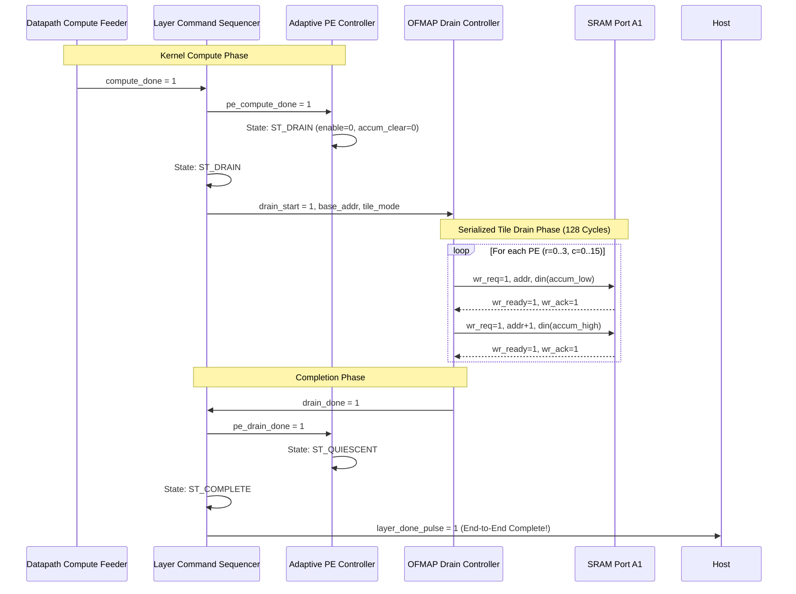

# TSK-11 Architecture Audit: Output Feature Map (OFMAP) Drain and Writeback

**Project:** Neural_Acc (Runtime-Quality-Aware Adaptive CNN Accelerator)  
**Workspace:** `E:\MTech\LanChain\MTP`  
**RTL Directory:** `phase2_step1_microarchitecture_and_rtl`  
**Auditor:** Independent RTL Microarchitecture & Verification Auditor  
**Date:** November 1, 2026  
**Status:** Architecture Specification & Interface Audit (No RTL Modified)

---

## 1. Executive Summary

Milestone **TSK-10** successfully verified that the 4x16 PE array computes mathematically exact 2D output tiles across multi-step $K$ reductions, signed operands, dynamic range limits, and adaptive column gating. However, both the TSK-10 implementation report and independent audit identified a major architectural omission:

> **MAJ-10-01 (Absence of Integrated OFMAP Writeback Datapath):**  
> Accumulator outputs are exposed exclusively via parallel top-level wires (`accum_out[0:3][0:15]`). SRAM Write Ports 1 through 7 are tied to ground, and Write Port 0 is dedicated solely to external DMA input ingress. The accelerator lacks an autonomous mechanism to drain completed tiles into on-chip SRAM or off-chip memory.

This audit investigates the microarchitecture, dataflow, timing, memory mapping, and interface contracts required to introduce a safe, robust **OFMAP Drain and Writeback Subsystem** for milestone TSK-11.

### Key Audit Findings:
1. **Accumulator Register Freeze:** In [`mac_unit_40b.sv`](file:///e:/MTech/LanChain/MTP/phase2_step1_microarchitecture_and_rtl/mac_unit_40b.sv), partial sum registers freeze and retain their contents indefinitely when `enable == 0` and `accum_clear == 0`. The sequencer's `ST_DRAIN` state naturally guarantees this condition, providing a completely stable multi-cycle window for sequential reading.
2. **Current Sequencer "Dummy" Drain:** Currently, [`datapath_compute_feeder.sv`](file:///e:/MTech/LanChain/MTP/phase2_step1_microarchitecture_and_rtl/datapath_compute_feeder.sv) enters `ST_DRAIN` and asserts `drain_done = 1'b1` unconditionally in the very next clock cycle. As a result, `layer_done_pulse` fires as soon as compute finishes. If a new layer command arrives immediately, the accumulators are cleared to zero before their contents can be extracted.
3. **SRAM Write Port Availability:** [`multibank_sram_subsystem.sv`](file:///e:/MTech/LanChain/MTP/phase2_step1_microarchitecture_and_rtl/multibank_sram_subsystem.sv) provides 8 write ports (Port A0..A7) with built-in bank conflict arbitration. Port A0 is dedicated to DMA Ingress; Ports A1 through A7 are currently tied off. An OFMAP drain engine can connect directly to Port A1.
4. **Physical SRAM Bandwidth Constraint:** Each of the 8 physical hybrid SRAM banks has exactly one physical write port. Concurrent writes on Port A0 (DMA) and Port A1 (OFMAP) are supported if and only if they target different physical banks. If both target the same bank, Port A0 has priority, and Port A1 is stalled (`wr_conflict_stall[1] = 1'b1`).
5. **Existing DMA Ingress Unidirectionality:** [`dma_controller.sv`](file:///e:/MTech/LanChain/MTP/phase2_step1_microarchitecture_and_rtl/dma_controller.sv) is strictly wired for ingress (AXI Read = external, AXI Write = internal SRAM). It cannot read from SRAM or accumulators to write to external memory without architectural redesign. Therefore, the initial TSK-11 implementation must focus on **On-Chip SRAM Writeback** via Port A1.
6. **Recommended Storage Format:** A lossless 64-bit aligned format (two 32-bit words per 40-bit accumulator) is recommended. One 4x16 tile requires **128 words (512 bytes)**, evenly distributing exactly 16 words across each of the 8 interleaved banks.

---

## 2. Existing Interfaces and Source Locations

| Module | File Location | Key Ports & Signals | Current Connection in Top-Level |
| :--- | :--- | :--- | :--- |
| **PE Array** | [`pe_array_40b.sv`](file:///e:/MTech/LanChain/MTP/phase2_step1_microarchitecture_and_rtl/pe_array_40b.sv#L25-L57) | `accum_out[0:3][0:15]` (40b signed)<br>`enable`, `accum_clear`, `col_active` | Connected to top-level pins `accum_out`; no internal sink |
| **MAC Unit** | [`mac_unit_40b.sv`](file:///e:/MTech/LanChain/MTP/phase2_step1_microarchitecture_and_rtl/mac_unit_40b.sv#L14-L32) | `accum_out` (40b reg)<br>`sum_41` (41b sat add) | Internal to each of the 64 PE instances |
| **SRAM Subsystem** | [`multibank_sram_subsystem.sv`](file:///e:/MTech/LanChain/MTP/phase2_step1_microarchitecture_and_rtl/multibank_sram_subsystem.sv#L26-L41) | `wr_req[7:0]`, `wr_addr[0:7]`<br>`wr_din[0:7]`, `wr_ready[7:0]`<br>`wr_ack[7:0]`, `wr_conflict_stall[7:0]` | Port 0 connected to DMA adapter;<br>Ports 1..7 tied to 0 ([`top.sv#L201-209`](file:///e:/MTech/LanChain/MTP/phase2_step1_microarchitecture_and_rtl/neural_acc_integrated_top.sv#L201-L209)) |
| **SRAM Bank** | [`hybrid_sram_bank.sv`](file:///e:/MTech/LanChain/MTP/phase2_step1_microarchitecture_and_rtl/hybrid_sram_bank.sv#L18-L34) | Port A: `we_a`, `addr_a`, `din_a`<br>Port B: `re_b`, `addr_b`, `dout_b` | 8 instances inside `multibank_sram_subsystem` |
| **DMA Controller** | [`dma_controller.sv`](file:///e:/MTech/LanChain/MTP/phase2_step1_microarchitecture_and_rtl/dma_controller.sv#L36-L93) | AXI Master Read (`m_axi_ar*`, `r*`)<br>AXI Master Write (`m_axi_aw*`, `w*`) | Read channel $\to$ external chip pins;<br>Write channel $\to$ internal SRAM adapter |
| **DMA Write Adapter** | [`dma_to_sram_write_adapter.sv`](file:///e:/MTech/LanChain/MTP/phase2_step1_microarchitecture_and_rtl/dma_to_sram_write_adapter.sv#L27-L53) | AXI Slave Write $\to$ SRAM Port A0 | Bridges `dma_controller` write channel to `sram_wr_req_bus[0]` |
| **Sequencer** | [`layer_command_sequencer.sv`](file:///e:/MTech/LanChain/MTP/phase2_step1_microarchitecture_and_rtl/layer_command_sequencer.sv#L25-L81) | `compute_done`, `drain_done`<br>`layer_done_pulse`, `pe_drain_done` | Coordinates FSM states `ST_WAIT_COMP` $\to$ `ST_DRAIN` $\to$ `ST_COMPLETE` |
| **Adaptive Controller** | [`adaptive_pe_controller.sv`](file:///e:/MTech/LanChain/MTP/phase2_step1_microarchitecture_and_rtl/adaptive_pe_controller.sv#L22-L51) | `compute_done`, `drain_done`<br>`enable`, `accum_clear`, `quiescent` | Holds `enable=0` and `accum_clear=0` in `ST_DRAIN` |
| **Compute Feeder** | [`datapath_compute_feeder.sv`](file:///e:/MTech/LanChain/MTP/phase2_step1_microarchitecture_and_rtl/datapath_compute_feeder.sv#L38-L73) | `compute_done`, `drain_done`<br>`sram_rd_req_bus[7:0]` | Feeds operands from SRAM Port B; asserts dummy `drain_done` in `ST_DRAIN` |

---

## 3. Current Dataflow vs. Proposed TSK-11 Dataflow

### 3.1 Current Dataflow (TSK-10 Baseline)

```mermaid
flowchart TD
    ExtMem["External System Memory (AXI4 Read)"] -->|AXI Read Burst| DMA["DMA Controller (Ingress Engine)"]
    DMA -->|AXI Write| Adapter["DMA-to-SRAM Write Adapter"]
    Adapter -->|Port A0 Write| SRAM["Multi-Bank SRAM Subsystem (8 Banks, 41.4 KB)"]
    SRAM -->|Port B0..B7 Read| Feeder["Datapath Compute Feeder"]
    Feeder -->|Row Act [0:3] & Col Weight [0:15]| PEArray["4x16 PE Array (64 PEs, mac_unit_40b)"]
    PEArray -->|Parallel 64x40b Wires| TopPins["Chip Output Pins accum_out[0:3][0:15]"]

    subgraph "Missing Datapath (Identified in MAJ-10-01)"
        direction TB
        Gap["NO ON-CHIP DRAIN OR WRITEBACK PATH"]
    end
    PEArray -.-> Gap
```

### 3.2 Proposed TSK-11 Dataflow (On-Chip OFMAP Writeback)

```mermaid
flowchart TD
    ExtMem["External System Memory"] -->|AXI Read| DMA["DMA Controller"]
    DMA -->|AXI Write| Adapter["DMA Write Adapter"]
    Adapter -->|Port A0 (Ingress)| SRAM["Multi-Bank SRAM Subsystem"]
    SRAM -->|Port B0..B7 (Read)| Feeder["Datapath Compute Feeder"]
    Feeder -->|Parallel Operands| PEArray["4x16 PE Array"]
    
    PEArray -->|accum_out[0:3][0:15]| DrainEngine["OFMAP Drain Controller (TSK-11 New)"]
    DrainEngine -->|Port A1 Write (wr_req, addr, din)| SRAM
    DrainEngine -.->|drain_done handshake| Sequencer["Layer Command Sequencer"]
    Sequencer -->|layer_done_pulse| Host["Host / Testbench"]
```

---

## 4. Recommended Writeback Architecture

### 4.1 Architecture Evaluation

Three potential writeback options were analyzed:

1. **Option A: Pure Off-Chip Egress DMA:**
   * Reads accumulators or SRAM and writes directly to an external AXI4 Master Write bus.
   * *Evaluation:* Requires exposing external AXI4 write pins and implementing an AXI write burst master with response tracking. Fails to support multi-layer on-chip ping-pong pipelining where Layer $N+1$ reads Layer $N$'s output from SRAM.
2. **Option B: Integrated On-Chip SRAM Drain Engine (RECOMMENDED):**
   * A dedicated hardware block captures the 64 accumulator values upon compute completion and writes them as 128 32-bit words into a designated OFMAP buffer in `multibank_sram_subsystem` via Write Port A1.
   * *Evaluation:* Extremely clean, modular, and fully utilizes the existing 8-bank SRAM write infrastructure. Enables on-chip layer chaining and preserves all baseline files.
3. **Option C: Unified Ingress/Egress Time-Multiplexed DMA:**
   * Modifies `dma_controller.sv` to time-share its internal FIFO between ingress and egress.
   * *Evaluation:* Violates the strict principle of least modification. `dma_controller.sv` is verified across 18 test cases; altering its internal state machine introduces significant regression risk.

### 4.2 Recommended Architecture: `ofmap_drain_controller`

We recommend introducing a standalone synthesizable module: `ofmap_drain_controller.sv`.

#### Primary Responsibilities:
1. **Accumulator Sampling:** When `drain_start` is triggered by the sequencer, latch all active PE accumulator outputs into a local shadow buffer (or stream directly via a row/col multiplexer).
2. **Word Serialization:** Unpack each 40-bit signed accumulator into two 32-bit words:
   * Word 0: `accum[31:0]` (Lower 32 bits)
   * Word 1: `{{24{accum[39]}}, accum[39:32]}` (Sign-extended high byte)
3. **SRAM Port A1 Protocol Driving:**
   * Drive `wr_req_bus[1]`, `wr_addr_bus[1]`, `wr_din_bus[1]`, and `wr_byte_we_bus[1] = 4'b1111`.
   * Sample `wr_ready_bus[1]` and `wr_ack_bus[1]`.
   * If `wr_conflict_stall_bus[1]` is asserted (due to concurrent DMA Port 0 writing to the same physical bank), hold address and data until accepted.
4. **Completion Signaling:** Once all 128 words are acknowledged, assert `drain_done` to release the sequencer and ping-pong buffer controller.

---

## 5. Output Data Format and Storage Calculations

### 5.1 Numerical Format Policy

The 40-bit accumulator outputs span $[-2^{39}, 2^{39}-1]$.

> [!IMPORTANT]
> The initial TSK-11 implementation must be **100% mathematically lossless**. No requantization, clipping, or lossy scaling will be performed in hardware. All 40 bits must be preserved in SRAM.

#### 64-Bit Aligned Two-Word Format:
Each accumulator coordinate $(r, c)$ is mapped to two consecutive 32-bit words:

$$\text{Word 0 (Offset } 2i\text{): } D_{\text{low}}[31:0] = \text{accum}[31:0]$$

$$\text{Word 1 (Offset } 2i+1\text{): } D_{\text{high}}[31:0] = \{\{24\{\text{accum}[39]\}\}, \text{accum}[39:32]\}$$

* Bits $[31:8]$ of Word 1 are the replicated sign bit (`accum[39]`).
* Bits $[7:0]$ of Word 1 are the upper 8 bits of the accumulator (`accum[39:32]`).

### 5.2 Storage Capacity and Alignment Calculations

* **Grid Dimensions:** 4 rows $\times$ 16 columns = 64 physical PEs.
* **Accumulators per Tile:** 64.
* **Words per Accumulator:** 2 $\times$ 32-bit words.
* **Words per Tile:** $64 \times 2 = 128 \text{ words}$.
* **Bytes per Tile:** $128 \times 4 = 512 \text{ bytes}$.

### 5.3 Memory Map and Bank Distribution

The multi-bank SRAM subsystem comprises 8 interleaved banks of 1,296 words each (Total = 10,368 words = 41,472 bytes). Address decoding maps consecutive words across banks:

$$\text{Bank ID} = \text{Word\_Addr}[2:0] = \text{Word\_Addr} \pmod 8$$

$$\text{Bank Row} = \text{Word\_Addr}[13:3] = \lfloor \text{Word\_Addr} / 8 \rfloor$$

When writing 128 consecutive words starting at an 8-word aligned base address:
* Total words written: 128 words.
* Words per bank: $128 / 8 = 16 \text{ words per bank}$.
* Bank row span: Exactly 16 consecutive rows per bank.

```
+---------------------------------------------------------------------------------+
|                              SRAM Memory Layout                                 |
+---------------------------------------------------------------------------------+
| Address Range (Words) | Byte Range     | Description                            |
+-----------------------+----------------+----------------------------------------+
| 0x0000 - 0x0FFF       | 0x0000 - 0x3FFF| Ping-Pong Buffer A (Input/Weight IFMAP)|
| 0x1000 - 0x1FFF       | 0x4000 - 0x7FFF| Ping-Pong Buffer B (Input/Weight IFMAP)|
| 0x2000 - 0x27FF       | 0x8000 - 0x9FFF| Dedicated OFMAP Region (2,048 Words)   |
|   -> Tile 0: 0x2000   |   -> 0x8000    | Tile 0 Storage (128 Words = 512 Bytes) |
|   -> Tile 1: 0x2080   |   -> 0x8200    | Tile 1 Storage (128 Words = 512 Bytes) |
| 0x2800 - 0x287F       | 0xA000 - 0xA1FF| Unallocated / High Scratchpad          |
+---------------------------------------------------------------------------------+
```

---

## 6. Arbitration and Buffering Requirements

### 6.1 Port Conflict Analysis

In `multibank_sram_subsystem.sv` ([lines 141-153](file:///e:/MTech/LanChain/MTP/phase2_step1_microarchitecture_and_rtl/multibank_sram_subsystem.sv#L141-L153)):
```systemverilog
for (int w_idx = 0; w_idx < NUM_WRITE_PORTS; w_idx = w_idx + 1) begin
    if (wr_req[w_idx] && bank_enable[b_idx] && (wr_bank_sel[w_idx] == b_idx)) begin
        if (!bank_wr_active[b_idx]) begin
            granted_wr_port[b_idx] = w_idx; // Lowest index has priority
            bank_wr_active[b_idx]  = 1'b1;
        end else begin
            wr_conflict_detected[b_idx] = 1'b1;
        end
    end
end
```

#### Behavioral Rules:
1. **Concurrent Non-Interfering Writes:** If Port 0 (DMA) writes to Bank 0 and Port 1 (OFMAP) writes to Bank 1, both writes proceed simultaneously with `wr_ready = 1` and `wr_ack = 1`.
2. **Bank Conflict Priority:** If Port 0 (DMA) and Port 1 (OFMAP) attempt to write to the same physical bank in the same cycle:
   * Port 0 is granted (`granted_wr_port = 0`).
   * Port 1 is stalled: `wr_ready_bus[1] = 0`, `wr_ack_bus[1] = 0`, `wr_conflict_stall_bus[1] = 1`.
3. **Buffering Requirement:** The OFMAP drain engine must implement standard ready/valid skid buffering: when `wr_ready_bus[1] == 0`, the current address and data beat must remain asserted until `wr_ready_bus[1] == 1` and `wr_ack_bus[1] == 1`.

---

## 7. Control-State Proposal & Sequence Timing

### 7.1 Proposed Handshake Sequence



### 7.2 State Machine Encoding for `ofmap_drain_controller`

```systemverilog
typedef enum logic [2:0] {
    DRAIN_IDLE     = 3'd0, // Awaiting drain_start trigger from sequencer
    DRAIN_CAPTURE  = 3'd1, // Latch 64 accumulators into shadow registers
    DRAIN_WRITE_LO = 3'd2, // Drive lower 32 bits (accum[31:0]) to SRAM Port A1
    DRAIN_WRITE_HI = 3'd3, // Drive sign-extended upper bits (accum[39:32])
    DRAIN_DONE     = 3'd4  // Pulse drain_done to sequencer; return to IDLE
} drain_fsm_t;
```

* **Latency:** In the absence of SRAM bank conflicts, transferring 128 words takes **128 clock cycles** ($128 \times 1\text{ beat}$). With 1 cycle for capture and 1 cycle for completion, total drain latency is **130 clock cycles**.

---

## 8. Failure Modes, Hazards, and Recovery

| Hazard / Failure Mode | Root Cause | Impact | Architectural Mitigation |
| :--- | :--- | :--- | :--- |
| **Premature Accumulator Clear** | Host dispatches new layer command before drain completes. | Accumulator values destroyed by `accum_clear`. | Sequencer holds in `ST_DRAIN` until `drain_done == 1`. New command cannot advance past `ST_VALIDATE` while busy. |
| **SRAM Bank Conflict Lockout** | DMA Ingress and OFMAP Drain continuously target same bank. | OFMAP drain stalls indefinitely. | Spatial memory isolation: Ingress targets Buffer A (`0x0000`) or B (`0x1000`); Drain targets OFMAP region (`0x2000`). |
| **Address Out-of-Bounds (OOB)** | Misconfigured OFMAP base address exceeds SRAM limit (10,368 words). | Physical memory corrupts or asserts `sram_oob_err`. | Hardware parameter validation: clamp base address; assert `drain_error_flag` if `base_addr + 128 > 10368`. |
| **Unexpected System Reset** | `rst_n` asserted during drain burst. | Partial tile written to SRAM. | Synchronous reset aborts drain, returns FSM to `DRAIN_IDLE`, and deasserts `wr_req`. |
| **Gated Column Data Leakage** | Inactive columns in 16/32-PE mode contain stale partial sums. | Corrupt or garbage data written to OFMAP buffer. | `pe_array_40b.sv` line 141 strictly drives `'0` for inactive columns (`pe_is_active ? raw : '0`). Stored values are guaranteed 0. |

---

## 9. Comprehensive Verification Plan (TSK-11 Phase 2)

### 9.1 Verification Scenarios

| Test Case | Scenario Description | Expected Outcome | Pass Criteria |
| :--- | :--- | :--- | :--- |
| **TC-11-01** | All 64 Coordinates Readback | Execute $K=1$ workload; read back 128 words from SRAM. | Bit-exact match against Python reference model for all 64 coordinates. |
| **TC-11-02** | Signed Positive & Negative | Workload with mixed-sign activations and weights. | Correct two's-complement representation in both lower and upper words. |
| **TC-11-03** | Max/Min Saturation Extremes | Workload forcing saturation to $+2^{39}-1$ and $-2^{39}$. | `0x7F_FFFF_FFFF` and `0x80_0000_0000` stored and unpacked accurately. |
| **TC-11-04** | 16-PE Mode Inactive Column Gating | Run in Mode 0 (cols 0..3 active, 4..15 inactive). | Words corresponding to cols 4..15 contain exact zeros (`0x00000000`). |
| **TC-11-05** | 32-PE Mode Inactive Column Gating | Run in Mode 1 (cols 0..7 active, 8..15 inactive). | Words corresponding to cols 8..15 contain exact zeros (`0x00000000`). |
| **TC-11-06** | SRAM Interleaving & Alignment | Verify low-order interleaving across Banks 0..7. | Exactly 16 words written to each of the 8 physical SRAM banks. |
| **TC-11-07** | Concurrent DMA Ingress & Drain | Stream DMA input to Buffer B while draining Tile 1 from Buffer A. | Arbitration resolves correctly; zero corrupted data in both buffers. |
| **TC-11-08** | Deliberate SRAM Bank Conflict | Force DMA Port 0 and Drain Port 1 to target Bank 0 simultaneously. | Port 1 stalls cleanly; resumes without lost or duplicated beats. |
| **TC-11-09** | Consecutive Multi-Tile Drain | Run Tile 1 $\to$ OFMAP Buffer 1, followed by Tile 2 $\to$ OFMAP Buffer 2. | Zero cross-tile contamination; buffers contain distinct valid tiles. |
| **TC-11-10** | Reset During Active Drain | Assert `rst_n` at word 64 of 128. | Controller resets cleanly to IDLE; no hanging bus requests. |
| **TC-11-11** | Negative Fault Injection | Mutate one bit in SRAM OFMAP region. | Testbench flags mismatch; runner exits with non-zero status. |

---

## 10. Open Questions and Architectural Assumptions

1. **Host OFMAP Inspection Method:**
   * *Assumption:* In testbenches and simulation, the host verifies OFMAP tiles by reading SRAM Port B or probing SRAM array registers directly.
   * *Question for Tapeout:* Will a future phase require an AXI Master Write channel to push OFMAP tiles to external DRAM?
2. **Ping-Pong Buffer Recycling for Layer Chaining:**
   * *Assumption:* For single-layer verification, OFMAP is written to a dedicated region (`0x2000`).
   * *Question for Multi-Layer:* Can the OFMAP buffer of Layer $N$ be designated as Ping-Pong Buffer A of Layer $N+1$ without intermediate copying? (Yes, since both reside in the same physical SRAM address space).
3. **Requantization / Activation Function:**
   * *Assumption:* Hardware requantization (e.g. 40-bit to INT8) is deferred to a future post-processing unit.

---

## 11. Exact Files Expected to Change in Implementation Phase

### Files to be Added:
1. `phase2_step1_microarchitecture_and_rtl/ofmap_drain_controller.sv` (New hardware module)
2. `phase2_step1_microarchitecture_and_rtl/tb_ofmap_drain_controller.sv` (Unit testbench)
3. `phase2_step1_microarchitecture_and_rtl/tb_tsk11_ofmap_integration.sv` (Integrated testbench)

### Files to be Modified:
1. `phase2_step1_microarchitecture_and_rtl/neural_acc_integrated_top.sv`
   * Instantiate `ofmap_drain_controller`.
   * Connect `sram_wr_req_bus[1]`, `sram_wr_addr_bus[1]`, `sram_wr_din_bus[1]`, `sram_wr_byte_we_bus[1]`.
   * Re-route `drain_done` handshake between sequencer and drain controller.
2. `phase2_step1_microarchitecture_and_rtl/layer_command_sequencer.sv`
   * Expose drain configuration ports (`ofmap_base_addr`, `drain_start`).
3. `phase2_step1_microarchitecture_and_rtl/datapath_compute_feeder.sv`
   * Decouple `drain_done` from the feeder (feeder asserts `compute_done` only).
4. `phase2_step1_microarchitecture_and_rtl/run_regression.py`
   * Register the new TSK-11 testbench suites.

### Protected Baseline Files (MUST NOT BE MODIFIED):
* `accelerator_core_top.sv` (Unchanged)
* `mac_unit_40b.sv` (Unchanged)
* `k_progress_tracker.sv` (Unchanged)
* `slot_control_unit.sv` (Unchanged)
* `hybrid_sram_bank.sv` (Unchanged)

---

## 12. Unsupported Features Boundary

To preserve strict verification hygiene, the following features remain **explicitly unsupported** in milestone TSK-11:
1. **Lossy Hardware Requantization / Activation Functions:** No ReLU, batch normalization, or FP/INT scaling.
2. **Direct Off-Chip AXI4 Egress Streaming:** OFMAP is written to on-chip SRAM; off-chip streaming requires a separate DMA egress channel.
3. **Arbitrary Stride Tensor Unpacking:** Output tiles are written in strict row-major, PE-index sequential order.
4. **Physical Gate-Level Power Optimization:** No dynamic voltage-frequency scaling (DVFS) or physical power gating switches.

