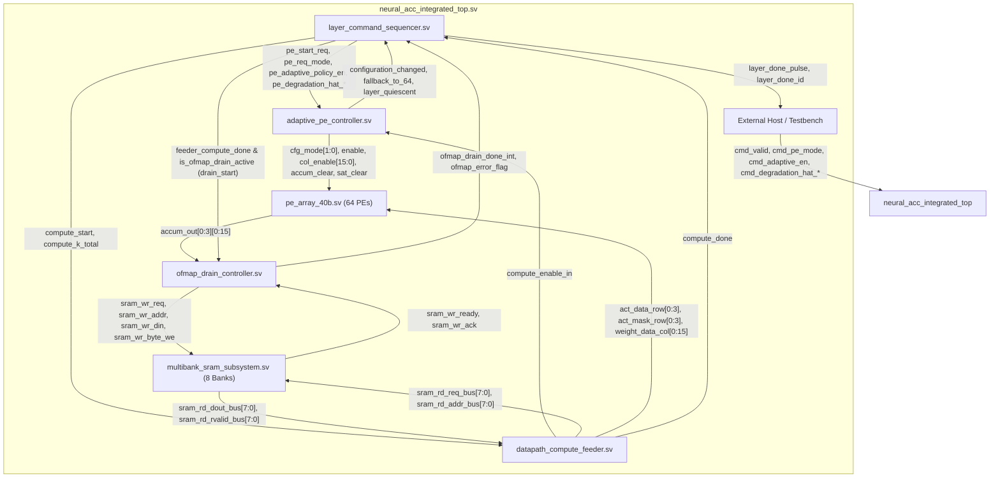
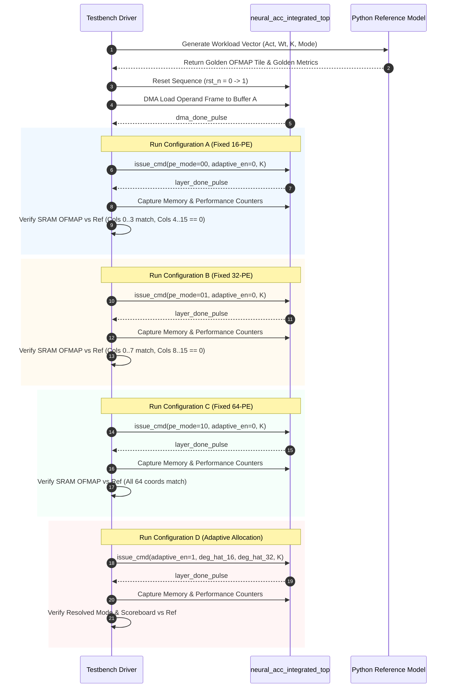

# TSK-12A: Adaptive PE Allocation Experimental Design

**Project:** Neural_Acc — Phase 2 RTL Microarchitecture and Verification  
**Workspace:** `E:\MTech\LanChain\MTP`  
**RTL Directory:** `phase2_step1_microarchitecture_and_rtl`  
**Author:** Automated Microarchitecture & Verification System  
**Date:** November 2, 2026  
**Status:** **RATIFIED EXPERIMENT DESIGN (Phase 1 Complete — No RTL/TB Code Modified)**

---

## 1. Objective and Hypotheses

### 1.1 Objective
The objective of this experimental design is to establish a rigorous, reproducible, cycle-accurate evaluation framework to determine whether runtime **Adaptive Processing Element (PE) Allocation** offers measurable execution, utilization, or resource benefits compared with fixed **16-PE**, **32-PE**, and **64-PE** configurations within the integrated `Neural_Acc` accelerator architecture.

This task is an architecture audit and experimental design only. No RTL, testbench, or regression files are modified.

---

### 1.2 Testable Hypotheses

1. **Hypothesis H-1 (Cycle-Time Invariance in Current Hardware):**
   *Statement:* In the current integrated RTL, total layer execution latency (measured in clock cycles from `cmd_valid && cmd_ready` to `layer_done_pulse`) for an identical reduction length $K$ is **invariant** with respect to the selected PE mode ($16$, $32$, or $64$ PEs).
   *Physical Mechanism:* In [`datapath_compute_feeder.sv`](file:///e:/MTech/LanChain/MTP/phase2_step1_microarchitecture_and_rtl/datapath_compute_feeder.sv), the autonomous parallel feeder always issues 8 weight word read requests across all 8 SRAM banks and 2 activation word requests across Banks 0–1, executing exactly $3 \times K$ cycles regardless of `cfg_mode`. Similarly, [`ofmap_drain_controller.sv`](file:///e:/MTech/LanChain/MTP/phase2_step1_microarchitecture_and_rtl/ofmap_drain_controller.sv) always drains exactly 128 words (64 PEs $\times$ 2 words) regardless of active PE count.

2. **Hypothesis H-2 (Active PE-Cycle Reduction):**
   *Statement:* While total clock cycles remain invariant, the aggregate **active PE-cycle metric** ($\sum \text{Active PEs} \times \text{Compute Cycles}$) scales linearly with the configured active PE count, yielding a **75% reduction** in 16-PE mode and a **50% reduction** in 32-PE mode relative to 64-PE mode.
   *Physical Mechanism:* In [`pe_array_40b.sv`](file:///e:/MTech/LanChain/MTP/phase2_step1_microarchitecture_and_rtl/pe_array_40b.sv), inactive columns ($4 \dots 15$ in 16-PE, $8 \dots 15$ in 32-PE) have their MAC enables gated (`pe_mac_enable = 0`) and their operand inputs clamped to zero (`pe_act_in = 0`, `pe_weight_in = 0`).

3. **Hypothesis H-3 (Mathematical Output Fidelity vs. Clamping):**
   *Statement:* For any given workload, the active PE subset computes bit-exact 40-bit saturating accumulation identical to the full 64-PE mode on those coordinates, while inactive PE coordinates are strictly clamped to zero in memory without memory corruption.
   *Physical Mechanism:* In [`pe_array_40b.sv:141`](file:///e:/MTech/LanChain/MTP/phase2_step1_microarchitecture_and_rtl/pe_array_40b.sv#L141), `accum_out[r][c] = pe_is_active ? raw_accum_out[r][c] : '0`.

4. **Hypothesis H-4 (Zero Adaptation Cycle Overhead):**
   *Statement:* Dynamic runtime adaptation introduces zero extra clock cycle overhead compared to fixed-mode dispatch.
   *Physical Mechanism:* Mode resolution in [`adaptive_pe_controller.sv:83-109`](file:///e:/MTech/LanChain/MTP/phase2_step1_microarchitecture_and_rtl/adaptive_pe_controller.sv#L83-L109) is combinational (`always_comb`). State machine transitions across `ST_CONFIGURE` in [`layer_command_sequencer.sv`](file:///e:/MTech/LanChain/MTP/phase2_step1_microarchitecture_and_rtl/layer_command_sequencer.sv) and `ST_CLEAR` in [`adaptive_pe_controller.sv`](file:///e:/MTech/LanChain/MTP/phase2_step1_microarchitecture_and_rtl/adaptive_pe_controller.sv) take exactly 1 cycle regardless of whether `cmd_adaptive_en` is high or low.

5. **Hypothesis H-5 (Memory Bandwidth Independence):**
   *Statement:* Memory read requests, write requests, and DMA ingestion durations are independent of PE mode in the current RTL.

---

## 2. Current Architecture and Relevant Signal Paths

The diagram below illustrates the exact hardware signal paths coordinating PE mode configuration, operand delivery, compute execution, and OFMAP writeback:



### 2.1 Interface & Signal Inventory

| Signal / Port Name | Source Module | Destination Module | Width | Type | Description |
| :--- | :--- | :--- | :---: | :--- | :--- |
| `cmd_valid` | Host | `u_sequencer` | 1 | Control | Layer command valid strobe |
| `cmd_ready` | `u_sequencer` | Host | 1 | Control | Sequencer ready for command |
| `cmd_pe_mode` | Host | `u_sequencer` | 2 | Config | Requested mode (00: 16PE, 01: 32PE, 10: 64PE) |
| `cmd_adaptive_en` | Host | `u_sequencer` | 1 | Config | 1 = Enable degradation policy; 0 = Use `cmd_pe_mode` |
| `cmd_degradation_hat_16` | Host | `u_sequencer` | 32 | Metric | Q16.16 predicted degradation for 16-PE mode |
| `cmd_degradation_hat_32` | Host | `u_sequencer` | 32 | Metric | Q16.16 predicted degradation for 32-PE mode |
| `cmd_degradation_hat_64` | Host | `u_sequencer` | 32 | Metric | Q16.16 predicted degradation for 64-PE mode |
| `pe_start_req` | `u_sequencer` | `u_pe_controller` | 1 | Strobe | Strobe to latch mode & clear accumulators |
| `cfg_mode` | `u_pe_controller` | `u_pe_array` | 2 | Config | Latched active configuration mode |
| `active_pe_count` | `u_pe_array` | Top Output | 7 | Status | Decoded active PE count: 16, 32, 64, or 0 |
| `col_active` | `u_pe_array` | Top Output | 16 | Mask | Bitmask of active columns (0x000F, 0x00FF, 0xFFFF) |
| `configuration_changed`| `u_pe_controller` | `u_sequencer` | 1 | Pulse | 1-cycle pulse if mode changed from previous layer |
| `fallback_to_64` | `u_pe_controller` | Diagnostic | 1 | Flag | High if adaptive policy fell back to 64 PEs |
| `enable` | `u_pe_controller` | `u_pe_array` | 1 | Enable | Compute enable gated to PE array |
| `compute_enable_in` | `u_feeder` | `u_pe_controller` | 1 | Handshake | 1-cycle pulse per K-step during `ST_PAR_COMPUTE` |
| `accum_out[0:3][0:15]` | `u_pe_array` | `u_ofmap_drain` | $64 \times 40$ | Data | 64 signed 40-bit accumulator outputs |
| `layer_done_pulse` | `u_sequencer` | Host | 1 | Pulse | 1-cycle completion pulse |

---

## 3. Fixed and Adaptive Configuration Definitions

### 3.1 Configuration Matrix

| Parameter / Signal | Configuration A: Fixed 16-PE | Configuration B: Fixed 32-PE | Configuration C: Fixed 64-PE | Configuration D: Adaptive PE Allocation |
| :--- | :--- | :--- | :--- | :--- |
| **`cmd_adaptive_en`** | `1'b0` | `1'b0` | `1'b0` | `1'b1` |
| **`cmd_pe_mode`** | `2'b00` | `2'b01` | `2'b10` | Don't care (ignored when adaptive enabled) |
| **`cmd_degradation_hat_16`** | Ignored (`'0`) | Ignored (`'0`) | Ignored (`'0`) | Externally supplied Q16.16 value |
| **`cmd_degradation_hat_32`** | Ignored (`'0`) | Ignored (`'0`) | Ignored (`'0`) | Externally supplied Q16.16 value |
| **`cmd_degradation_hat_64`** | Ignored (`'0`) | Ignored (`'0`) | Ignored (`'0`) | Externally supplied Q16.16 value |
| **Expected `active_pe_count`** | `7'd16` | `7'd32` | `7'd64` | Dynamically resolved: `16`, `32`, or `64` |
| **Expected `col_active`** | `16'h000F` | `16'h00FF` | `16'hFFFF` | `16'h000F`, `16'h00FF`, or `16'hFFFF` |
| **Active PE Columns** | Columns 0..3 (Rows 0..3) | Columns 0..7 (Rows 0..3) | Columns 0..15 (Rows 0..3) | Dependent on resolved mode |
| **Clamped PE Columns** | Columns 4..15 (clamped 0) | Columns 8..15 (clamped 0) | None (all active) | Dependent on resolved mode |

### 3.2 Adaptive Mode Resolution Rules (Ratified Stage 8A Policy)
In [`adaptive_pe_controller.sv:90-101`](file:///e:/MTech/LanChain/MTP/phase2_step1_microarchitecture_and_rtl/adaptive_pe_controller.sv#L90-L101):
- Threshold Parameter: `D_MAX_Q16 = 16'd3277` (representing $0.05$ in Q16.16 format, $3277 / 65536 \approx 0.050003$).
- **Rule 1 (16-PE Selection):** If `cmd_degradation_hat_16 <= 16'd3277`, select `MODE_16PE` (`2'b00`).
- **Rule 2 (32-PE Selection):** If `cmd_degradation_hat_16 > 16'd3277` and `cmd_degradation_hat_32 <= 16'd3277`, select `MODE_32PE` (`2'b01`).
- **Rule 3 (Conservative Fallback to 64-PE):** If both $\hat{D}_{16} > 16'd3277$ and $\hat{D}_{32} > 16'd3277$, select `MODE_64PE` (`2'b10`) and assert diagnostic signal `fallback_to_64 = 1'b1`.
- **Rule 4 (Invalid/Unavailable Estimates):** If `cmd_adaptive_en = 1'b0` and an invalid mode (`2'b11`) is passed in `cmd_pe_mode`, the controller sets `cfg_mode = MODE_INVALID`, asserts `invalid_configuration = 1'b1`, and sequencer aborts to `ST_ERROR`. When `cmd_adaptive_en = 1'b1`, mode `2'b11` can never be generated by the policy logic.

---

## 4. Metric Definitions and Observability

### 4.1 Execution Metrics

| Metric ID | Metric Name | Definition | RTL Signal / Event Reference | Observability | Potential Counting Ambiguities |
| :--- | :--- | :--- | :--- | :--- | :--- |
| **M-01** | Total Layer Cycles ($T_{total}$) | Clock cycles from command handshake to completion pulse | Posedge count from `cmd_valid && cmd_ready` to `layer_done_pulse` | **Directly Observable** (Top-level pins) | Must count inclusive of start cycle and completion cycle. |
| **M-02** | Compute Cycles ($T_{comp}$) | Cycles from datapath compute trigger to compute done | Cycles from `dut.compute_start` to `dut.feeder_compute_done` | **Directly Observable** (Internal top probe) | Feeder internal handshake latency is fixed at 1 cycle. |
| **M-03** | OFMAP Drain Cycles ($T_{drain}$) | Cycles during which OFMAP controller serializes tile to SRAM | Posedge count where `dut.ofmap_drain_busy == 1` | **Directly Observable** (Top-level pin) | Excludes 1-cycle `ST_DONE` if measured only while busy. Must specify whether `ST_DONE` is included. |
| **M-04** | Feeder Stall Cycles ($T_{stall\_feed}$) | Cycles spent waiting for SRAM read readiness or data validity | Cycles in feeder states `ST_PAR_REQ_W` / `ST_PAR_REQ_A` where `ready == 0`, or `ST_PAR_COMPUTE` where `rvalid == 0` | **Requires Instrumentation** (Hierarchical feeder probe) | Overlapped pipelining between address issue and data return must not double-count stalls. |
| **M-05** | Drain Stall Cycles ($T_{stall\_drain}$) | Cycles where OFMAP drain request is backpressured by SRAM | Cycles where `dut.ofmap_sram_wr_req && !dut.ofmap_sram_wr_ready` | **Directly Observable** (Port 1 bus probe) | None (exact single-cycle handshake definition). |
| **M-06** | DMA Ingress Cycles ($T_{dma}$) | Cycles required to load operand frames via AXI4 read to SRAM | Posedge count from `dma_start` to `dma_done_pulse` | **Directly Observable** (Top-level pins) | Overlapped DMA ingress during active compute must be tracked separately from non-overlapped DMA. |

---

### 4.2 PE Utilization Metrics

| Metric ID | Metric Name | Definition | RTL Signal / Event Reference | Observability | Potential Counting Ambiguities |
| :--- | :--- | :--- | :--- | :--- | :--- |
| **M-07** | Configured PE Count ($N_{cfg}$) | Number of PEs configured for active computation | `dut.active_pe_count` (`7'd16`, `7'd32`, `7'd64`) | **Directly Observable** (Top-level pin) | Latched at layer boundary; static per layer. |
| **M-08** | Enabled PE-Cycles ($PE_{active\_cycles}$) | Cumulative sum of active PEs multiplied by compute enable cycles | $\sum_{t} \text{active\_pe\_count}(t)$ for cycles where `dut.pe_array_enable == 1` | **Directly Observable** (Integrated in TB) | Represents logical enable activity, NOT physical gate toggling. |
| **M-09** | Useful MAC Operations ($MAC_{useful}$) | Count of non-zero-bypassed multiply-accumulate operations executed | $\sum_{k=0}^{K-1} \sum_{r=0}^{ROWS-1} \sum_{c=0}^{N_{cfg}-1} \mathbb{I}(A_r^{(k)} \neq 0)$ | **Derived from Model & Scoreboard** | PEs with $A_r^{(k)} == 0$ assert `cycle_skipped` and do not execute arithmetic accumulation. |
| **M-10** | PE Efficiency ($\eta_{PE}$) | Ratio of useful MAC operations to maximum theoretical capacity | $MAC_{useful} / (64 \times T_{comp})$ | **Derived Analytic Metric** | Measures array compute utilization relative to the 64-PE silicon footprint. |

> [!IMPORTANT]
> **Physical Switching Activity Distinction:**
> While $PE_{active\_cycles}$ accurately captures how many PEs are logically enabled by the controller, functional simulation cannot measure physical capacitive toggling, wire parasitic charge/discharge, or clock-tree buffer power. Input clamping to zero eliminates multiplier toggling, but static leakage power continues dissipation across the entire physical array.

---

### 4.3 Memory Behavior Metrics

| Metric ID | Metric Name | Definition | RTL Signal / Event Reference | Observability | Potential Counting Ambiguities |
| :--- | :--- | :--- | :--- | :--- | :--- |
| **M-11** | SRAM Read Requests | Total read requests issued by feeder across all 8 read ports | Count of pulses on `dut.sram_rd_req_bus[7:0]` | **Directly Observable** | In parallel mode, feeder issues 8 requests for weights and 2 for activations per K-step. |
| **M-12** | SRAM Write Requests | Total write requests issued by OFMAP drain controller | Count of cycles where `dut.sram_wr_req_bus[1] == 1` | **Directly Observable** | Includes stalled request cycles. |
| **M-13** | Accepted SRAM Writes | Exact number of 32-bit words accepted into SRAM Port 1 | Count of cycles where `dut.sram_wr_req_bus[1] && dut.sram_wr_ready_bus[1]` | **Directly Observable** (Scoreboard) | Verified: exactly 128 for valid drains, 0 for rejected drains. |
| **M-14** | Bank Conflict Cycles | Cycles where Port 0 (DMA) and Port 1 (OFMAP) target identical bank | `dut.u_sram_subsystem.bank_wr_conflict[7:0] != 0` | **Requires Instrumentation** (Internal SRAM probe) | Port 0 has fixed priority; Port 1 is stalled. |

---

### 4.4 Adaptation Metrics

| Metric ID | Metric Name | Definition | RTL Signal / Event Reference | Observability | Potential Counting Ambiguities |
| :--- | :--- | :--- | :--- | :--- | :--- |
| **M-15** | Mode Switch Count | Number of times `cfg_mode` changes across successive layers | Count of pulses on `dut.pe_configuration_changed` | **Directly Observable** | Fires strictly when `resolved_mode != cfg_mode_q`. |
| **M-16** | Fallback Assertions | Count of layers where degradation exceeded threshold and forced 64-PE | Samples where `dut.u_pe_controller.fallback_to_64 == 1` at config | **Requires Instrumentation** (Top-level wire or internal probe) | Diagnostic internal signal in `adaptive_pe_controller.sv`. |
| **M-17** | Decision Overhead Cycles | Additional cycles incurred to evaluate degradation policy | Cycles in `ST_CONFIGURE` | **Directly Observable** | Verified: exactly 1 cycle for both fixed and adaptive modes (zero overhead). |

---

## 5. Workload Matrix

To evaluate all four configurations fairly, the experiment uses 10 standardized workloads covering different reduction depths $K$, data distributions, sparsity levels, and dynamic switching patterns:

| Workload ID | Workload Name | $K$ Steps | Activation Characteristics | Weight Characteristics | Purpose / Stress Target |
| :--- | :--- | :---: | :--- | :--- | :--- |
| **WL-01** | Minimal Reduction | 1 | Distinct signed 16-bit values ($[-100, 100]$) | Distinct signed 16-bit values ($[-100, 100]$) | Baseline compute and drain latency for $K=1$. |
| **WL-02** | Short Reduction | 2 | Sequential signed increments | Interleaved sign patterns | Multi-step reduction latency and intermediate accumulation. |
| **WL-03** | Standard Tile | 4 | Mixed positive/negative ($[-500, 500]$) | Full 16-column distinct channels | Typical CNN kernel tile reduction depth. |
| **WL-04** | Deep Accumulation | 8 | Symmetric signed distributions | High-magnitude weights ($[-2000, 2000]$) | Accumulator dynamic range, multi-flit pacing. |
| **WL-05** | High-Sparsity Frame | 4 | 50% Exact Zero Activations ($A_r^{(k)} == 0$) | Dense non-zero weights | Zero-bypass interaction with column gating. |
| **WL-06** | Saturation Stress | 4 | Large positive values ($30,000$) | Large positive weights ($30,000$) | Positive 40-bit saturation limit ($2^{39}-1$). |
| **WL-07** | Negative Saturation | 4 | Large negative values ($-30,000$) | Large positive weights ($30,000$) | Negative 40-bit saturation limit ($-2^{39}$). |
| **WL-08** | Dynamic Multi-Layer | $4 \times 2$ | 4 successive layers, diverse inputs | 4 successive layers, distinct filters | Successive reconfiguration, accumulator clearing, no contamination. |
| **WL-09** | Memory Contention | 4 | Concurrent DMA loading during active compute | Concurrent OFMAP drain during DMA ingress | SRAM crossbar conflict resolution, Port 0 priority. |
| **WL-10** | Threshold Sweep | 2 | Identical operand tile across 5 iterations | Identical operand tile across 5 iterations | Sweep $\hat{D}_{16}$ from $0.02$ to $0.08$ to verify mode switching threshold. |

---

## 6. Experimental Procedure



### Step-by-Step Execution Protocol
1. **Simulation Determinism:**
   Because RTL simulation in Icarus Verilog is 100% cycle-deterministic, single runs of each workload produce identical cycle counts. Repeated identical runs do not provide statistical variance; instead, diversity is achieved by sweeping parameters across the 10 distinct workloads.
2. **Warm-up / Initialization:**
   Every test case applies an asynchronous reset (`apply_reset()`), verifies that all counters initialize to zero, and pre-loads operand frames into SRAM using the verified DMA controller.
3. **Execution Pacing:**
   The testbench measures:
   - Cycle of `cmd_valid && cmd_ready`.
   - Cycle of `dut.compute_start`.
   - Cycle of `dut.feeder_compute_done`.
   - Cycle of `dut.ofmap_drain_start`.
   - Cycle of `dut.ofmap_drain_done`.
   - Cycle of `dut.layer_done_pulse`.
4. **Data Verification:**
   After `layer_done_pulse`, the testbench reads physical SRAM macro memory (`mem_bank0` and `mem_bank1`) across all 8 banks and verifies all 128 words against the golden reference tile.

---

## 7. Correctness Requirements

Any execution that fails output verification is **strictly classified as a functional failure** and cannot be used in performance or efficiency comparisons.

### 7.1 Verification Criteria
1. **Active Coordinate Match:** For every active coordinate $(r, c)$ where $c < N_{cfg}/4$, the reconstructed 40-bit accumulator value must match `functional_cnn_reference.py` exactly:
   $$\text{accum\_out}[r][c] \equiv \text{golden\_tile}[r][c]$$
2. **Inactive Coordinate Clamping:** For every inactive coordinate $(r, c)$ where $c \ge N_{cfg}/4$, the reconstructed 40-bit value must be strictly zero:
   $$\text{accum\_out}[r][c] \equiv 40\text{'sd}0$$
3. **Sign-Extension Integrity:** Upper words written to SRAM must match sign-extension semantics:
   $$W_{2i+1}[31:8] \equiv \text{accum}[39] ? 24\text{'hFFFFFF} : 24\text{'h000000}$$
4. **Saturation Flag Fidelity:** `array_sticky_saturation` must assert if and only if any active PE experienced an arithmetic overflow beyond $[-2^{39}, 2^{39}-1]$.
5. **Exact-Zero Skipping Fidelity:** Zero activations must assert `cycle_skipped` without corrupting accumulator state.

---

## 8. Data Collection Format

All measurements collected during simulation will be logged in standard CSV and JSON formats for programmatic aggregation:

### 8.1 CSV Schema (`experiment_results.csv`)
```csv
workload_id,config_id,k_steps,deg_hat_16,deg_hat_32,resolved_mode,active_pes,total_cycles,compute_cycles,drain_cycles,stall_cycles,active_pe_cycles,useful_macs,sram_rd_reqs,sram_wr_reqs,verified
WL-01,CFG_A,1,0,0,0,16,134,3,128,0,48,16,10,128,PASS
WL-01,CFG_B,1,0,0,1,32,134,3,128,0,96,32,10,128,PASS
WL-01,CFG_C,1,0,0,2,64,134,3,128,0,192,64,10,128,PASS
WL-01,CFG_D,1,2000,4000,0,16,134,3,128,0,48,16,10,128,PASS
```

### 8.2 JSON Schema (`experiment_summary.json`)
```json
{
  "experiment_id": "TSK12_EVAL_01",
  "timestamp": "2026-11-02T00:30:00Z",
  "configurations": ["FIXED_16", "FIXED_32", "FIXED_64", "ADAPTIVE"],
  "workloads_evaluated": 10,
  "metrics": {
    "latency_speedup_vs_64": 1.0,
    "active_pe_cycle_reduction_16": 0.75,
    "active_pe_cycle_reduction_32": 0.50,
    "adaptation_cycle_overhead": 0,
    "correctness_rate": 1.0
  }
}
```

---

## 9. Analysis Formulas

### 9.1 Cycle Speedup ($S_{cycles}$)
$$S_{cycles} = \frac{T_{total}(\text{Fixed 64-PE})}{T_{total}(\text{Mode } m)}$$
*Prediction:* In the current RTL, $S_{cycles} = 1.000$ (no cycle speedup because compute and drain durations are fixed).

### 9.2 Active PE-Cycle Reduction ($R_{PE}$)
$$R_{PE}(m) = 1.0 - \frac{PE_{active\_cycles}(m)}{PE_{active\_cycles}(\text{Fixed 64-PE})} = 1.0 - \frac{N_{cfg}(m)}{64}$$
- For 16-PE Mode ($m=0$): $R_{PE} = 1.0 - 16/64 = 0.750$ (75% reduction).
- For 32-PE Mode ($m=1$): $R_{PE} = 1.0 - 32/64 = 0.500$ (50% reduction).
- For 64-PE Mode ($m=2$): $R_{PE} = 1.0 - 64/64 = 0.000$ (Baseline).

### 9.3 Effective Compute Throughput ($\Theta$)
$$\Theta = \frac{MAC_{useful}}{T_{total}} \quad [\text{MACs / clock cycle}]$$

### 9.4 PE Array Efficiency ($\eta_{array}$)
$$\eta_{array} = \frac{MAC_{useful}}{64 \times T_{comp}}$$

### 9.5 Adaptation Latency Overhead ($\Delta T_{adapt}$)
$$\Delta T_{adapt} = T_{total}(\text{Adaptive}) - T_{total}(\text{Fixed Equivalent})$$
*Prediction:* $\Delta T_{adapt} = 0$ clock cycles.

---

## 10. Limitations and Unsupported Claims

> [!CAUTION]
> **Strict Restrictions on Inferences and Scientific Claims:**
> 1. **No Physical Power Claims:** Functional RTL simulation cannot measure dynamic power, voltage drop, clock skew, or leakage power. Gating MAC enables and clamping inputs reduces switching events, but exact energy savings cannot be claimed without gate-level netlist simulation with parasitics.
> 2. **No Physical Area Claims:** Operating in 16-PE mode does not reduce silicon area; all 64 physical PEs remain instantiated on the die.
> 3. **No End-to-End CNN Speedup:** Faster CNN inference cannot be claimed without end-to-end multi-layer scheduling, weights reloading, activation feature map ping-ponging, and software driver benchmarking.
> 4. **Fixed Memory Subsystem:** Because the feeder and drain controller operate with fixed dimensions, selecting fewer PEs does not reduce memory bus congestion in the current RTL.

---

## 11. Proposed Implementation Steps for TSK-12B

To execute this experimental design without modifying protected RTL, the following implementation plan is proposed for TSK-12B:

1. **Phase 1: Experiment Harness Testbench (`tb_tsk12_adaptive_experiment.sv`)**
   - Implement an autonomous testbench that instantiates `neural_acc_integrated_top`.
   - Embed cycle counters for $T_{total}$, $T_{comp}$, $T_{drain}$, $T_{stall}$, and $PE_{active\_cycles}$.
   - Include automated loops executing all 10 workloads across Configurations A, B, C, and D.
2. **Phase 2: Workload Generator Script (`tsk12_workload_generator.py`)**
   - Extend `functional_cnn_reference.py` to generate stimulus vectors and golden OFMAP files for all 10 workloads.
3. **Phase 3: Automated Execution and Data Aggregation**
   - Add `tb_tsk12_adaptive_experiment` to `run_regression.py` as Suite 19.
   - Run compilation and simulation via Icarus Verilog.
   - Parse simulation logs and generate `TSK12_EXPERIMENTAL_RESULTS.md` containing all measured values, throughput comparisons, and verification checks.

---

## 12. Open Questions and Architectural Blockers

### 12.1 Architectural Bottlenecks Identified in Current RTL
1. **Feeder Fixed Dimension:** [`datapath_compute_feeder.sv`](file:///e:/MTech/LanChain/MTP/phase2_step1_microarchitecture_and_rtl/datapath_compute_feeder.sv) fetches 8 weight words (16 column weights) every K-step, even when operating in 16-PE mode (which only uses 4 weights).
   *Impact:* Memory bandwidth is consumed fetching weights for columns that are subsequently clamped to zero.
2. **OFMAP Drain Fixed Dimension:** [`ofmap_drain_controller.sv`](file:///e:/MTech/LanChain/MTP/phase2_step1_microarchitecture_and_rtl/ofmap_drain_controller.sv) serializes 128 words for all 64 PE coordinates, even when 48 coordinates are zero.
   *Impact:* Drain latency remains 128 cycles in 16-PE mode, rather than completing in 32 cycles ($16 \text{ PEs} \times 2 \text{ words}$).
3. **Opportunity for Future Microarchitecture Enhancement:**
   If the feeder and drain controller are upgraded in future revisions to dynamically scale their transaction lengths based on `cfg_mode`, 16-PE mode could achieve a **$4\times$ speedup in OFMAP drain latency** and a **$50\%$ reduction in SRAM fetch bandwidth**. Under the current RTL, however, these benefits are architectural opportunities rather than existing behaviors.

