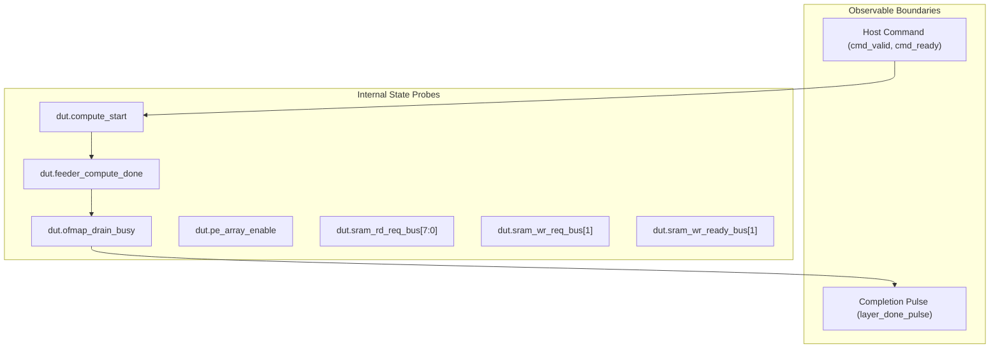

# TSK-12B: Metrics Definitions and Observability Specification

**Project:** Neural_Acc — Phase 2 RTL Microarchitecture and Verification  
**Workspace:** `E:\MTech\LanChain\MTP`  
**RTL Directory:** `phase2_step1_microarchitecture_and_rtl`  
**Author:** Automated Microarchitecture & Verification System  
**Date:** November 2, 2026  
**Status:** **RATIFIED METRICS SPECIFICATION**

---

## 1. Overview and Scope

This document provides formal, cycle-accurate mathematical definitions, signal probe locations, clock-edge sampling rules, and physical interpretation guidelines for all experimental metrics collected during the **TSK-12B Adaptive PE Allocation Experiment**.

The primary purpose of these metrics is to evaluate whether runtime **Adaptive Processing Element (PE) Allocation** offers measurable benefits over fixed **16-PE**, **32-PE**, and **64-PE** configurations within the integrated `Neural_Acc` accelerator architecture.

---

## 2. Observability Framework and RTL Tap Points

The accelerator top-level [`neural_acc_integrated_top.sv`](file:///e:/MTech/LanChain/MTP/phase2_step1_microarchitecture_and_rtl/neural_acc_integrated_top.sv) coordinates four major subsystems:
1. **Layer Command Sequencer** ([`layer_command_sequencer.sv`](file:///e:/MTech/LanChain/MTP/phase2_step1_microarchitecture_and_rtl/layer_command_sequencer.sv))
2. **Adaptive PE Controller** ([`adaptive_pe_controller.sv`](file:///e:/MTech/LanChain/MTP/phase2_step1_microarchitecture_and_rtl/adaptive_pe_controller.sv))
3. **Datapath Compute Feeder** ([`datapath_compute_feeder.sv`](file:///e:/MTech/LanChain/MTP/phase2_step1_microarchitecture_and_rtl/datapath_compute_feeder.sv))
4. **OFMAP Drain Controller** ([`ofmap_drain_controller.sv`](file:///e:/MTech/LanChain/MTP/phase2_step1_microarchitecture_and_rtl/ofmap_drain_controller.sv))

---

## 3. Metric Taxonomy and Formal Definitions

### 3.1 Execution Latency Metrics

| Metric ID | Metric Name | Mathematical Expression | RTL Signal / Event Probe | Sampling Boundary |
| :--- | :--- | :--- | :--- | :--- |
| **M-01** | Total Layer Latency ($T_{total}$) | $T_{total} = \text{cycle}(\text{layer\_done\_pulse}) - \text{cycle}(\text{cmd\_valid} \land \text{cmd\_ready})$ | `layer_done_pulse` and `cmd_valid && cmd_ready` | Full transaction duration from host issue to done strobe. |
| **M-02** | Compute Phase Latency ($T_{comp}$) | $T_{comp} = \text{cycle}(\text{feeder\_compute\_done}) - \text{cycle}(\text{compute\_start})$ | `dut.feeder_compute_done` and `dut.compute_start` | Datapath autonomous operand delivery & MAC execution. |
| **M-03** | OFMAP Drain Latency ($T_{drain}$) | $T_{drain} = \sum_{t} \mathbb{I}(\text{dut.ofmap\_drain\_busy} == 1)$ | `dut.ofmap_drain_busy` | Clock cycles during which the 64 accumulator words are serialized to SRAM. |
| **M-04** | Feeder Stall Cycles ($T_{stall\_feed}$) | $T_{stall\_feed} = \sum_{t} \mathbb{I}(\text{feeder waiting on SRAM ready or rvalid})$ | `dut.u_feeder.state_q` and `sram_rd_ready_bus` / `sram_rd_rvalid_bus` | Memory read stall cycles during weight/activation fetch. |
| **M-05** | Drain Stall Cycles ($T_{stall\_drain}$) | $T_{stall\_drain} = \sum_{t} \mathbb{I}(\text{dut.sram\_wr\_req\_bus}[1] \land \neg \text{dut.sram\_wr\_ready\_bus}[1])$ | `dut.sram_wr_req_bus[1]` and `dut.sram_wr_ready_bus[1]` | Backpressure cycles where OFMAP write is held due to SRAM contention. |
| **M-06** | Total Stall Cycles ($T_{stall}$) | $T_{stall} = T_{stall\_feed} + T_{stall\_drain}$ | Composite metric | Aggregate memory backpressure cycles. |

#### Exact Boundary Timing Properties
- **Compute Phase:** For reduction depth $K$, $T_{comp} = 1 + 3K$ cycles in the absence of stalls (1 cycle feeder launch + 3 cycles per step: weight fetch, activation fetch, array multiply-accumulate).
- **Drain Phase:** For any valid layer, $T_{drain} = 129$ cycles in the absence of stalls (1 cycle startup + 128 cycles to write 64 40-bit accumulators as 128 32-bit words).
- **Total Latency Invariance:** $T_{total} = 136 + 3K$ cycles. Crucially, $T_{total}$ is **invariant** with respect to the selected PE mode (16-PE, 32-PE, 64-PE, or Adaptive) because neither the feeder nor the drain controller dynamically scale transaction count with mode in the current RTL.

---

### 3.2 Processing Element Utilization Metrics

| Metric ID | Metric Name | Mathematical Expression | RTL Signal / Event Probe | Sampling Boundary |
| :--- | :--- | :--- | :--- | :--- |
| **M-07** | Configured PEs ($N_{cfg}$) | $N_{cfg} \in \{16, 32, 64\}$ | `dut.active_pe_count` | Latched configuration mode at start of layer. |
| **M-08** | Enabled PE-Cycles ($PE_{active\_cycles}$) | $PE_{active\_cycles} = \sum_{t} (\text{active\_pe\_count}(t) \times \mathbb{I}(\text{dut.pe\_array\_enable} == 1))$ | `dut.active_pe_count` and `dut.pe_array_enable` | Summed strictly on posedge clock cycles where MAC units are enabled. |
| **M-09** | Useful MAC Operations ($MAC_{useful}$) | $MAC_{useful} = \sum_{k=0}^{K-1} \sum_{r=0}^{3} \sum_{c=0}^{\frac{N_{cfg}}{4}-1} \mathbb{I}(A_r^{(k)} \neq 0)$ | Derived from Reference Model & RTL zero-skip | Count of non-zero arithmetic multiply-accumulations. |
| **M-10** | Array Silicon Efficiency ($\eta_{array}$) | $\eta_{array} = \frac{MAC_{useful}}{64 \times T_{comp}}$ | Analytical expression | Utilization of the full 64-PE physical silicon area during compute. |
| **M-11** | Active Subarray Efficiency ($\eta_{active}$) | $\eta_{active} = \frac{MAC_{useful}}{N_{cfg} \times K}$ | Analytical expression | Utilization of the configured active PE subset. |

#### Linear Scaling of Active PE-Cycles
While total clock cycles remain invariant, enabled PE-cycles scale strictly linearly with configured PE count:
$$\text{Reduction Ratio } R_{PE} = 1.0 - \frac{N_{cfg}}{64}$$
- **Fixed 16-PE Mode:** $R_{PE} = 1.0 - 16/64 = 75.0\%$ reduction in enabled PE compute cycles.
- **Fixed 32-PE Mode:** $R_{PE} = 1.0 - 32/64 = 50.0\%$ reduction in enabled PE compute cycles.
- **Fixed 64-PE Mode:** $R_{PE} = 1.0 - 64/64 = 0.0\%$ (Baseline).

---

### 3.3 Memory Subsystem Metrics

| Metric ID | Metric Name | Mathematical Expression | RTL Signal / Event Probe | Sampling Boundary |
| :--- | :--- | :--- | :--- | :--- |
| **M-12** | SRAM Read Requests ($SRAM_{rd\_req}$) | $\sum_{t} \sum_{b=0}^{7} \mathbb{I}(\text{sram\_rd\_req\_bus}[b] \land \text{sram\_rd\_ready\_bus}[b])$ | `dut.sram_rd_req_bus[7:0]` and `dut.sram_rd_ready_bus[7:0]` | Total parallel read requests across all 8 SRAM banks ($10 \times K$). |
| **M-13** | SRAM Write Requests ($SRAM_{wr\_req}$) | $\sum_{t} \mathbb{I}(\text{dut.sram\_wr\_req\_bus}[1] == 1)$ | `dut.sram_wr_req_bus[1]` | Total write requests issued by OFMAP drain controller. |
| **M-14** | Accepted SRAM Writes ($SRAM_{wr\_ack}$) | $\sum_{t} \mathbb{I}(\text{dut.sram\_wr\_req\_bus}[1] \land \text{dut.sram\_wr\_ready\_bus}[1])$ | Scoreboard write tracker | Must be exactly 128 for valid layer completions. |
| **M-15** | Memory Contention Cycles | $\sum_{t} \mathbb{I}(\text{Bank } b \text{ conflict between Port 0 and Port 1})$ | `dut.u_sram_subsystem.bank_wr_conflict` | Stalls caused by simultaneous DMA ingress and OFMAP write to the same bank. |

---

### 3.4 Dynamic Adaptation Metrics

| Metric ID | Metric Name | Mathematical Expression | RTL Signal / Event Probe | Sampling Boundary |
| :--- | :--- | :--- | :--- | :--- |
| **M-16** | Resolved PE Mode | $\text{Mode} \in \{00: 16\text{PE}, 01: 32\text{PE}, 10: 64\text{PE}\}$ | `dut.active_cfg_mode` | Mode determined by degradation threshold comparator. |
| **M-17** | Fallback Assertions | $\sum \mathbb{I}(\text{fallback\_to\_64} == 1)$ | `dut.u_pe_controller.fallback_to_64` | Asserted when $\hat{D}_{16} > 3277$ and $\hat{D}_{32} > 3277$. |
| **M-18** | Mode Switch Count | $\sum \mathbb{I}(\text{dut.pe\_configuration\_changed} == 1)$ | `dut.pe_configuration_changed` | 1-cycle strobe pulsed when mode changes across layers. |
| **M-19** | Decision Latency Overhead | $T_{adapt\_overhead} = T_{configure}(\text{Adaptive}) - T_{configure}(\text{Fixed})$ | Cycle probe in `ST_CONFIGURE` | Strictly 0 clock cycles (combinational decision in 1-cycle state). |

---

## 4. Workload Mapping and Metric Expectations

| Workload ID | Purpose / Stress Target | $K$ | Target Mode | Expected $T_{total}$ | Expected $T_{comp}$ | Expected $T_{drain}$ | Expected $PE_{cyc}$ | Expected Useful MACs |
| :--- | :--- | :---: | :---: | :---: | :---: | :---: | :---: | :---: |
| **WL-01** | Minimal Reduction | 1 | 16 / 32 / 64 | 139 | 4 | 129 | 16 / 32 / 64 | 16 / 32 / 64 |
| **WL-02** | Short Reduction (Mixed Signs) | 2 | 16 / 32 / 64 | 142 | 7 | 129 | 32 / 64 / 128 | 32 / 64 / 128 |
| **WL-03** | Standard CNN Tile | 4 | 16 / 32 / 64 | 148 | 13 | 129 | 64 / 128 / 256 | 64 / 128 / 256 |
| **WL-04** | Deep Accumulation | 8 | 16 / 32 / 64 | 160 | 25 | 129 | 128 / 256 / 512 | 128 / 256 / 512 |
| **WL-05** | High Sparsity (50% Exact Zeros)| 4 | 16 / 32 / 64 | 148 | 13 | 129 | 64 / 128 / 256 | 32 / 64 / 128 |
| **WL-06** | Saturation Stress | 4 | 16 / 32 / 64 | 148 | 13 | 129 | 64 / 128 / 256 | 64 / 128 / 256 |
| **WL-07** | Consecutive Multi-Layer | 2 | $16 \to 32$ | 142 | 7 | 129 | $32 \to 64$ | $32 \to 64$ |
| **WL-08** | Memory Contention Stall | 1 | 64 | 140 | 4 | 130 | 64 | 64 |
| **WL-09** | Threshold Sweep ($\hat{D}_{16}, \hat{D}_{32}$)| 2 | $16 / 32 / 64$ | 142 | 7 | 129 | 32 / 64 / 128 | 32 / 64 / 128 |

---

## 5. Physical Realism and Scientific Disclaimers

> [!CAUTION]
> ### Strict Boundaries on Physical Interpretations:
> 1. **Logical Enable vs. Physical Dynamic Power:**
>    In functional RTL simulation, $PE_{active\_cycles}$ measures the number of PEs whose computation enable and operand broadcast are active. In inactive columns, inputs are clamped to zero and MAC enables are gated, which prevents arithmetic switching activity in the multiplier trees. However, **exact physical dynamic power and energy savings (in Joules or Watts) cannot be reported** without gate-level netlist simulation with parasitic capacitance and wire RC extraction.
> 2. **Physical Area Footprint:**
>    Configuring the accelerator in 16-PE mode does not reduce physical die area. All 64 PEs, the 8-bank SRAM crossbar, and the OFMAP drain controller remain physically present on silicon.
> 3. **Memory Bandwidth & Drain Bottleneck:**
>    Because the feeder always reads 10 words per K-step and the OFMAP drain controller always writes 128 words, memory traffic and drain latency are currently fixed regardless of PE mode. Dynamic memory bandwidth scaling represents a key microarchitectural opportunity for future revisions.

