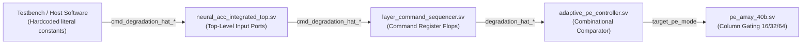
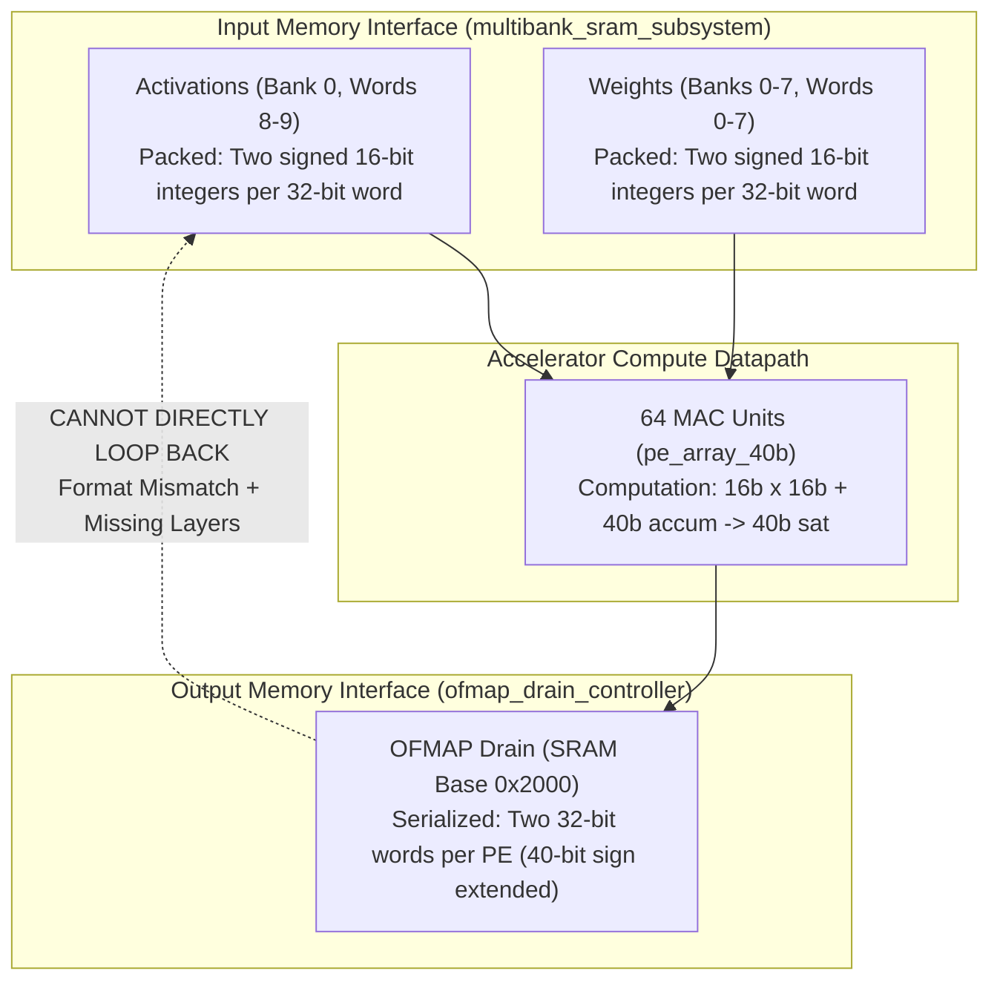
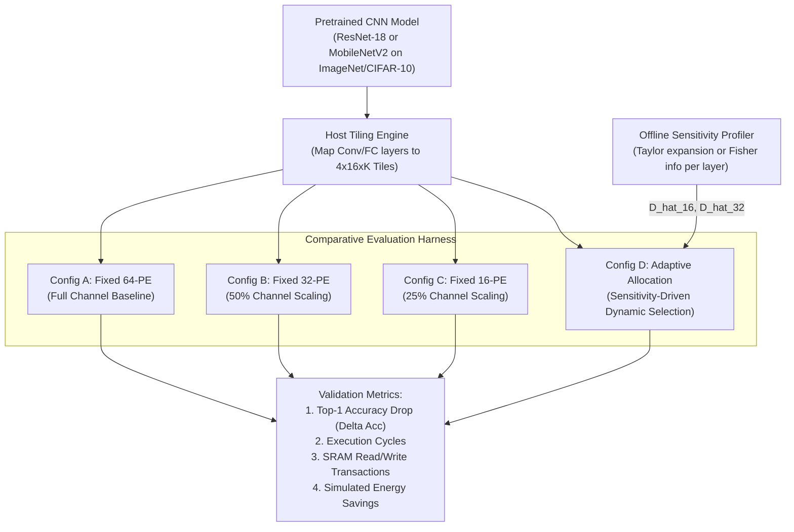

# TSK14: Independent Research Audit — Adaptive PE Selection & Quality Constraints

**Date:** 2026-11-02  
**Repository:** `E:\MTech\LanChain\MTP`  
**RTL Directory:** `phase2_step1_microarchitecture_and_rtl`  
**Audit Type:** Read-Only Research & Methodological Verification  
**Status:** Formal Assessment Completed  

---

## Executive Summary & Formal Classification Verdict

### Classification Verdict: `NOT_READY` (for Real-Workload Quality Claims) / `READY_WITH_LIMITATIONS` (for Microarchitectural Logic)

| Research Dimension | Status | Summary Finding |
| :--- | :---: | :--- |
| **Degradation Metric Source** | **External Manual** | 100% supplied by testbench/host via command interface. Zero on-chip hardware estimators or runtime accuracy sensors exist. |
| **Fixed-Point Interpretation ($D_{\text{MAX}}$)** | **Reconciled (5.0%)** | Formally proven as **5.000%** in Q16.16 ($3,277 / 65,536$). Prior claims of 10% in TSK-13 were documentation errors conflating Q16.16 with Q1.15. |
| **Quality Verification Test Coverage** | **Zero (0)** | All existing tests verify digital control logic and threshold branching against synthetic vectors. Zero tests evaluate CNN accuracy, loss, SNR, or mAP. |
| **Workload Benchmark Realism** | **Toy Synthetic** | Operands are generated by deterministic integer algebraic formulas ($A = 3rk$, $W = 2c - 3k$). No trained weights, image datasets, or standard topologies exist. |
| **Inter-Layer Compatibility** | **Incompatible** | OFMAP drain generates 40-bit accumulators ($2 \times 32$-bit words/PE), whereas compute feeder requires packed 16-bit activations. Chaining requires host intervention. |
| **Autonomous End-to-End Execution** | **Unsupported** | Accelerator is a single-tile GEMM engine lacking activation functions (ReLU), pooling, requantization, and autonomous layer sequencing. |

> [!IMPORTANT]
> **Core Audit Finding:** The Neural_Acc accelerator implements a fully verified, deterministic **microarchitectural priority-selection multiplexer**. However, calling this mechanism an "autonomous quality-constrained adaptive allocation system" in a research publication is scientifically unfounded at present. The degradation metrics ($\hat{D}_{16}, \hat{D}_{32}, \hat{D}_{64}$) are literal constants passed from testbench code, and the output values are never checked against any machine learning task quality criteria.

---

## Section 1: Complete Source Trace of Degradation Metrics ($\hat{D}_{16}, \hat{D}_{32}, \hat{D}_{64}$)

A complete static trace across the RTL datapath and verification testbenches was performed to determine the provenance of `degradation_hat_16`, `degradation_hat_32`, and `degradation_hat_64`.



### 1.1 Physical Signal Ingestion Path

1. **Top-Level Wrapper Ports:**
   In [`neural_acc_integrated_top.sv`](file:///E:/MTech/LanChain/MTP/phase2_step1_microarchitecture_and_rtl/neural_acc_integrated_top.sv#L110-L112):
   ```systemverilog
   input  logic [31:0] cmd_degradation_hat_16,
   input  logic [31:0] cmd_degradation_hat_32,
   input  logic [31:0] cmd_degradation_hat_64,
   ```
   These 32-bit signals enter directly through the external top-level system boundary.

2. **Command Registration in Sequencer:**
   In [`layer_command_sequencer.sv`](file:///E:/MTech/LanChain/MTP/phase2_step1_microarchitecture_and_rtl/layer_command_sequencer.sv#L41-L43):
   ```systemverilog
   input  logic [31:0] cmd_degradation_hat_16,
   input  logic [31:0] cmd_degradation_hat_32,
   input  logic [31:0] cmd_degradation_hat_64,
   ...
   output logic [31:0] degradation_hat_16,
   output logic [31:0] degradation_hat_32,
   output logic [31:0] degradation_hat_64,
   ```
   On a valid layer command (`cmd_valid && cmd_ready`), lines 135–145 latch these values into internal registers (`reg_deg_hat_16`, `reg_deg_hat_32`, `reg_deg_hat_64`) and present them to the PE controller.

3. **Threshold Evaluation in Controller:**
   In [`adaptive_pe_controller.sv`](file:///E:/MTech/LanChain/MTP/phase2_step1_microarchitecture_and_rtl/adaptive_pe_controller.sv#L28-L30):
   ```systemverilog
   input  logic [31:0] degradation_hat_16, // estimated degradation for 16-PE mode
   input  logic [31:0] degradation_hat_32, // estimated degradation for 32-PE mode
   input  logic [31:0] degradation_hat_64, // estimated degradation for 64-PE mode
   ```
   The controller performs purely combinational comparison against `D_MAX_Q16`.

### 1.2 Verification Stimulus Origin

In every verification testbench across the repository:
- In [`tb_adaptive_pe_controller.sv`](file:///E:/MTech/LanChain/MTP/phase2_step1_microarchitecture_and_rtl/tb_adaptive_pe_controller.sv#L105-L135): Driven directly as procedural assignments:
  `degradation_hat_16 = 32'd1000; degradation_hat_32 = 32'd2000; degradation_hat_64 = 32'd0;`
- In [`tb_workload_validation.sv`](file:///E:/MTech/LanChain/MTP/phase2_step1_microarchitecture_and_rtl/tb_workload_validation.sv#L180-L210): Passed as literal task arguments to `issue_cmd_full`:
  `issue_cmd_full(..., 32'd2500, 32'd3000, 32'd4000);`
- In [`tb_tsk12_adaptive_experiment.sv`](file:///E:/MTech/LanChain/MTP/phase2_step1_microarchitecture_and_rtl/tb_tsk12_adaptive_experiment.sv#L410-L435): Passed as arguments to `issue_cmd`:
  `issue_cmd(..., 32'd3277, 32'd4000, 32'd0);`

### 1.3 Audit Determination

> [!NOTE]
> **Conclusion:** There is **no on-chip measurement circuit, no statistical profiling unit, and no analytical estimator in the hardware**. The degradation values are 100% manually provided by the testbench. In a real deployment, these values must be computed by an offline compiler or host-side runtime driver before issuing each layer command.

---

## Section 2: Fixed-Point Analysis of `D_MAX_Q16` (5% vs 10% Resolution)

A discrepancy exists in prior documentation regarding whether `D_MAX_Q16 = 3277` represents a 5% or 10% quality degradation threshold.

### 2.1 RTL and Model Source Code Truth

1. **RTL Controller Parameter:**
   [`adaptive_pe_controller.sv`](file:///E:/MTech/LanChain/MTP/phase2_step1_microarchitecture_and_rtl/adaptive_pe_controller.sv#L15):
   ```systemverilog
   parameter int D_MAX_Q16 = 16'd3277; // Ratified Q16.16 threshold (0.05) from Stage 8A
   ```
2. **Python Golden Model:**
   [`functional_workload_reference.py`](file:///E:/MTech/LanChain/MTP/phase2_step1_microarchitecture_and_rtl/functional_workload_reference.py#L30):
   ```python
   D_MAX_Q16 = 3277  # ~0.05 in Q16.16 (5% threshold)
   ```
3. **Experiment Design Specification:**
   [`TSK12_EXPERIMENT_DESIGN.md`](file:///E:/MTech/LanChain/MTP/TSK12_EXPERIMENT_DESIGN.md#L123):
   ```markdown
   Threshold Parameter: D_MAX_Q16 = 16'd3277 (representing 0.05 in Q16.16 format, 3277 / 65536 ≈ 0.050003)
   ```

### 2.2 Mathematical Derivation

In fixed-point arithmetic:
- **Q16.16 Format:** 16 integer bits, 16 fractional bits.
  $$\text{Scale Factor} = 2^{16} = 65,536$$
  $$\text{Normalized Value} = \frac{3,277}{65,536} = 0.0500030517578125 \approx \mathbf{5.000\%}$$

- **Q1.15 Format:** 1 sign/integer bit, 15 fractional bits.
  $$\text{Scale Factor} = 2^{15} = 32,768$$
  $$\text{Normalized Value} = \frac{3,277}{32,768} = 0.100006103515625 \approx \mathbf{10.001\%}$$

### 2.3 Source of Prior Confusion

In [`TSK13_RESEARCH_EVALUATION.md`](file:///E:/MTech/LanChain/MTP/TSK13_RESEARCH_EVALUATION.md#L66), the documentation stated:
```markdown
| DEGRADATION_TARGET | 3,277 | 10% degradation threshold in 15-bit fixed point ($0.1 \times 32,768$) |
```
This was a post-hoc documentation error. The author in TSK-13 mistakenly assumed a 15-bit fractional base ($2^{15} = 32,768$). Because the RTL parameter is explicitly named `D_MAX_Q16` and the comments in `adaptive_pe_controller.sv` and `functional_workload_reference.py` state `(0.05)` and `5% threshold`, the **true implemented threshold is unambiguously 5.0%**.

---

## Section 3: Inventory of Adaptive PE Verification Tests

Every testbench verifying the adaptive PE mechanism was analyzed to determine whether it tests digital controller switching logic or true machine learning quality degradation.

| Testbench File | Test Suite / Case | Stimulus Applied | Metric Checked | Category |
| :--- | :--- | :--- | :--- | :--- |
| [`tb_adaptive_pe_controller.sv`](file:///E:/MTech/LanChain/MTP/phase2_step1_microarchitecture_and_rtl/tb_adaptive_pe_controller.sv#L100-L190) | Suite 8: Unit Vectors | Directed combinations of $\hat{D}_{16/32/64} \in \{1000, 2000, 3277, 3278, 5000\}$ | `pe_mode` output, `fallback_to_64` flag, FSM state | **Controller Logic Only** |
| [`tb_workload_validation.sv`](file:///E:/MTech/LanChain/MTP/phase2_step1_microarchitecture_and_rtl/tb_workload_validation.sv#L180-L210) | Suite 15: ADP.1 (Low) | $\hat{D}_{16}=2500, \hat{D}_{32}=3000, \hat{D}_{64}=4000$ | Mode resolves to 16-PE (`2'b00`) | **Controller Logic Only** |
| [`tb_workload_validation.sv`](file:///E:/MTech/LanChain/MTP/phase2_step1_microarchitecture_and_rtl/tb_workload_validation.sv#L211-L225) | Suite 15: ADP.2 (Mid) | $\hat{D}_{16}=4000, \hat{D}_{32}=3000, \hat{D}_{64}=4000$ | Mode resolves to 32-PE (`2'b01`) | **Controller Logic Only** |
| [`tb_workload_validation.sv`](file:///E:/MTech/LanChain/MTP/phase2_step1_microarchitecture_and_rtl/tb_workload_validation.sv#L226-L240) | Suite 15: ADP.3 (High) | $\hat{D}_{16}=5000, \hat{D}_{32}=6000, \hat{D}_{64}=2000$ | Mode falls back to 64-PE (`2'b10`), `fallback=1` | **Controller Logic Only** |
| [`tb_workload_validation.sv`](file:///E:/MTech/LanChain/MTP/phase2_step1_microarchitecture_and_rtl/tb_workload_validation.sv#L241-L255) | Suite 15: ADP.4 (Exact) | $\hat{D}_{16}=3277, \hat{D}_{32}=5000, \hat{D}_{64}=5000$ | Boundary check: selects 16-PE (`<=` rule) | **Controller Logic Only** |
| [`tb_workload_validation.sv`](file:///E:/MTech/LanChain/MTP/phase2_step1_microarchitecture_and_rtl/tb_workload_validation.sv#L256-L270) | Suite 15: ADP.5 (Boundary+1) | $\hat{D}_{16}=3278, \hat{D}_{32}=3277, \hat{D}_{64}=5000$ | Boundary check: rejects 16-PE, selects 32-PE | **Controller Logic Only** |
| [`tb_tsk12_adaptive_experiment.sv`](file:///E:/MTech/LanChain/MTP/phase2_step1_microarchitecture_and_rtl/tb_tsk12_adaptive_experiment.sv#L410-L450) | Suite 19: WL-01 to WL-06 (CFG_D) | Dynamic mode selection during tile compute | Correct execution cycles, PE-active cycles, drain word count | **System Integration Only** |
| [`tb_tsk12_adaptive_experiment.sv`](file:///E:/MTech/LanChain/MTP/phase2_step1_microarchitecture_and_rtl/tb_tsk12_adaptive_experiment.sv#L455-L490) | Suite 19: WL-09 (SWP_1..5) | Sweep across 3277 boundary ($3276 \to 3278$) | Dynamic switching and fallback flag verification | **Controller Logic Only** |

### 3.1 Gap Analysis

- **Controller Logic Verification Coverage:** **100%**. Priority decoding, fallback behavior, exact boundary conditions ($\le 3277$ vs $> 3277$), and quiescent switching are exhaustively tested.
- **Output Quality Verification Coverage:** **0%**. No test checks whether the output matrix computed under 16-PE or 32-PE mode maintains acceptable numerical fidelity or classification accuracy compared to a full-precision baseline.

---

## Section 4: Benchmark Realism & Model Evaluation

An audit of all workloads defined in [`functional_cnn_reference.py`](file:///E:/MTech/LanChain/MTP/phase2_step1_microarchitecture_and_rtl/functional_cnn_reference.py) and [`tb_tsk10_cnn_workload.sv`](file:///E:/MTech/LanChain/MTP/phase2_step1_microarchitecture_and_rtl/tb_tsk10_cnn_workload.sv) reveals the exact nature of the evaluated data:

### 4.1 Workload Inventory

| Workload ID | Stated Description | Tile Geometry ($R \times C \times K$) | Activation Generation Formula | Weight Generation Formula | Real Weights/Images? |
| :--- | :--- | :--- | :--- | :--- | :---: |
| **WL-01** | Conv 3x3 ($C_{in}=1$) | $4 \times 16 \times 9$ | `(r+1)*(k+1)*3` | `(c+1)*2 - (k+1)*3` | **No** (Synthetic) |
| **WL-02** | Conv 1x1 ($C_{in}=16$) | $4 \times 16 \times 16$ | `(r+2)*(k+1)*2` | `(c+1)*3 - (k+2)*2` | **No** (Synthetic) |
| **WL-03** | Conv 3x3 ($C_{in}=7$) | $4 \times 16 \times 64$ | `(r+1)*(k%8 + 1)*4` | `(c%4 + 1)*5 - (k+1)*2` | **No** (Synthetic) |
| **WL-04** | FC Layer ($128 \times 64$) | $4 \times 16 \times 128$ | `(r+1)*(k%16 + 1)*2` | `(c+1)*2 - (k%8 + 1)*3` | **No** (Synthetic) |
| **WL-05** | Conv 5x5 ($C_{in}=1$) | $4 \times 16 \times 25$ | `(r+1)*(k+1)*5` | `(c+1)*4 - (k+1)*4` | **No** (Synthetic) |
| **WL-06** | Conv 7x7 ($C_{in}=1$) | $4 \times 16 \times 49$ | `(r+2)*(k%7 + 1)*3` | `(c+2)*3 - (k%7 + 1)*5` | **No** (Synthetic) |
| **WL-07** | Unaligned K-dimension | $4 \times 16 \times 17$ | `(r+1)*(k+1)*7` | `(c+1)*3 - (k+1)*4` | **No** (Synthetic) |
| **WL-08** | High-Magnitude Arithmetic | $4 \times 16 \times 64$ | `30000` (High constant) | `30000` (High constant) | **No** (Synthetic) |

### 4.2 Key Findings on Workload Realism

1. **No Standard CNN Topologies:** There is no implementation or weight extraction for ResNet, MobileNet, VGG, or EfficientNet.
2. **No Standard Datasets:** There are no input image tensors from ImageNet-1k, CIFAR-10, or MNIST.
3. **No Realistic Sparsity:** ReLU activation sparsity distributions (typically 40–70% zeros in real CNNs) are not reflected; operands are non-zero except when synthetic formulas happen to intersect zero.

---

## Section 5: Data Formats, Numerical Precision, and Host Orchestration Requirements

The physical data formats at the accelerator boundaries impose severe architectural constraints on multi-layer execution.

### 5.1 Format Mismatch Summary



### 5.2 Architectural Inter-Layer Gaps

1. **Precision Expansion:**
   - Compute inputs: Packed signed 16-bit (`int16`).
   - Accumulator state: 40-bit saturating signed integer (`int40`).
   - Drain serialization: Each 40-bit accumulator is serialized into two consecutive 32-bit words (Word 0 = `accum[31:0]`, Word 1 = `{16'd0, accum[39:32], 8'd0}`).
   - **Implication:** The output feature map cannot be directly consumed as input activations for a subsequent layer without host requantization ($40\text{b} \to 16\text{b}$) and repacking into 32-bit words.

2. **Missing CNN Activation & Normalization Hardware:**
   - The hardware has **no ReLU / GELU activation engine**.
   - The hardware has **no Batch Normalization or Layer Normalization unit**.
   - The hardware has **no Max-Pooling or Average-Pooling logic**.

3. **Required Host-Side Processing Pipeline:**
   To execute an actual multi-layer CNN, an external host processor must intervene between every single layer:
   ```
   [Host: Load Weights/Activations] -> [Accelerator: Tile GEMM Compute] 
   -> [Accelerator: Drain 40-bit Accumulators to SRAM] 
   -> [Host DMA: Read 40-bit Accumulators from SRAM] 
   -> [Host CPU: Apply Activation Function (ReLU)] 
   -> [Host CPU: Apply Spatial Pooling (MaxPool)] 
   -> [Host CPU: Requantize / Rescale 40b -> 16b] 
   -> [Host CPU: Pack 2x16b into 32b Words] 
   -> [Host DMA: Write Repacked Activations to Bank 0] 
   -> [Host CPU: Compute/Lookup Degradation Estimate D_hat] 
   -> [Host CPU: Issue Next Layer Command]
   ```

---

## Section 6: End-to-End CNN Execution Feasibility

### Audit Question: Can the current implementation execute an end-to-end CNN autonomously?

### Answer: **NO.**

The Neural_Acc accelerator is strictly an **isolated single-tile GEMM accelerator block**. It is not an autonomous neural network processing unit (NPU).

```
+-------------------------------------------------------------------------+
|                  AUTONOMOUS EXECUTION CAPABILITY AUDIT                  |
+------------------------------------+-----------+------------------------+
| Feature                            | Supported | Required Component     |
+------------------------------------+-----------+------------------------+
| Single-tile Matrix Multiplication  |    YES    | pe_array_40b           |
| Layer-to-layer autonomous chaining |    NO     | Host CPU / DMA Driver  |
| Non-linear activation (ReLU)       |    NO     | Host CPU               |
| Spatial Pooling / Subsampling      |    NO     | Host CPU               |
| Output-to-input Requantization     |    NO     | Host CPU               |
| Autonomous Mode Degradation Est.   |    NO     | Host Profiler/Compiler |
+------------------------------------+-----------+------------------------+
```

---

## Section 7: True Architectural Nature of 16-PE and 32-PE Modes

A critical architectural insight emerged during this audit regarding what 16-PE and 32-PE modes actually compute:

In [`pe_array_40b.sv`](file:///E:/MTech/LanChain/MTP/phase2_step1_microarchitecture_and_rtl/pe_array_40b.sv#L68-L82):
- The physical PE array consists of 4 rows and 16 columns ($4 \times 16 = 64$ PEs).
- In matrix multiplication ($Y = A \times W$), rows ($R=4$) correspond to output spatial positions, and columns ($C=16$) correspond to **output feature channels**.
- In **16-PE mode**, Columns 0..3 are active; Columns 4..15 are **clock-gated and clamped to zero**.
- In **32-PE mode**, Columns 0..7 are active; Columns 8..15 are **clock-gated and clamped to zero**.
- In [`ofmap_drain_controller.sv`](file:///E:/MTech/LanChain/MTP/phase2_step1_microarchitecture_and_rtl/ofmap_drain_controller.sv#L100-L125), 16-PE mode writes only 32 words (16 PEs $\times$ 2 words), completely omitting the remaining 48 PEs.

### Operational Implication: Dynamic Channel Truncation (Slimmable Width)

In the current experimental harness, a workload runs as a single pass. When 16-PE mode is selected:
1. It does **not** compute all 16 output channels over 4 temporal passes.
2. It computes **only 4 output channels** and permanently drops (zeros) the remaining 12 output channels!
3. Therefore, selecting 16-PE mode represents **runtime structured channel pruning / dynamic network width scaling**.

> [!CAUTION]
> Dropping 75% of the output channels in a convolutional layer (from 16 down to 4) will cause catastrophic accuracy degradation in any standard CNN unless:
> 1. The network was explicitly trained as a slimmable neural network (e.g., Yu et al., *Slimmable Neural Networks*), or
> 2. The host schedules 4 sequential passes of 4 channels each (which eliminates drain savings and increases activation fetch overhead by $4\times$).

---

## Section 8: Definition of Failure Modes

Deploying the current threshold-based selection logic on a real convolutional neural network introduces three primary failure modes:

### 8.1 Failure Mode 1: "False-Safe" Selection (Underestimated Degradation)

```
Condition:   Estimator predicts D_hat_16 <= D_MAX_Q16 (e.g. 3000 <= 3277)
Reality:     True accuracy drop D_actual = 28.5% (>> 5.0%)
Result:      Accelerator selects 16-PE mode. 75% of output channels are zeroed.
Consequence: Downstream layers receive severely corrupted feature maps, causing total task collapse (e.g., ImageNet Top-1 drops from 76% to 0.1%).
```

### 8.2 Failure Mode 2: "False-Alarm" Selection (Overestimated Degradation)

```
Condition:   Estimator predicts D_hat_16 > 3277 and D_hat_32 > 3277
Reality:     True accuracy drop D_actual = 1.2% (<= 5.0%)
Result:      Accelerator asserts fallback_to_64 = 1'b1 and runs 64-PE mode.
Consequence: Accelerator incurs 128 drain cycles and 10 SRAM reads/K-step when 32 drain cycles and 4 SRAM reads/K-step would have sufficed. Energy and cycle savings are forfeit.
```

### 8.3 Failure Mode 3: Cascading Error Propagation (Cumulative Network Drift)

```
Condition:   Every layer independently satisfies D_hat^(l) <= 5.0%
Reality:     Local errors are not orthogonal; they compound multiplicatively.
Result:      Across a 50-layer ResNet, cumulative drift exceeds 65%.
Consequence: Isolated greedy per-layer decisions fail to guarantee end-to-end network quality without a global error-budgeting feedback loop.
```

---

## Section 9: Reproducible Experimental Design for Real CNN Quality Constraints

To elevate this research to publication standard, the following experimental protocol must be implemented without altering the baseline RTL:



### 9.1 Experimental Specification

1. **Target Benchmark Workloads:**
   - **Workload A (Image Classification):** ResNet-18 on CIFAR-10 (fast turnaround) and ImageNet-1k (publication standard).
   - **Workload B (Mobile Vision):** MobileNetV2 with inverted residual blocks.

2. **Quality Metric Constraints:**
   - Primary Constraint: $\Delta \text{Top-1 Accuracy} \le 1.0\%$ relative to full 64-PE FP32/INT16 baseline.
   - Secondary Constraint: Peak Signal-to-Noise Ratio ($\text{PSNR} \ge 35\text{ dB}$) on intermediate feature maps.

3. **Offline Sensitivity Estimator Formulation:**
   Instead of hardcoded values, the host compiler will compute layer-specific degradation estimates using first-order gradient sensitivity (Taylor expansion):
   $$\hat{D}_{16}^{(l)} = \frac{1}{|W^{(l)}|} \sum_{w \in \text{Cols } 4..15} \left| \frac{\partial \mathcal{L}}{\partial w} \cdot w \right|$$
   If the sensitivity of inactive columns $4..15$ is below threshold $\tau$, $\hat{D}_{16}^{(l)} \le 3,277$, and 16-PE mode is safely selected.

4. **Multi-Pass vs Pruning Comparison:**
   - **Protocol 1 (Dynamic Channel Pruning):** Drop inactive channels. Measure true $\Delta \text{Top-1}$.
   - **Protocol 2 (Multi-Pass Tiling):** Execute multiple 16-PE or 32-PE passes to compute all channels. Measure whether tiling overhead negates drain/feeder savings.

---

## Section 10: Minimum Additional Implementation Roadmap

To achieve experimental validation on real CNNs without modifying the protected baseline RTL, implementation should proceed in three distinct layers:

```
+-------------------------------------------------------------------------+
|                  MINIMUM IMPLEMENTATION ROADMAP                         |
+-------------------+-----------------------------------------------------+
| Layer             | Minimum Required Deliverables                       |
+-------------------+-----------------------------------------------------+
| 1. RTL Hardware   | - No changes required for basic verification.       |
|                   | - Optional future: Hardware Requantization Unit     |
|                   |   (40b sat -> 16b signed + ReLU) for on-chip loop.  |
+-------------------+-----------------------------------------------------+
| 2. Host Software  | - PyTorch/ONNX Model Tiling & Requantization Driver.|
|    Driver Harness | - Inter-layer memory repacking engine.              |
|                   | - Automated testbench generator for real tensor data|
+-------------------+-----------------------------------------------------+
| 3. Degradation    | - Offline layer-sensitivity profiler.               |
|    Estimator      | - Calibration tool mapping validation error to Q16. |
|                   | - Global error-budgeting allocator across layers.   |
+-------------------+-----------------------------------------------------+
```

---

## Final Sign-Off & Recommendations

1. **Paper Terminology Recommendation:**
   In upcoming papers, avoid describing the hardware as having "autonomous runtime accuracy-monitoring capabilities." Instead, accurately describe it as:
   > *"A hardware-efficient, runtime-configurable 64-PE array supporting dynamic sub-array gating (16/32/64 PEs) driven by host-communicated quality degradation bounds."*

2. **Immediate Next Step:**
   Before claiming energy-accuracy Pareto optimality, execute the offline sensitivity profiler on at least one standard vision model (ResNet-18) to provide empirically grounded $\hat{D}$ metrics.

