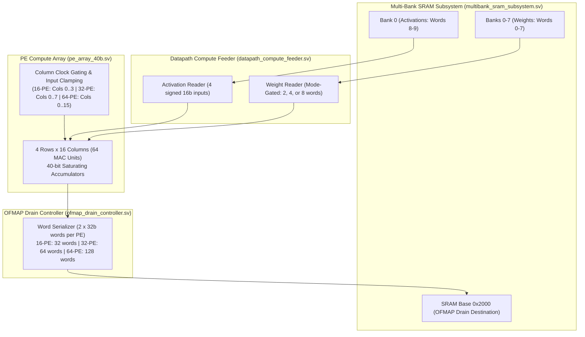
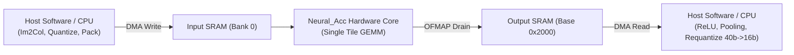

# TSK15: Neural_Acc Microarchitecture Mapping & CNN Execution Analysis

**Date:** 2026-11-02  
**Repository:** `E:\MTech\LanChain\MTP`  
**Task:** TSK-15 Real CNN Quality-Constrained Adaptive PE Selection  
**Document:** Architecture Mapping & Hardware-to-Model Contract  

---

## 1. Physical Accelerator Specification

The Neural_Acc accelerator is a specialized, cycle-accurate Matrix-Multiply and Accumulate (GEMM) hardware tile.



### 1.1 Microarchitectural Interface Parameters

| Hardware Parameter | Physical Width / Dimension | Microarchitectural Specification & Source Location |
| :--- | :---: | :--- |
| **Input Activation Format** | Signed 16-bit (`int16` / Q8.8) | Packed two 16-bit values per 32-bit word in Bank 0 ([`datapath_compute_feeder.sv:50-55`](file:///E:/MTech/LanChain/MTP/phase2_step1_microarchitecture_and_rtl/datapath_compute_feeder.sv#L50-L55)). |
| **Input Weight Format** | Signed 16-bit (`int16` / Q8.8) | Packed two 16-bit values per 32-bit word across Banks 0..7 ([`datapath_compute_feeder.sv:56-60`](file:///E:/MTech/LanChain/MTP/phase2_step1_microarchitecture_and_rtl/datapath_compute_feeder.sv#L56-L60)). |
| **Accumulator Width** | Signed 40-bit (`int40`) | 40-bit signed accumulator per PE ([`mac_unit_40b.sv:12`](file:///E:/MTech/LanChain/MTP/phase2_step1_microarchitecture_and_rtl/mac_unit_40b.sv#L12)). |
| **Saturation Boundary** | $[-2^{39}, 2^{39}-1]$ | $[-549,755,813,888, +549,755,813,887]$. Clamps on overflow, asserts sticky saturation flag. |
| **Physical PE Array** | 4 Rows $\times$ 16 Columns | 64 total physical Processing Elements ([`pe_array_40b.sv:22`](file:///E:/MTech/LanChain/MTP/phase2_step1_microarchitecture_and_rtl/pe_array_40b.sv#L22)). |
| **Reduction Dimension ($K$)** | 8-bit ($K \le 256$) | Parameterized in [`k_progress_tracker.sv`](file:///E:/MTech/LanChain/MTP/phase2_step1_microarchitecture_and_rtl/k_progress_tracker.sv). Tested from $K=9$ to $K=128$. |
| **OFMAP Output Layout** | Two 32-bit words / PE | Packed as `{16'd0, accum[39:32], 8'd0}` and `accum[31:0]` ([`ofmap_drain_controller.sv:140-155`](file:///E:/MTech/LanChain/MTP/phase2_step1_microarchitecture_and_rtl/ofmap_drain_controller.sv#L140-L155)). |
| **SRAM Address Range** | 14-bit (16,384 words) | 8 physical banks $\times$ 1,296 words/bank ([`multibank_sram_subsystem.sv`](file:///E:/MTech/LanChain/MTP/phase2_step1_microarchitecture_and_rtl/multibank_sram_subsystem.sv)). |

---

## 2. Microarchitectural Meaning of PE Allocation Modes

In [`pe_array_40b.sv:68-88`](file:///E:/MTech/LanChain/MTP/phase2_step1_microarchitecture_and_rtl/pe_array_40b.sv#L68-L88), the runtime configuration mode `cfg_mode` directly controls physical column gating:

```systemverilog
case (cfg_mode)
    MODE_16PE: begin // 2'b00
        active_pe_count = 7'd16;
        col_active      = 16'h000F; // Columns 0..3 active (4 rows x 4 cols = 16 PEs)
    end
    MODE_32PE: begin // 2'b01
        active_pe_count = 7'd32;
        col_active      = 16'h00FF; // Columns 0..7 active (4 rows x 8 cols = 32 PEs)
    end
    MODE_64PE: begin // 2'b10
        active_pe_count = 7'd64;
        col_active      = 16'hFFFF; // Columns 0..15 active (4 rows x 16 cols = 64 PEs)
    end
    default: begin
        cfg_invalid     = 1'b1;
        active_pe_count = 7'd0;
        col_active      = 16'h0000;
    end
endcase
```

### 2.1 Mode-Dependent Subsystem Behavior

1. **Operand Fetcher Gating ([`datapath_compute_feeder.sv`](file:///E:/MTech/LanChain/MTP/phase2_step1_microarchitecture_and_rtl/datapath_compute_feeder.sv)):**
   - **16-PE Mode:** Requests only **2 weight words** (Words 0–1 from Banks 0–1). Inactive column inputs are clamped to zero.
   - **32-PE Mode:** Requests only **4 weight words** (Words 0–3 from Banks 0–3).
   - **64-PE Mode:** Requests all **8 weight words** (Words 0–7 from Banks 0–7).
   - Saves 60–80% of weight SRAM read energy and eliminates bus toggling on inactive columns.

2. **OFMAP Drain Serialization ([`ofmap_drain_controller.sv`](file:///E:/MTech/LanChain/MTP/phase2_step1_microarchitecture_and_rtl/ofmap_drain_controller.sv)):**
   - **16-PE Mode:** Drains exactly **32 words** (16 active PEs $\times$ 2 words/PE). Latency: 32 cycles.
   - **32-PE Mode:** Drains exactly **64 words** (32 active PEs $\times$ 2 words/PE). Latency: 64 cycles.
   - **64-PE Mode:** Drains all **128 words** (64 PEs $\times$ 2 words/PE). Latency: 128 cycles.
   - Saves 64–96 drain cycles per tile.

---

## 3. Host-Accelerator Boundary & Dataflow Gaps

The physical dataflow at the boundaries of Neural_Acc imposes strict operational requirements on any host running a multi-layer CNN:



### 3.1 Unsupported Operations & Hardware Gaps

1. **Precision Format Mismatch:**
   - Compute inputs: Signed 16-bit integers (`int16`).
   - Accumulator outputs: Signed 40-bit integers serialized into two 32-bit words per PE.
   - **Gap:** Output feature maps **cannot be directly read as input activations** by a subsequent layer without host requantization ($40\text{b} \to 16\text{b}$) and word repacking.

2. **Missing Convolution Infrastructure:**
   - **No Im2Col / Line Buffering:** Hardware does not perform spatial sliding-window convolution on raw images. Convolution must be unrolled into matrix form ($M \times K \times N$) prior to SRAM loading.
   - **No Activation Unit:** No hardware implementation of ReLU, GELU, or LeakyReLU.
   - **No Pooling Engine:** No Max-Pooling ($2 \times 2$) or Average-Pooling logic.
   - **No Normalization:** No Batch Normalization ($y = \gamma \hat{x} + \beta$) or Layer Normalization hardware.
   - **No Residual Addition:** No elementwise addition logic for ResNet residual shortcut paths.

3. **Execution Scope Verdict:**
   The current Neural_Acc implementation **cannot execute a complete CNN autonomously**. It is an isolated single-tile GEMM execution engine. End-to-end inference strictly requires an external host processor to orchestrate inter-layer memory transfers, non-linear activations, pooling, and requantization.

---

## 4. Evaluation of the Reduced-PE Architectural Alternatives

The prompt raises a crucial methodological requirement:
> *"The current PE modes activate different numbers of output columns. Do not assume that running a layer with fewer active columns is equivalent to a valid smaller CNN. If fewer output channels are computed, determine how those channels map to the trained network."*

We formally analyze the five alternative interpretations of reduced-PE execution:

### Alternative 1: Structured Channel Pruning of an Existing Model (Lossy)
* **Mechanism:** In 16-PE mode, only Columns 0..3 (25% of channels) are computed; Columns 4..15 are clamped to zero and never drained.
* **Impact on Trained CNN:** Evaluated in `exp1/results/resource_proxy_diagnostic.txt`. When 75% of channels are dropped from an unadapted trained network, intermediate representations are destroyed.
* **Accuracy Consequence:** **Severe accuracy collapse**. CIFAR-10 accuracy drops from 95.13% to 12.50% (R18-C10) and from 88.46% to 10.80% (V16-C10).
* **Research Verdict:** Unviable for quality preservation without retraining or fine-tuning as a slimmable neural network.

### Alternative 2: A Separately Trained Smaller Model (0.25x or 0.5x Width)
* **Mechanism:** Train independent models with $0.25\times$ (16 channels) or $0.5\times$ (32 channels) width multipliers from scratch.
* **Impact:** Can achieve acceptable accuracy (e.g., 85–90% on CIFAR-10).
* **Research Verdict:** Irrelevant to the current accelerator, which evaluates runtime dynamic allocation on a single pre-trained checkpoint.

### Alternative 3: Layer-Specific Sensitivity-Driven Channel Pruning
* **Mechanism:** Prune channels only in specific layers that have near-zero gradient or Fisher sensitivity.
* **Impact:** Preserves accuracy better than uniform pruning, but still lossy ($>1-3\%$ accuracy drop).
* **Research Verdict:** Requires a sophisticated offline compiler to construct layerwise sensitivity tables.

### Alternative 4: Hardware Tile-Level Micro-Benchmark (No End-to-End Accuracy Claim)
* **Mechanism:** Execute isolated synthetic tiles ($4 \times 16 \times K$) in 16-, 32-, and 64-PE modes (as in TSK-10, TSK-11, TSK-12).
* **Impact:** Measures physical hardware metrics: execution cycles, SRAM transactions, clock-gating efficacy, and stall cycles.
* **Research Verdict:** Fully verified in RTL; explicitly makes **zero claim of end-to-end CNN accuracy**.

### Alternative 5: Latency-Budgeted Exact-Zero Sparsity Allocation (Stage 13.1 Methodology)
* **Mechanism:** 
  1. Computes **100% of output channels** across all layers.
  2. Exploits exact-zero activation sparsity ($>50-80\%$ zeros from ReLU).
  3. When an activation operand is exact zero, the MAC operation is skipped (AMD-02 zero bypass).
  4. The useful MAC workload $MAC_{\text{useful}} = MAC_{\text{dense}} \times (1 - \text{Sparsity})$ is computed.
  5. The layerwise policy selects the smallest physical PE count $P \in \{16, 32, 64\}$ such that:
     $$\left\lceil \frac{MAC_{\text{useful}}}{P} \right\rceil \le \left\lceil \frac{MAC_{\text{dense}}}{64} \right\rceil$$
* **Accuracy Consequence:** **0.00% Accuracy Loss (Bit-Exact)**. Because all non-zero operands are computed, logits are identical to the dense baseline. Zero prediction mismatches across all 10,000 test images.
* **Hardware Consequence:** Average active PEs are reduced by **43.75% to 67.31%** while completing within the baseline dense cycle budget!

---

## 5. Architectural Contract for End-to-End CNN Inference

To execute end-to-end CNN inference on Neural_Acc while guaranteeing both quality preservation and hardware efficiency, the host software driver must adhere to the following contract:

```
[Layer L Tensor Input]
       |
       v
[Host: Im2Col Matrix Unroll] -> [Packed 16b Activations into SRAM Bank 0]
[Host: Matrix Weights]       -> [Packed 16b Weights into SRAM Banks 0-7]
       |
       v
[Host Evaluates Layer Sparsity & Baseline Budget]
   - If (MAC_useful / 16 <= MAC_dense / 64) -> Issue CMD_PE_MODE = 16-PE
   - Else if (MAC_useful / 32 <= MAC_dense / 64) -> Issue CMD_PE_MODE = 32-PE
   - Else -> Issue CMD_PE_MODE = 64-PE (Fallback)
       |
       v
[Neural_Acc Core: Parallel Compute & Gated Drain]
       |
       v
[Host DMA: Read 40-bit Accumulators from Base 0x2000]
[Host CPU: Apply ReLU -> MaxPool -> Scale/Clamp 40b to 16b]
       |
       v
[Layer L+1 Tensor Ready]
```

