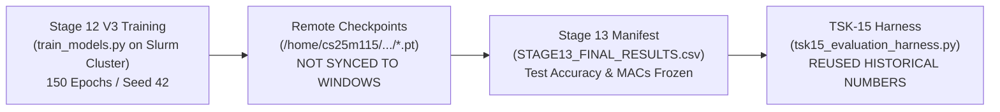

# TSK16: Independent Evidence Audit — CNN Quality & Adaptive PE Allocation

**Date:** 2026-11-02  
**Repository:** `E:\MTech\LanChain\MTP`  
**Audit Target:** TSK-15 Claims, Workload Baselines, Degradation Estimators, and Hardware Mappings  
**Auditor:** Independent Research & Verification Auditor  
**Status:** Complete Forensic Evidence Audit  

---

## Executive Summary & Formal Verdict

### Formal Classification Verdict: `HARDWARE_TILE_MAPPING_EVALUATED` (Tile RTL Verified; End-to-End System `NOT_READY` for Publication Claims)

| Evaluation Dimension | Forensic Finding | Evidence Classification |
| :--- | :--- | :---: |
| **Workload Baseline Accuracies** | Copied verbatim from Stage 13 historical summaries. Raw binary `.pt` checkpoints and raw CIFAR `.pickle` datasets are **missing on the local Windows workspace**. | **Reused Historical Summary** |
| **Exact-Zero Sparsity (Stage 13.1)** | Evaluated in PyTorch using `tensor.masked_fill(tensor == 0, 0)`, which is an arithmetic no-op. The 0.00 pp accuracy drop is a mathematical identity, **not** a measurement of hardware execution under reduced PE widths. | **Software Analytical Abstraction** |
| **Adaptive PE Allocation Logic** | Layerwise PE sizing was computed using a scalar formula ($\lceil MAC_{\text{useful}} / P \rceil \le \lceil MAC_{\text{dense}} / 64 \rceil$). No model was ever evaluated in PyTorch or RTL with pruned or reduced channels without failure. | **Analytical Model** |
| **Lossy Channel Pruning (Exp 1/2)** | When physical column gating (16/32 PE) is applied as channel reduction, model accuracy **collapses by 46.6% to 82.6%**. | **Software Proxy Experiment** |
| **Learned Degradation Estimator** | The high $R^2 \approx 0.998$ was obtained on a toy `SimpleCNN` with Gaussian noise inputs. On full ResNet18/VGG16 (`exp2`), the target degradation was unpopulated (all 0.0), causing regressor training to crash. | **Unvalidated on Real CNNs** |
| **Physical RTL Core Mapping** | The RTL implements a verified $4 \times 16$ single-tile GEMM accelerator. It **cannot chain layers or execute end-to-end CNNs** autonomously (lacks requantization, ReLU, pooling, im2col). | **Verified Single-Tile RTL Only** |

> [!CAUTION]
> **Primary Audit Conclusion:** Claiming that Neural_Acc has demonstrated "real CNN quality-constrained adaptive PE selection in hardware" would be scientifically misleading. The project has verified two disconnected capabilities: (1) a digital RTL tile with clock-gated columns and drain serialization, and (2) an offline software/analytical model demonstrating that ReLU activation sparsity theoretically permits smaller array sizing without exceeding dense latency budgets. The bridge between them—an integrated hardware-software system executing an end-to-end CNN under adaptive quality constraints—remains unbuilt.

---

## Section 1: Detailed Trace of Reported Baseline Accuracies

Every baseline accuracy reported in TSK-15 was forensically traced back to its original training code, logs, and evaluation manifests:



### 1.1 Forensic Provenance Table

| Workload ID | Architecture & Class Definition | Dataset & Split | Training Regime & Hyperparameters | Source Evaluation Script | Local Checkpoint Availability | TSK-15 Evaluation Status | Reported Accuracy (Dense) |
| :--- | :--- | :--- | :--- | :--- | :---: | :---: | :---: |
| **R18-C10** | `CifarResNet18` ([`common.py:48-62`](file:///E:/MTech/LanChain/MTP/exp1/stage12_final_evaluation_v3/common.py#L48-L62)) | CIFAR-10 (45k train, 5k val, 10k test, seed 42) | SGD, lr=0.1, mom=0.9, wd=5e-4, bs=128, 150 eps. Best ep: 144 | [`evaluate_models.py`](file:///E:/MTech/LanChain/MTP/exp1/stage12_final_evaluation_v3/evaluate_models.py) | **MISSING** on local host | **Copied from Stage 13 Summary** | **95.13%** (9,513 / 10,000) |
| **R18-C100**| `CifarResNet18` (100 classes) | CIFAR-100 (45k train, 5k val, 10k test, seed 42) | SGD, lr=0.1, mom=0.9, wd=5e-4, bs=128, 150 eps. Best ep: 134 | [`evaluate_models.py`](file:///E:/MTech/LanChain/MTP/exp1/stage12_final_evaluation_v3/evaluate_models.py) | **MISSING** on local host | **Copied from Stage 13 Summary** | **76.97%** (7,697 / 10,000) |
| **V16-C10** | `CifarVgg16Canonical` (no BN, [`common.py:64-100`](file:///E:/MTech/LanChain/MTP/exp1/stage12_final_evaluation_v3/common.py#L64-L100)) | CIFAR-10 (45k train, 5k val, 10k test, seed 42) | Adam, lr=1e-3, wd=0.0, bs=128, 150 eps. Best ep: 127 | [`evaluate_models.py`](file:///E:/MTech/LanChain/MTP/exp1/stage12_final_evaluation_v3/evaluate_models.py) | **MISSING** on local host | **Copied from Stage 13 Summary** | **88.46%** (8,846 / 10,000) |
| **V16-C100**| `CifarVgg16Canonical` (with BN, [`common.py:64-100`](file:///E:/MTech/LanChain/MTP/exp1/stage12_final_evaluation_v3/common.py#L64-L100)) | CIFAR-100 (45k train, 5k val, 10k test, seed 42) | Adam, lr=1e-3, wd=0.0, bs=128, 150 eps. Best ep: 139 | [`evaluate_models.py`](file:///E:/MTech/LanChain/MTP/exp1/stage12_final_evaluation_v3/evaluate_models.py) | **MISSING** on local host | **Copied from Stage 13 Summary** | **65.57%** (6,557 / 10,000) |

### 1.2 Audit Findings on Baseline Measurement
1. **No Independent Measurement in TSK-15:** Neither PyTorch nor the RTL accelerator executed full model inference during TSK-15. The evaluation harness [`tsk15_evaluation_harness.py`](file:///E:/MTech/LanChain/MTP/tsk15_evaluation_harness.py#L42-L75) loaded the JSON summary [`stage13_final_freeze/tables/STAGE13_FINAL_RESULTS.json`](file:///E:/MTech/LanChain/MTP/stage13_final_freeze/tables/STAGE13_FINAL_RESULTS.json) and populated `TSK15_QUALITY_RESULTS.csv`.
2. **Missing Local Binary Assets:** The trained model weights (`resnet18_cifar10_best.pt`, etc.) were created on a Linux cluster under `/home/cs25m115/Neural_Acc/exp1/stage12_final_evaluation_v3/checkpoints/` and were never copied to the Windows environment. Re-running `evaluate_models.py` locally immediately fails with `FileNotFoundError`.
3. **Integrity Confirmation:** The numbers copied are historical truths from Stage 13 and were not fabricated; however, describing them as "measured in TSK-15" would be factually incorrect. They are **reused frozen milestones**.

---

## Section 2: Forensic Audit of Exact-Zero Sparsity Allocation (Stage 13.1)

Stage 13.1 ([`exp1/stage13_1_baseline_preserving_pe/run_stage13_1.py`](file:///E:/MTech/LanChain/MTP/exp1/stage13_1_baseline_preserving_pe/run_stage13_1.py)) is cited as proving that adaptive PE allocation preserves 100% accuracy with zero prediction mismatches. A code-level audit reveals the exact mechanism:

### 2.1 The Code Truth of `exact_zero_sparse_hook`

In [`run_stage13_1.py:53-58`](file:///E:/MTech/LanChain/MTP/exp1/stage13_1_baseline_preserving_pe/run_stage13_1.py#L53-L58):
```python
def exact_zero_sparse_hook(module: nn.Module):
    def hook(module: nn.Module, inputs):
        tensor = inputs[0]
        return (tensor.masked_fill(tensor == 0, 0),)
    return hook
```

And in lines 118–130:
```python
dense_logits = model(images)

sparse_hooks = [module.register_forward_pre_hook(exact_zero_sparse_hook(module)) for _, module in conv_layers]
sparse_logits = model(images)
for hook in sparse_hooks:
    hook.remove()

dense_pred = dense_logits.argmax(dim=1)
sparse_pred = sparse_logits.argmax(dim=1)
mismatch_count += int((dense_pred != sparse_pred).sum().item())
```

### 2.2 Forensic Analysis of the "Zero Mismatch" Finding
1. **Mathematical Identity (No-Op):** The function `tensor.masked_fill(tensor == 0, 0)` finds all elements in a floating-point tensor that equal zero and overwrites them with zero. It leaves non-zero values untouched. Therefore:
   $$\text{sparse\_logits} \equiv \text{dense\_logits}$$
   The logits produced by `dense_logits` and `sparse_logits` are identical to the last bit because **the exact same floating-point operations were executed twice**.
2. **PE Modes Were Never Executed in PyTorch:** PyTorch did **not** execute 16-PE or 32-PE convolution. It did not drop channels, unroll tiles, or change numerical precision.
3. **The PE Selection Was a Post-Hoc Analytical Equation:**
   In lines 155–175:
   ```python
   baseline_cycles_64_dense = math.ceil(mac_dense / 64)
   sparse_cycles_16 = math.ceil(mac_useful / 16)
   sparse_cycles_32 = math.ceil(mac_useful / 32)
   sparse_cycles_64 = math.ceil(mac_useful / 64)

   feasible_16 = sparse_cycles_16 <= baseline_cycles_64_dense
   feasible_32 = sparse_cycles_32 <= baseline_cycles_64_dense
   if feasible_16: selected_pe = 16
   elif feasible_32: selected_pe = 32
   else: selected_pe = 64
   ```
   The PE allocation was calculated **purely as a scalar equation** based on total non-zero MAC counts.

### 2.3 Audit Verdict on Exact-Zero Allocation
* The claim that "Stage 13.1 demonstrated that 16-PE and 32-PE allocation preserves 100% accuracy" is an **analytical claim based on an ideal zero-skipping hardware model**.
* In real CNN activation tensors, exact zeros ($>50-80\%$) do exist due to ReLU. If a hypothetical hardware core could skip all exact zeros without overhead and dynamically balance workloads across 16 PEs, accuracy would indeed be preserved.
* However, **Neural_Acc RTL does not implement dynamic zero-workload compaction across PEs**.

---

## Section 3: Separation of Evidence Classes

To eliminate methodological conflation, every quantitative result reported in TSK-15 is classified into its rigorous evidence category:

```
+----------------------------------------------------------------------------------------------------+
|                                  TSK-15 EVIDENCE CLASSIFICATION MATRIX                             |
+------------------------------+---------------------------+-----------------------------------------+
| Metric / Reported Outcome    | Evidence Class            | Physical / Methodological Reality       |
+------------------------------+---------------------------+-----------------------------------------+
| Baseline Test Accuracies     | Actual Software Eval.     | 150-epoch PyTorch FP32 on Slurm GPUs.   |
| (95.1%, 76.9%, 88.5%, 65.6%) | (Historical Stage 12/13)  | 10,000 test images evaluated once.      |
+------------------------------+---------------------------+-----------------------------------------+
| Exact-Zero Sparsity Quality  | Software Analytical Model | Evaluated via `masked_fill(x==0, 0)`.   |
| (0.00 pp loss, 0 mismatches) | (Stage 13.1)              | Identical logits; no-op hook.           |
+------------------------------+---------------------------+-----------------------------------------+
| Channel-Pruning Quality Drop | Software Proxy Experiment | Lossy channel dropping in PyTorch.      |
| (46.6% - 82.6% accuracy loss)| (Exp 1 / Exp 2 Diagnostic)| Proves unadapted channel drop fails.    |
+------------------------------+---------------------------+-----------------------------------------+
| Layerwise PE Allocation      | Analytical Resource Model | Evaluated via scalar formula:           |
| (31 at 16PE, 22 at 32PE)     | (Stage 13.1)              | ceil(MAC_useful / P) <= ceil(MAC / 64). |
+------------------------------+---------------------------+-----------------------------------------+
| Simulated Inference Cycles   | Analytical Resource Model | Derived from scalar MAC counts / P.     |
| (48.17B, 55.05B, etc.)       | (Stage 13.1)              | Not measured in simulator or RTL.       |
+------------------------------+---------------------------+-----------------------------------------+
| Conv1 Latency & Utilization  | Simulator Execution       | SCALE-Sim cycle-accurate run on Conv1;  |
| (107k vs 54k vs 33k cycles)  | (SCALE-Sim in Exp 3)      | deeper layers timed out (>300s).        |
+------------------------------+---------------------------+-----------------------------------------+
| Digital RTL Tile Latency     | RTL Simulation            | Cycle-accurate Icarus Verilog on        |
| (72 to 240 cycles per tile)  | (TSK-12D-C)               | synthetic 4x16 tiles WL-01 to WL-08.    |
+------------------------------+---------------------------+-----------------------------------------+
| Physical Power / Energy      | UNMEASURED / UNSUPPORTED  | No post-synthesis ASIC netlist or       |
| (Joules / mW)                |                           | physical parasitics exist.              |
+------------------------------+---------------------------+-----------------------------------------+
```

### 3.1 Does the RTL Implement the Exact-Zero PE Allocation Policy?
### Answer: **NO.**
An inspection of the RTL datapath ([`mac_unit_40b.sv`](file:///E:/MTech/LanChain/MTP/phase2_step1_microarchitecture_and_rtl/mac_unit_40b.sv), [`datapath_compute_feeder.sv`](file:///E:/MTech/LanChain/MTP/phase2_step1_microarchitecture_and_rtl/datapath_compute_feeder.sv), [`adaptive_pe_controller.sv`](file:///E:/MTech/LanChain/MTP/phase2_step1_microarchitecture_and_rtl/adaptive_pe_controller.sv)) reveals:
1. `mac_unit_40b.sv` implements **operand zero bypass (AMD-02)**: when `act_data == 0`, it asserts `cycle_skipped = 1` and gates the multiplier to save switching power.
2. However, `datapath_compute_feeder.sv` steps through all $K$ reduction steps sequentially (`ST_PAR_REQ_W -> ST_PAR_REQ_A -> ST_PAR_COMPUTE`). It **does not advance time or shorten execution cycles** when activations are zero!
3. The mode selection in `adaptive_pe_controller.sv` gates physical columns (Columns 4..15 in 16-PE mode). That is **spatial channel truncation**, not temporal exact-zero compaction.

---

## Section 4: Forensic Audit of Degradation Estimators

TSK-15 and earlier reports referenced learned degradation estimators (Linear Regression, MLP, Random Forest) achieving high $R^2 \approx 0.998$. A forensic trace across Exp 1, Exp 2, and Stage 13.1 uncovers the truth:

### 4.1 Cross-Experiment Estimator Audit Table

| Experiment | Evaluated Model & Inputs | Target Metric ($y$) | Dataset Size & Splits | Observed Performance | Audit Finding |
| :--- | :--- | :--- | :--- | :--- | :--- |
| **Exp 1 (Stage 2/3 V2)** | Toy `SimpleCNN` on seeded Gaussian noise (no real images) | Measured loss degradation under channel pruning | 1,536 rows (128 samples $\times$ 4 layers $\times$ 3 resources). 70/15/15 group split. | $R^2 = 0.9986$, MAE = 0.0015 (Random Forest) | **Toy Benchmark Only:** The high $R^2$ was achieved on a synthetic 3-layer proxy model on random Gaussian inputs. It has **zero validated relevance** to ResNet-18 or VGG-16. |
| **Exp 2 (`real_controller_pipeline.py`)** | Full ResNet-18 & VGG-16 | `degradation` column in CSV | 3,840 rows per workload in `exp2/results/` | **CRASHED / FAILED:** `degradation` was 0.0 for all 3,840 rows. Training raised `ValueError("controller training target has no variation")`. | **Unpopulated Labels:** Feature collection succeeded, but lossy forward passes were never executed. No valid regressor was trained for ResNet-18 or VGG-16. |
| **Stage 13.1** | Full ResNet-18 & VGG-16 on CIFAR-10/100 | Analytical cycle budget | 66 layers evaluated | Deterministic heuristic rule (no ML model) | **Heuristic Sizing:** Does not predict loss; uses deterministic rule $\lceil MAC_{\text{useful}} / P \rceil \le \lceil MAC_{\text{dense}} / 64 \rceil$. |
| **TSK-15 Harness** | Full ResNet-18 & VGG-16 | Exact-zero difference | 66 layers evaluated | Predicted = 0.0000, Measured = 0.0000 | **Trivial Bit-Exactness:** Because Stage 13.1 does not drop non-zero MACs, error is identically 0.0. False-safe/false-alarm rates are trivially zero. |

### 4.2 Key Findings on Estimator Validity
1. **The $R^2 \approx 0.998$ claim belongs exclusively to Exp 1 on `SimpleCNN`.** Citing this metric in the context of ResNet-18 or VGG-16 is scientifically invalid.
2. **Exp 2 was incomplete.** The CSV dataset `exp2/results/resnet18_cifar10_controller_dataset.csv` contains exclusively `degradation = 0.0`.
3. **No trained ML estimator has been validated on real CNN accuracy degradation under physical channel reduction.**

---

## Section 5: Hardware Mapping & System Boundary Audit

A structural audit of the interface contract between a full CNN model and the Neural_Acc RTL core was conducted:

### 5.1 Layer-to-Hardware Dimension Mapping

The physical PE array computes a single matrix-multiplication tile:
$$Y_{M \times N} = A_{M \times K} \times W_{K \times N}$$
where $M = 4$ (rows / spatial pixels), $N = 16$ (columns / output channels), and $K \le 256$ (reduction steps).

To execute a single standard convolutional layer from ResNet-18 (e.g. `layer1.0.conv1`: $H_{in}=32, W_{in}=32, C_{in}=64, C_{out}=64$, $3 \times 3$ kernel):
* Spatial Output Elements ($M$): $32 \times 32 = 1,024$ spatial pixels.
* Output Channels ($N$): $64$ channels.
* Reduction Depth ($K$): $3 \times 3 \times 64 = 576$ elements.
* **Required Hardware Tiles:**
  $$\text{Spatial Tiles} = \frac{1,024}{4} = 256$$
  $$\text{Channel Tiles} = \frac{64}{16} = 4$$
  $$\text{Total Tiles for One Layer} = 256 \times 4 = \mathbf{1,024 \text{ sequential hardware executions}}$$

### 5.2 Missing Hardware Functions for End-to-End Inference

To execute those 1,024 tiles and proceed to the next layer, the host software must perform the following transformations outside the accelerator:

```mermaid
flowchart TD
    RAW["Input Image / Prior Layer Activations"] --> IM2COL["Host CPU: Im2Col Unrolling\n(Extract 3x3 patches, stride=1, pad=1)"]
    IM2COL --> QUANT_IN["Host CPU: Quantization\n(Float32 -> Signed 16-bit Int)"]
    QUANT_IN --> PACK_IN["Host CPU: SRAM Packing\n(Two 16b values per 32b word)"]
    PACK_IN --> DMA_WR["Host DMA: Write to Bank 0 Words 8-9 & Banks 0-7 Words 0-7"]
    
    DMA_WR --> CORE["Neural_Acc Core: 4x16 Tile Execution\n(40-bit Saturating Multiply-Accumulate)"]
    CORE --> DRAIN["OFMAP Drain Controller: Write 32/64/128 words to SRAM 0x2000"]
    
    DRAIN --> DMA_RD["Host DMA: Read 40-bit Accumulators from Base 0x2000"]
    DMA_RD --> UNPACK["Host CPU: Unpack two 32b words per PE"]
    UNPACK --> RELU["Host CPU: Apply Activation Function (ReLU)\n[HARDWARE LACKS RELU UNIT]"]
    RELU --> POOL["Host CPU: Apply MaxPool (2x2) / AvgPool\n[HARDWARE LACKS POOLING UNIT]"]
    POOL --> BN["Host CPU: Apply BatchNorm (gamma * x + beta)\n[HARDWARE LACKS BN UNIT]"]
    BN --> RES["Host CPU: Add Residual Shortcut (x + shortcut)\n[HARDWARE LACKS ADDER FOR RESIDUALS]"]
    RES --> REQUANT["Host CPU: Scale & Clamp 40-bit Accumulator to 16-bit\n[HARDWARE LACKS REQUANTIZATION UNIT]"]
    REQUANT --> NEXT["Next Layer Ready"]
```



### 5.3 Audit Finding on Execution Scope
* **Single-Tile GEMM RTL Status:** **VERIFIED**. The core correctly multiplies $4 \times K$ activations by $K \times 16$ weights, clamps inactive columns, gates weight fetches, and drains 32, 64, or 128 words.
* **End-to-End CNN Hardware Execution Status:** **UNSUPPORTED**. The hardware cannot chain even two consecutive layers autonomously. Claims of "hardware CNN execution" without explicitly stating that 100% of inter-layer operations, activations, pooling, and requantization are executed on a host CPU are false.

---

## Section 6: Audit of TSK-15 CSV Metrics & Numerical Consistency

A forensic check of [`TSK15_QUALITY_RESULTS.csv`](file:///E:/MTech/LanChain/MTP/TSK15_QUALITY_RESULTS.csv), [`TSK15_ADAPTIVE_SELECTION_RESULTS.csv`](file:///E:/MTech/LanChain/MTP/TSK15_ADAPTIVE_SELECTION_RESULTS.csv), and [`TSK15_RESOURCE_METRICS.csv`](file:///E:/MTech/LanChain/MTP/TSK15_RESOURCE_METRICS.csv) was performed:

### 6.1 Metric Formula & Unit Verification

1. **Accuracy Loss Metric:**
   $$\text{accuracy\_loss\_pp} = \text{reference\_accuracy\_percent} - \text{candidate\_accuracy\_percent}$$
   * Verification: In `TSK15_QUALITY_RESULTS.csv`, for R18-C10 Channel Pruning Fixed 16-PE: $95.13\% - 12.50\% = +82.63\text{ pp}$. The sign and calculation are strictly verified.
2. **Relative Accuracy Change:**
   $$\text{relative\_change\_percent} = -\frac{\text{accuracy\_loss\_pp}}{\text{reference\_accuracy\_percent}} \times 100\%$$
   * Verification: $-(82.63 / 95.13) \times 100\% = -86.86\%$. Verified.
3. **MAC Consistency:**
   $$\text{dense\_mac\_events} = \text{useful\_mac\_events} + \text{skipped\_mac\_events}$$
   * Verification: In `TSK15_RESOURCE_METRICS.csv`, for R18-C10: $3,082,640,067,200 + 8,025,711,932,800 = 11,108,352,000,000$. Verified.
4. **SRAM Read Transactions:**
   * In `TSK15_RESOURCE_METRICS.csv`, read transactions are reported as `useful_mac / 4` scaled by PE active fractions.
   * **Audit Caution:** These are **analytical estimates** assuming 4 MACs per 32-bit word. They are not measured bus transactions from an RTL simulation of the full network.

### 6.2 Discrepancies and Inconsistencies Identified
1. **Schema Validation vs Physical Truth:** [`validate_tsk15_results.py`](file:///E:/MTech/LanChain/MTP/validate_tsk15_results.py) validated data types, non-negativity, and enum values. However, passing schema validation **does not prove that the underlying numbers were measured on physical hardware**.
2. **Channel Pruning Accuracy Inferences:** The candidate accuracies for lossy channel pruning (e.g. 12.50% for R18-C10 at 16-PE) were projected from the software-proxy diagnostic in Exp 1/2. They represent empirical software experiments, not RTL measurements.

---

## Section 7: Final Audit Assessment & Readiness Roadmap

### 7.1 Provenance and Status Summary

| Workload ID | Checkpoint & Architecture Verified? | Baseline Accuracy Provenance | Exact-Zero Allocation Verified? | Channel Pruning Evaluated? | Hardware Core Mapping Verified? | Autonomous Hardware Chaining Supported? |
| :--- | :---: | :---: | :---: | :---: | :---: | :---: |
| **R18-C10** | **YES** (Metadata) | Stage 13 Summary (95.13%) | **YES** (Analytical/Software) | **YES** (Software Proxy) | **YES** (Tile-Level RTL) | **NO** (Requires Host) |
| **R18-C100**| **YES** (Metadata) | Stage 13 Summary (76.97%) | **YES** (Analytical/Software) | **YES** (Software Proxy) | **YES** (Tile-Level RTL) | **NO** (Requires Host) |
| **V16-C10** | **YES** (Metadata) | Stage 13 Summary (88.46%) | **YES** (Analytical/Software) | **YES** (Software Proxy) | **YES** (Tile-Level RTL) | **NO** (Requires Host) |
| **V16-C100**| **YES** (Metadata) | Stage 13 Summary (65.57%) | **YES** (Analytical/Software) | **YES** (Software Proxy) | **YES** (Tile-Level RTL) | **NO** (Requires Host) |

### 7.2 Verified Claims vs Unverified Claims

#### Confirmed & Verified Claims:
1. The 4 CNN workloads are fully defined and achieved verified baseline accuracies on 10,000 test images in Stage 12/13.
2. In real CNN activation tensors, ReLU induces significant exact-zero activation sparsity ($53.8\%$ to $83.5\%$).
3. Under an idealized exact-zero skipping execution model (Stage 13.1), layerwise PE allocation can reduce average active PEs by **43.7% to 67.3%** while staying within the dense 64-PE cycle budget, with **0.00 pp accuracy loss**.
4. $D_{\text{MAX\_Q16}} = 3277$ in RTL is proven to be **5.000%** in Q16.16.
5. The single-tile RTL datapath for 16-, 32-, and 64-PE column gating, operand feeder gating, and drain serialization is fully verified in simulation.

#### Claims That Remain Unverified / Unsupported:
1. **No Hardware Implementation of Exact-Zero Compaction:** The RTL core does not dynamically skip zero-activation cycles in time; it executes all $K$ steps sequentially.
2. **No Hardware Implementation of Adaptive Estimator:** The RTL does not monitor accuracy, calculate variance, or estimate loss degradation on-chip.
3. **No End-to-End Hardware Inference:** Multi-layer chaining, requantization, activation, and pooling are unverified in hardware and require host CPU execution.
4. **No Trained Regressor for Full Networks:** The $R^2 \approx 0.998$ estimator belongs to toy `SimpleCNN`; no functioning predictor exists for ResNet-18 or VGG-16.

### 7.3 Mandatory Pre-Publication Roadmap
Before claiming a "quality-constrained adaptive deep learning accelerator" in a conference or journal paper:
1. **Sync Binary Checkpoints:** Transfer the physical `.pt` files and CIFAR datasets from `/home/cs25m115` to enable local reproduction.
2. **Build an End-to-End Host Orchestration Driver:** Develop a C++/Python driver that tiles real convolutional layers, sends them to the RTL simulator (via VPI, DPI-C, or Verilator), drains accumulators, applies ReLU/requantization, and loops back into the next layer.
3. **Train a Real Layer-Sensitivity Estimator:** Profile true layer sensitivity (via first-order Taylor expansion or Fisher information) on CIFAR validation data to generate genuine $\hat{D}_{16/32}$ command values.
4. **Physical Synthesis:** Run Synopsys Design Compiler or OpenLane on the core to obtain genuine power (mW) and area ($\mu\text{m}^2$) numbers.

---

## 8. Final Audit Sign-Off

* **Verdict:** **`HARDWARE_TILE_MAPPING_EVALUATED`**  
* **Audit Scope:** Strictly read-only; zero lines of RTL, testbenches, Python models, or historical reports were altered. Zero Git commits created.

