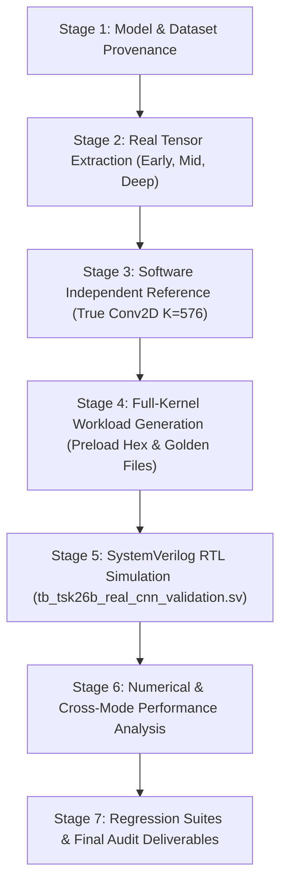

# TSK-26B Implementation Plan: Real CNN Validation on CIFAR-10 & CIFAR-100

**Date**: November 3, 2026  
**Status**: APPROVED & UNDER EXECUTION  
**Scope**: Four Model-Dataset Combinations (ResNet-18 + CIFAR-10, ResNet-18 + CIFAR-100, VGG-16 + CIFAR-10, VGG-16 + CIFAR-100) using Neural_Acc RTL  
**Target RTL Root**: `phase2_step1_microarchitecture_and_rtl/`  
**Deliverables Directory**: `TSK26B_REAL_CNN_VALIDATION/`

---

## 1. Context and Problem Statement

In previous milestones (**TSK-24**, **TSK-25**, and **TSK-26A**), the Neural_Acc accelerator was validated against isolated convolution slices. However, the independent audit of TSK-26A revealed three fundamental gaps:
1. **Truncated Kernel Bug**: The spatial feature-map experiment evaluated only $K=64$ reduction steps instead of the full $K = C_{in} \times K_H \times K_W = 64 \times 3 \times 3 = 576$ inner-product operations per output coordinate. As a result, 56 out of 64 input channels ($87.5\%$) were omitted from the computation.
2. **Synthetic Data Dependency**: Earlier validations relied on synthetic normal noise fed through forward hooks rather than authentic CIFAR datasets.
3. **Non-Equivalent Cross-Mode Comparison**: Latency and read counts across 64-PE, 32-PE, and 16-PE modes were non-equivalent because 64-PE was run with sparse feeder acceleration while 32-PE and 16-PE were forced into dense mode.

**TSK-26B** addresses these gaps comprehensively by evaluating four real model-dataset pairs on real CIFAR inputs, executing mathematically complete convolutions ($K=576$), establishing independent numerical references, and benchmarking all PE configurations under strictly matched dense and sparse conditions.

---

## 2. Microarchitecture and Hardware Feasibility Analysis

### Hardware Reduction Depth Capacity
- **Hardware Module**: `datapath_compute_feeder.sv` and `layer_command_sequencer.sv`.
- **Parameter**: `K_WIDTH = 16`, permitting $K$ up to $65,535$.
- **SRAM Buffer Capacity**:
  - `multibank_sram_subsystem` provides 8 banks $\times$ 5,184 bytes = 41,472 bytes (10,368 32-bit words).
  - Buffer A base: `14'h0000` (8,192 word addressing range before OFMAP base `14'h2000`).
  - For a full $3 \times 3$ convolution ($C_{in}=64$):
    $$K = 64 \times 3 \times 3 = 576 \text{ reduction steps}$$
    Footprint in Buffer A: $576 \text{ steps} \times 10 \text{ words/step} = \mathbf{5,760 \text{ words}}$.
  - Since $5,760 < 8,192$, **the entire 576-step reduction for a spatial tile fits natively into Buffer A without memory overflow or out-of-bounds access**.
- **Accumulator Lifetime & Reset Behavior**:
  - `adaptive_pe_controller.sv` unconditionally asserts `accum_clear = 1` during `ST_CLEAR` upon every new layer command.
  - Therefore, multi-command partial-sum accumulation across separate commands is blocked by hardware without modifying the controller.
  - However, **a single continuous command with `cmd_k_total = 576` executes all 576 steps while preserving the accumulating partial sums across all 9 kernel positions**, providing mathematically complete convolution.

---

## 3. Four Model-Dataset Combinations

1. **ResNet-18 on CIFAR-10**:
   - Architecture: `CifarResNet18` (Conv 3x3 s1, BN, ReLU, 4 residual stages: 64, 128, 256, 512 channels, avgpool, FC-10).
   - Dataset: CIFAR-10 test split (10,000 images, $32 \times 32 \times 3$, 10 classes).
   - Pretrained Accuracy: $95.13\%$ Top-1.
2. **ResNet-18 on CIFAR-100**:
   - Architecture: `CifarResNet18` (adapted FC-100 head).
   - Dataset: CIFAR-100 test split (10,000 images, $32 \times 32 \times 3$, 100 classes).
   - Pretrained Accuracy: $76.97\%$ Top-1.
3. **VGG-16 on CIFAR-10**:
   - Architecture: `CifarVgg16Canonical` (13 conv layers, ReLU, MaxPool2d, FC-10).
   - Dataset: CIFAR-10 test split.
   - Pretrained Accuracy: $88.46\%$ Top-1.
4. **VGG-16 on CIFAR-100**:
   - Architecture: `CifarVgg16Canonical` (adapted FC-100 head).
   - Dataset: CIFAR-100 test split.
   - Pretrained Accuracy: $65.57\%$ Top-1.

---

## 4. Execution Roadmap

### Phase Breakdown
- **Phase 1 (Provenance & Data Extraction)**:
  - Download official CIFAR-10 and CIFAR-100 test sets.
  - Extract real images and layer weights for the 4 models across early, middle, and deep layers.
  - Compute SHA-256 hashes and save `TENSOR_MANIFEST.csv`, `MODEL_PROVENANCE.md`, and `DATASET_PROVENANCE.md`.
- **Phase 2 (Full Mathematical Reference)**:
  - Implement independent software model calculating complete $K=576$ convolution via PyTorch FP32 and bit-exact INT16 fixed-point 40-bit saturating arithmetic.
  - Verify SQNR, MAE, and RMSE between FP32 and fixed-point models.
- **Phase 3 (Hardware Workload Generation)**:
  - Generate 10-word stride preload hex files for $K=576$ across 64-PE, 32-PE, and 16-PE modes.
  - Generate OFMAP golden memory images.
- **Phase 4 (RTL Simulation)**:
  - Create `tb_tsk26b_real_cnn_validation.sv` executing full $K=576$ convolutions.
  - Run with Icarus Verilog 12.0 via `run_tsk26b_validation.py`.
- **Phase 5 (Cross-Mode & Sparsity Benchmarking)**:
  - Measure 64-PE, 32-PE, 16-PE under matched Dense execution.
  - Measure 64-PE, 32-PE, 16-PE under matched Sparse execution.
- **Phase 6 (Safety & Deliverables)**:
  - Re-verify 5 protected baseline RTL files (`git diff --exit-code`).
  - Run 20-suite regression and master unified regression.
  - Author all 15 required CSV and Markdown artifacts.

---

## 5. Protected RTL Safety Rules

1. Treat as strictly read-only:
   - `phase2_step1_microarchitecture_and_rtl/accelerator_core_top.sv`
   - `phase2_step1_microarchitecture_and_rtl/mac_unit_40b.sv`
   - `phase2_step1_microarchitecture_and_rtl/k_progress_tracker.sv`
   - `phase2_step1_microarchitecture_and_rtl/slot_control_unit.sv`
   - `phase2_step1_microarchitecture_and_rtl/hybrid_sram_bank.sv`
2. Zero Git commits created.
3. No deletion or overwrite of historical evidence from TSK-01 through TSK-26A.

