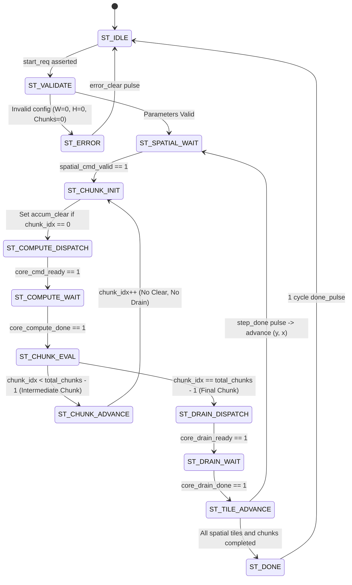

# TSK-27C: Microarchitecture Specification
## Autonomous Spatial Tile Sequencing and Multi-Chunk Accumulation Controller

**Document Version:** 1.0  
**Project:** Neural_Acc: Activation-Sparse CNN Accelerator with Adaptive PE Allocation  
**Module:** `tsk27c_spatial_accumulation_controller.sv`  

---

## 1. Architectural Architecture Overview

In deep convolutional layers with large input channel depths ($K = C_{in} \times K_h \times K_w > K_{max\_tile}$), reductions must be partitioned into multiple chunks without spilling intermediate partial sums to external memory or clearing the physical MAC accumulators between chunks.

[`tsk27c_spatial_accumulation_controller.sv`](file:///e:/MTech/LanChain/MTP/TSK27C_SPATIAL_ACCUMULATION_INTEGRATION/tsk27c_spatial_accumulation_controller.sv) provides a synthesizable integration layer that couples:
1. **Outer Spatial Sequencer (`spatial_tile_sequencer.sv`):** Manages 2D $(y, x)$ coordinate progression, boundary rollover, and SRAM pointer tracking.
2. **Inner Chunk Accumulation Engine:** Manages multi-pass $K$-reductions ($chunk\_idx = 0 .. N_{chunks}-1$), selective accumulator clearing, intermediate chunk continuation, and final OFMAP draining.

```
                  ┌──────────────────────────────────────────────────────────────┐
                  │          tsk27c_spatial_accumulation_controller              │
                  │                                                              │
   start_req      │  ┌──────────────────────────┐                                │
  ───────────────►│  │  spatial_tile_sequencer  │                                │
   cfg_grid_w     │  │                          │                                │
  ───────────────►│  │  • 2D (x, y) Counter     │                                │
   cfg_grid_h     │  │  • SRAM Address Pointer  │                                │
  ───────────────►│  └────────────┬─────────────┘                                │
   cfg_chunks     │               │ cmd_valid                                    │
  ───────────────►│               ▼                                              │
                  │  ┌──────────────────────────┐                                │
                  │  │ Inner Chunk Reduction FSM│                                │
                  │  │                          │                                │
                  │  │  • chunk_idx counter     │                                │ core_accum_clear
                  │  │  • is_first_chunk check  ├────────────────────────────────┼─────────────────►
                  │  │  • is_last_chunk check   │                                │ core_compute_start
                  │  │  • drain trigger gating  ├────────────────────────────────┼─────────────────►
                  │  └────────────┬─────────────┘                                │ core_drain_req
                  │               │ step_done (after final chunk drain)          ├─────────────────►
                  │               ▼                                              │
                  └──────────────────────────────────────────────────────────────┘
```

---

## 2. Inner Chunk FSM State Machine



### 2.1 State Descriptions
1. **`ST_IDLE`:** Quiescent state. Accepts configuration and `start_req`.
2. **`ST_VALIDATE`:** Enforces parameter bounds: $W_{out} \ge 1$, $H_{out} \ge 1$, and $N_{chunks} \ge 1$.
3. **`ST_SPATIAL_WAIT`:** Awaits spatial tile dispatch from `spatial_tile_sequencer.sv`.
4. **`ST_CHUNK_INIT`:** Evaluates current `chunk_idx`:
   - If `chunk_idx == 0`: Asserts `core_accum_clear = 1` for 1 cycle.
   - If `chunk_idx > 0`: Holds `core_accum_clear = 0` (preserves running sum).
5. **`ST_COMPUTE_DISPATCH`:** Asserts `core_compute_start = 1` to downstream compute datapath. Holds until accepted.
6. **`ST_COMPUTE_WAIT`:** Awaits `core_compute_done` from the datapath feeder/slot tracker.
7. **`ST_CHUNK_EVAL`:** Inspects chunk reduction progress:
   - **Intermediate Chunk ($chunk\_idx < N_{chunks}-1$):** Transitions to `ST_CHUNK_ADVANCE`. Suppresses OFMAP drain completely.
   - **Final Chunk ($chunk\_idx == N_{chunks}-1$):** Transitions to `ST_DRAIN_DISPATCH`.
8. **`ST_CHUNK_ADVANCE`:** Increments `chunk_idx <= chunk_idx + 1` and updates memory chunk offsets.
9. **`ST_DRAIN_DISPATCH`:** Asserts `core_drain_req = 1` to the OFMAP drain controller.
10. **`ST_DRAIN_WAIT`:** Awaits `core_drain_done` confirming that all accumulated outputs were transferred to Buffer B.
11. **`ST_TILE_ADVANCE`:** Asserts `spatial_step_done = 1` to advance `spatial_tile_sequencer` to the next $(y, x)$ coordinate, resetting `chunk_idx <= 0`.
12. **`ST_DONE`:** Asserts `done_pulse = 1` and clears `busy`.

---

## 3. Accumulator Preservation Timing Protocol

```
                  Chunk 0 (First Chunk)          Chunk 1 (Intermediate)         Chunk 2 (Final Chunk)
CLK            : ──┌─┐─┌─┐─┌─┐─┌─┐─┌─┐─┌─┐─────┌─┐─┌─┐─┌─┐─┌─┐─┌─┐─┌─┐───────┌─┐─┌─┐─┌─┐─┌─┐─┌─┐─┌─┐──
chunk_idx      : ──X             0             X             1             X             2          ──
core_accum_clr : ──┌─────┐─────────────────────────────────────────────────────────────────────────────
                   │     │ (Cleared to 0)
core_compute_st: ─────┌─────┐─────────────────────┌─────┐─────────────────────┌─────┐──────────────────
core_compute_dn: ─────────────────┌─────┐─────────────────────┌─────┐─────────────────────┌─────┐───────
core_drain_req : ───────────────────────────────────────────────────────────────────┌─────────┐────────
                                                                                    │ (1 Drain Exactly)
core_drain_done: ─────────────────────────────────────────────────────────────────────────┌─────┐───────
spatial_advance: ─────────────────────────────────────────────────────────────────────────┌─────┐───────
                                                                                          (Advance x, y)
```

1. **Clear Assertion:** Exactly 1 pulse asserted at the start of Chunk 0. Zero clear pulses for all subsequent chunks.
2. **Drain Assertion:** Exactly 1 drain request issued after Chunk $N-1$ compute finishes. Zero drain pulses on intermediate chunks.
3. **Partial Sum Safety:** Physical MAC accumulators retain intermediate product sums across chunk boundaries without spilling or reset.

