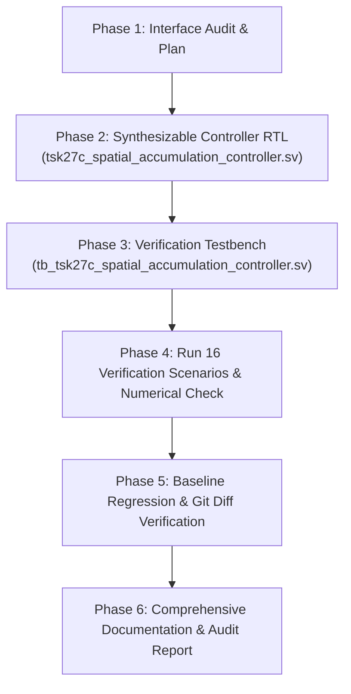

# TSK-27C: Integration and Verification Plan
## Autonomous Spatial Sequencing and Multi-Chunk Accumulation Controller

**Milestone Identifier:** TSK-27C  
**Project:** Neural_Acc: Activation-Sparse CNN Accelerator with Adaptive PE Allocation  
**Status:** In Progress (Planning Phase Complete)  

---

## 1. Objectives & Scope

1. **Non-Protected Integration Layer (`tsk27c_spatial_accumulation_controller.sv`):**
   - Reuse `spatial_tile_sequencer.sv` for 2D spatial coordinate advancement $(y, x)$.
   - Introduce an inner reduction chunk sequencer:
     $$chunk\_idx \in [0, N_{chunks}-1]$$
   - Implement clear gating: `accum_clear` asserted strictly during `chunk_idx == 0`.
   - Implement drain gating: `drain_req` asserted strictly during `chunk_idx == N_{chunks}-1`.
   - Implement intermediate chunk continuation: When `chunk_idx < N_{chunks}-1`, compute completion directly transitions to the next chunk without triggering drain or losing partial sums.

2. **Handshake and Control Protocol:**
   - Spatial coordinates advance strictly after the final chunk's drain completes.
   - Downstream backpressure stalls chunk progression and coordinate advancement.
   - Start-while-busy requests are cleanly rejected via `busy_reject`.
   - Abort requests terminate active execution into a deterministic error state.

3. **Numerical Verification:**
   - Instantiate actual hardware MAC units (`mac_unit_40b`) to execute a 3-chunk reduction (Chunk 0, Chunk 1, Chunk 2) in hardware.
   - Validate bit-exact equivalence against an independent Python/SystemVerilog fixed-point golden model covering positive/negative operands, zero inputs, cancellation, and accumulator headroom.

4. **Safety & Baseline Preservation:**
   - Strictly 0 modifications to all 5 protected baseline RTL files.
   - Zero Git commits.
   - Full 20-suite regression execution with 0 failures.

---

## 2. Step-by-Step Implementation Roadmap

### Detailed Phase Tasks

- [x] **Task 1: Repository & Interface Audit:** Completed and documented in `TSK27C_INTERFACE_AUDIT.md`.
- [ ] **Task 2: Architecture Specification:** Author `ARCHITECTURE.md` with state machines and timing diagrams.
- [ ] **Task 3: Synthesizable Controller RTL:** Implement `tsk27c_spatial_accumulation_controller.sv` integrating `spatial_tile_sequencer.sv`.
- [ ] **Task 4: Dedicated Testbench:** Implement `tb_tsk27c_spatial_accumulation_controller.sv` covering all 16 required test scenarios:
  1. 1x1 spatial grid with 1 reduction chunk.
  2. 2x2 grid with 1 reduction chunk.
  3. 2x2 grid with multiple reduction chunks ($N=3$).
  4. 3x2 grid with multiple reduction chunks ($N=2$).
  5. Accumulator clearing asserted only on Chunk 0.
  6. Accumulator preservation across intermediate chunks (Chunks 1..N-2).
  7. Output draining requested only after final chunk (Chunk N-1).
  8. Backpressure during spatial advancement.
  9. Backpressure during intermediate chunks.
  10. Backpressure during final output draining.
  11. Start while busy lockout and reject flag.
  12. Invalid dimensions ($W=0$ or $H=0$).
  13. Invalid chunk count ($N_{chunks}=0$).
  14. Abort handling during intermediate chunk.
  15. Asynchronous reset during active operation.
  16. Consecutive back-to-back operations.
- [ ] **Task 5: 3-Chunk Numerical Hardware Verification:**
  - Feed real signed INT16 operands into hardware MACs.
  - Accumulate Chunk 0 + Chunk 1 + Chunk 2.
  - Verify 0 mismatches against reference mathematical model.
- [ ] **Task 6: Export Results & Baseline Regressions:**
  - Export `TSK27C_RESULTS.csv`.
  - Run full `run_regression.py` across all 20 existing suites.
  - Verify `git diff --exit-code` on protected files.
- [ ] **Task 7: Final Documentation:**
  - Author `README.md`, `TSK27C_LIMITATIONS.md`, `FINAL_AUDIT_REPORT.md`, and conversation artifact.

