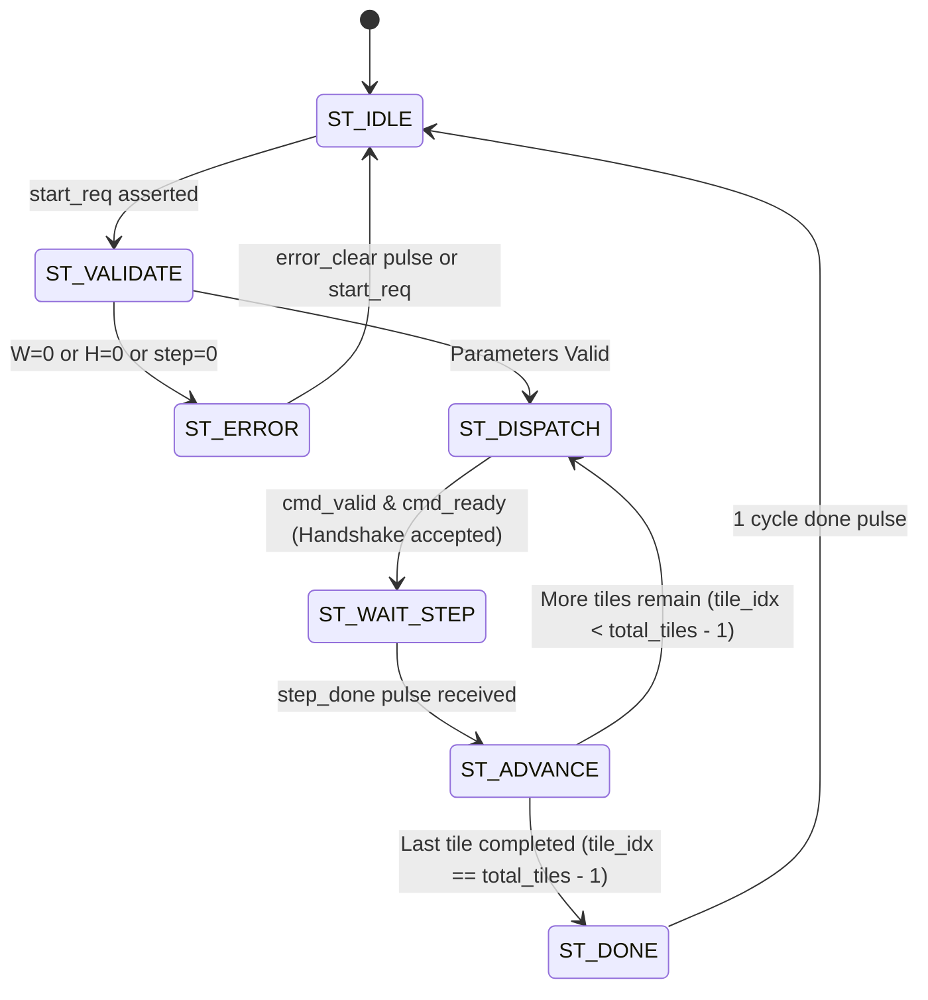
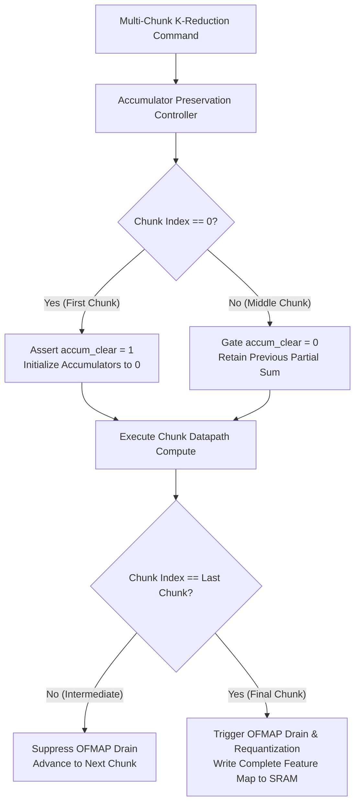

# TSK-27A: Microarchitecture Specification
## Autonomous Spatial Tile Sequencer & Accumulator Preservation Architecture

**Document Version:** 1.0  
**Author:** Neural_Acc Engineering Team  
**Scope:** Standalone Spatial Sequencer, Command Protocol, Accumulator Lifetime, and Preservation Proposals  

---

## 1. System Overview and Architectural Problem

In preceding milestones (TSK-24 through TSK-26C), spatial coordinate loops and tile command dispatch were orchestrated externally by the host software driver or SystemVerilog testbench. For an $H_{out} \times W_{out}$ feature map:
- The host issued an individual command via `cmd_valid / cmd_ready` for every spatial position or row-group.
- Between each spatial command, the accelerator completed its compute and OFMAP drain cycles.
- The host explicitly computed memory base addresses, loaded input vectors into SRAM, and coordinated the progression of coordinates $(x, y)$.

```
[Host / Testbench Driver]
   │
   ├─► Compute Address for Tile (y, x)
   ├─► Issue cmd_valid ───► [layer_command_sequencer]
   ├─► Wait for layer_done_pulse
   ├─► Advance (y, x) coordinate
   └─► Repeat for H_out x W_out tiles (High Host Overhead)
```

**Milestone TSK-27A** introduces hardware-autonomous spatial scheduling via `spatial_tile_sequencer.sv`. The host issues a **single configuration and start pulse**, after which the sequencer iterates through the entire 2D spatial grid without host intervention:

```
[Host System]
   │
   └─► Single START (W_out, H_out, Base Addrs, Strides)
            │
            ▼
   ┌──────────────────────────────────────────────────────────────┐
   │                 spatial_tile_sequencer.sv                    │
   │                                                              │
   │  • Nested Coordinate Counters: (y = 0..H-1, x = 0..W-1)      │
   │  • Autonomous Address Generation (IFMAP / OFMAP pointers)    │
   │  • Robust Ready/Valid Handshake with Downstream Core         │
   │  • Step Completion Tracking & Coordinate Rollover            │
   │  • Busy Lockout, Invalid Configuration & Error Diagnostics  │
   └──────────────────────────────┬───────────────────────────────┘
                                  │
                                  ├─► cmd_valid / cmd_ready
                                  ├─► current_x, current_y
                                  ├─► current_ifmap_addr, current_ofmap_addr
                                  ▼
                     [Downstream Accelerator Core]
```

---

## 2. Microarchitecture of `spatial_tile_sequencer.sv`

### 2.1 Interface Signal Definitions

```
                     ┌──────────────────────────────────┐
                     │     spatial_tile_sequencer       │
   clk               │                                  │
  ──────────────────►│                                  │
   rst_n             │                                  │
  ──────────────────►│                                  │
                     │                                  │
   -- Config & Ctrl -│                                  │
   start_req         │                                  │
  ──────────────────►│                                  │ busy
   abort_req         │                                  ├─────────────────►
  ──────────────────►│                                  │ done_pulse
   cfg_grid_w [15:0] │                                  ├─────────────────►
  ──────────────────►│                                  │ error_flag
   cfg_grid_h [15:0] │                                  ├─────────────────►
  ──────────────────►│                                  │ error_code [3:0]
   cfg_step_x [7:0]  │                                  ├─────────────────►
  ──────────────────►│                                  │
   cfg_step_y [7:0]  │                                  │ current_x [15:0]
  ──────────────────►│                                  ├─────────────────►
   cfg_base_ifmap    │                                  │ current_y [15:0]
  ──────────────────►│                                  ├─────────────────►
   cfg_base_ofmap    │                                  │ current_tile_idx
  ──────────────────►│                                  ├─────────────────►
   cfg_stride_ifmap_x│                                  │ total_tiles_count
  ──────────────────►│                                  ├─────────────────►
   cfg_stride_ifmap_y│                                  │
  ──────────────────►│                                  │
   cfg_stride_ofmap  │                                  │
  ──────────────────►│                                  │
                     │                                  │
   -- Downstream Cmd │                                  │
   cmd_ready         │                                  │ cmd_valid
  ──────────────────►│                                  ├─────────────────►
   step_done         │                                  │ cmd_tile_idx
  ──────────────────►│                                  ├─────────────────►
                     │                                  │ cmd_ifmap_addr
                     │                                  ├─────────────────►
                     │                                  │ cmd_ofmap_addr
                     │                                  ├─────────────────►
                     │                                  │ cmd_last_tile
                     │                                  ├─────────────────►
                     └──────────────────────────────────┘
```

### 2.2 FSM State Machine

The module implements a 7-state Moore/Mealy hybrid FSM:



1. **`ST_IDLE`:** Quiescent state. Accepts `start_req`. If `start_req` arrives while already busy, asserts `busy_reject` and remains in state.
2. **`ST_VALIDATE`:** Verifies that $W_{out} > 0$, $H_{out} > 0$, and step parameters $\ge 1$. Computes total tiles:
   $$\text{tiles\_x} = \lceil W_{out} / \text{step\_x} \rceil, \quad \text{tiles\_y} = \lceil H_{out} / \text{step\_y} \rceil, \quad \text{total\_tiles} = \text{tiles\_x} \times \text{tiles\_y}$$
3. **`ST_DISPATCH`:** Asserts `cmd_valid = 1` along with current coordinates, addresses, and `cmd_last_tile` flag. Holds until `cmd_ready = 1`.
4. **`ST_WAIT_STEP`:** Deasserts `cmd_valid`. Awaits `step_done` pulse from the downstream accelerator core indicating current tile completion.
5. **`ST_ADVANCE`:** Increments horizontal coordinate:
   $$x_{next} = x + \text{step\_x}$$
   If $x_{next} \ge W_{out}$, rolls over:
   $$x_{next} = 0, \quad y_{next} = y + \text{step\_y}$$
   Updates IFMAP and OFMAP address pointers and increments `tile_idx`.
6. **`ST_DONE`:** Pulses `done_pulse = 1` for exactly 1 clock cycle and returns to `ST_IDLE`.
7. **`ST_ERROR`:** Holds error code and error flag until cleared.

---

## 3. Accumulator Lifetime and Preservation Audit

### 3.1 Root Causes of Partial Sum Loss in Existing RTL

Our code inspection of the existing microarchitecture identified two independent points where accumulators are unconditionally cleared:

#### A. In `mac_unit_40b.sv` (Protected Baseline)
```verilog
always_ff @(posedge clk or negedge rst_n) begin
    if (!rst_n) begin
        accum_out <= '0;
    end else begin
        if (accum_clear) begin
            accum_out <= '0;
        end else if (enable && !bypass_mac) begin
            accum_out <= sum_41[ACCUM_WIDTH-1:0];
        end
    end
end
```
- **Discovery:** The arithmetic MAC unit natively supports partial sum accumulation! If `accum_clear` is deasserted, it adds new products directly to the existing accumulator value.
- **Limitation:** It clears whenever the external input signal `accum_clear` is asserted.

#### B. In `slot_control_unit.sv` (Protected Baseline)
```verilog
ST_ALLOCATED: begin
    accum_clear = 1'b1; // Unconditional 1-cycle clear
    state_d = ST_COMPUTING;
end
```
- On every slot allocation, `slot_control_unit` unconditionally asserts `accum_clear = 1'b1`.
- It has no input port to suppress clearing.

#### C. In `adaptive_pe_controller.sv`
```verilog
ST_CLEAR: begin
    accum_clear = 1'b1;
    sat_clear   = 1'b1;
    state_d     = ST_COMPUTE;
end
```
- Whenever a layer command starts, `adaptive_pe_controller` unconditionally asserts `accum_clear = 1'b1`.

#### D. In `layer_command_sequencer.sv`
- Every completed compute command automatically transitions to `ST_DRAIN`.
- Draining transfers accumulator values to Buffer B. If an intermediate reduction chunk drains, it writes partial sums into memory prematurely.

### 3.2 Accumulator Preservation Architecture Proposal

To support multi-chunk reduction across large $K$ ($K > K_{max\_tile}$) without modifying protected baseline RTL:



1. **`cmd_accum_preserve` Control Flag:**
   A 1-bit qualification flag indicating that the current command is a continuation of a prior reduction chunk.
2. **`accum_clear` Gate:**
   $$\text{effective\_accum\_clear} = \text{pe\_array\_accum\_clear} \ \& \ (\neg \text{cmd\_accum\_preserve})$$
3. **Selective Drain Enable:**
   OFMAP drain and requantization are triggered only when `is_last_k_chunk == 1'b1`. Intermediate chunks bypass the drain state and directly pulse `step_done`.

---

## 4. Hardware/Software Partition Summary

| Feature | Pre-TSK-27 Implementation | TSK-27 Autonomous Sequencer | Fully Autonomous Accelerator |
| :--- | :--- | :--- | :--- |
| **Spatial Loop Sequencing** | Host / Testbench Python loop | **Hardware `spatial_tile_sequencer`** | Hardware `spatial_tile_sequencer` |
| **Coordinate Rollover** | Host software | **Hardware FSM (`ST_ADVANCE`)** | Hardware FSM |
| **Address Generation** | Host precomputes base addresses | **Hardware Pointer Computation** | Hardware Pointer Computation |
| **Command Handshake** | Host generates valid for each pixel | **Hardware Autonomous Dispatch** | Hardware Autonomous Dispatch |
| **K-Chunk Accumulation** | Single-pass K only ($K \le 576$) | Proposal defined & audited | Hardware Accumulator Preservation |
| **OFMAP Draining** | Post-command drain | Supported per spatial step | Pipelined with next spatial fetch |

