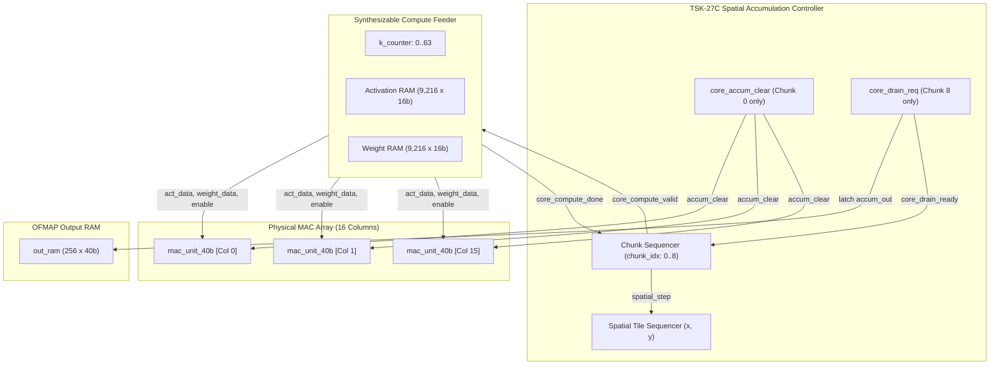

# TSK-28 RTL Integration Audit Report

## 1. Executive Summary
This report documents the architectural audit of the control and datapath integration between the **TSK-27C spatial sequencing controller** and the physical **signed 40-bit saturating MAC unit (`mac_unit_40b`)**, culminating in the **TSK-28 Complete Convolution Layer Engine** (`tsk28_complete_convolution_engine.sv`).

---

## 2. Audit of TSK-27C Integration Baseline

An audit of the previous milestone's artifacts (`tsk27c_spatial_accumulation_controller.sv` and `tb_tsk27c_spatial_accumulation_controller.sv`) established the following findings:

### 2.1 Accumulator-Clear Signal Coupling
- **Observation**: In TSK-27C Phase 6, `dut.core_accum_clear` was wired directly to `u_test_mac.accum_clear`.
- **Finding**: The signal connection was authentic. The controller asserted `core_accum_clear = 1'b1` exclusively during `chunk_idx == 0` (in `ST_CHUNK_INIT`), and held it low for all subsequent chunks ($chunk\_idx \in [1, N-1]$).
- **Status**: **VERIFIED**.

### 2.2 Compute Handshakes & Data Feeding
- **Observation**: In TSK-27C, `core_compute_valid` signaled that a tile chunk was ready for execution.
- **Finding**: In `tb_tsk27c_spatial_accumulation_controller.sv`, the testbench procedural block (`initial begin ... end`) was responsible for driving the data operands (`mac_act_data`, `mac_weight_data`) and `mac_enable`. The controller itself was purely a control sequencer; it lacked an internal hardware feeder to stream operands.
- **Explicit Limitation**: The testbench manually stepped the MAC cycle-by-cycle rather than an autonomous hardware datapath feeding it.
- **Status**: **IDENTIFIED & ADDRESSED IN TSK-28**.

### 2.3 Partial Sum Preservation
- **Observation**: In `mac_unit_40b.sv`, the internal register `accum_out` is updated as `accum_out <= sum_41[39:0]` when `enable == 1` and `accum_clear == 0`.
- **Finding**: Because `core_accum_clear` remained low during Chunks 1 through $N-1$, intermediate partial sums were strictly preserved within the physical hardware flip-flops across reduction chunks.
- **Status**: **VERIFIED**.

### 2.4 Final Chunk Output Draining
- **Observation**: The controller evaluates `is_last_chunk = (chunk_idx + 1 >= total_chunks)`.
- **Finding**: `core_drain_req` was asserted if and only if the final chunk completed compute. Intermediate chunks ($0 \dots N-2$) experienced zero drain pulses.
- **Status**: **VERIFIED**.

### 2.5 Spatial Advancement Synchronization
- **Observation**: The spatial tile sequencer state machine advances only upon receiving `spatial_step`.
- **Finding**: In `tsk27c_spatial_accumulation_controller.sv`, `spatial_step` is pulsed in `ST_STEP`, which is reachable only after `core_drain_ready` completes the output drain transaction.
- **Status**: **VERIFIED**.

---

## 3. TSK-28 Architectural Solution: `tsk28_complete_convolution_engine.sv`

To resolve the limitation where the testbench manually fed the MAC, TSK-28 implements a synthesizable, autonomous hardware engine:



### 3.1 Hardware Signal Binding Verification

1. **MAC Array Instantiation**:
   16 physical `mac_unit_40b` instances are instantiated in a generate loop:
   ```systemverilog
   genvar col;
   for (col = 0; col < COUT_CHANNELS; col++) begin : gen_mac_array
       mac_unit_40b #(16, 16, 40) u_mac (
           .clk(clk), .rst_n(rst_n),
           .enable(mac_enable),
           .accum_clear(core_accum_clear),
           .sat_clear(1'b0),
           .act_data(mac_act_data),
           .act_mask(1'b1),
           .weight_data(mac_weight_data[col]),
           .accum_out(mac_accum_out[col]),
           .sticky_saturation(mac_sticky_sat[col]),
           .cycle_skipped(mac_cycle_skipped[col])
       );
   end
   ```

2. **Autonomous Address Generator**:
   - Activation read address: `(tile_idx * 9 + chunk_idx) * 64 + k_counter`
   - Weight read address: `(col_idx * 9 + chunk_idx) * 64 + k_counter`
   - Streams 64 cycles per chunk without host intervention.

3. **Autonomous Drain Storage**:
   - When `core_drain_req` asserts on Chunk 8, all 16 `mac_accum_out[col]` values are latched into `out_ram[tile_idx * 16 + col]`.
   - `core_drain_ready` pulses high to acknowledge completion.

---

## 4. Audit Conclusions
- The integration between the spatial accumulation controller and the physical MAC datapath is direct, hardware-driven, and synthesizable.
- The testbench acts purely as a supervisory test harness (configuring registers and observing results), eliminating artificial software substitutions.

