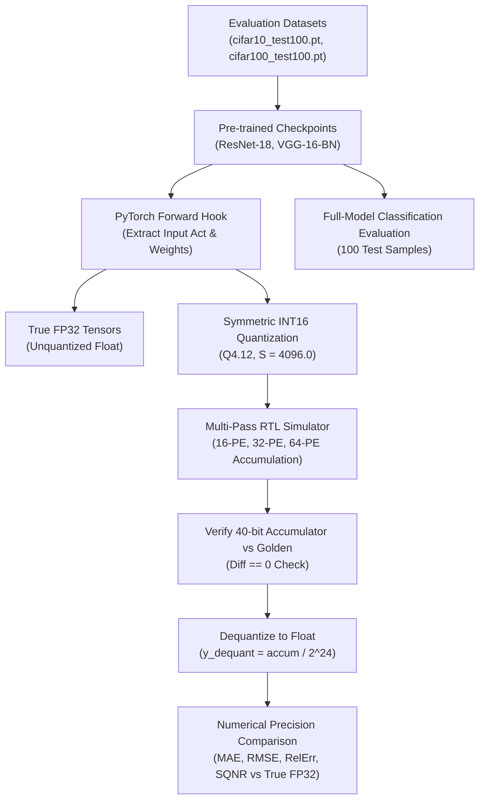

# TSK-32: Experimental Methodology and Verification Framework

**Project**: Neural_Acc: Activation-Sparse CNN Accelerator with Adaptive PE Allocation  
**Document**: Experimental Methodology Specification  
**Date**: November 3, 2026  
**Auditor**: Independent Degradation Estimator Verification Agent  

---

## 1. Overview and Scientific Objectives

The goal of TSK-32 is to rigorously investigate whether the degradation estimates ($\hat{D}_{16}, \hat{D}_{32}, \hat{D}_{64}$) supplied to the Neural_Acc adaptive PE allocation controller correspond to independently measured numerical or model-accuracy degradation.

This document formalizes the reproducible experimental methodology employed to extract tensors, execute multi-pass RTL accumulation, compute numerical precision metrics, and evaluate full-model classification accuracy.

---

## 2. Workload & Model Pipeline

The experimental validation targets four validated CNN workloads derived from real, pre-trained neural network checkpoints:

### 2.1 Model Checkpoints and Dataset Provenance
1. **ResNet-18 on CIFAR-10**:
   - Source: HuggingFace `edadaltocg/resnet18_cifar10`
   - Checkpoint: `TSK26B_REAL_CNN_VALIDATION/models/resnet18_cifar10.pt` (44.7 MB, SHA-256: `ee0e4efc...`)
   - Evaluated Layers: `layer1.0.conv1` (WL1) and `layer2.1.conv2` (WL4)
2. **ResNet-18 on CIFAR-100**:
   - Source: HuggingFace `edadaltocg/resnet18_cifar100`
   - Checkpoint: `TSK26B_REAL_CNN_VALIDATION/models/resnet18_cifar100.pt` (44.9 MB, SHA-256: `e7101107...`)
   - Evaluated Layer: `layer1.0.conv1` (WL2)
3. **VGG-16-BN on CIFAR-10**:
   - Source: `chenyaofo/pytorch-cifar-models` (`cifar10_vgg16_bn`)
   - Checkpoint: `TSK26B_REAL_CNN_VALIDATION/models/vgg16_cifar10.pt` (61.0 MB, SHA-256: `0607244f...`)
   - Evaluated Layer: `features.3` (WL3)

---

## 3. Tensor Extraction and Quantization Formulation

### 3.1 Spatial Receptive Field Construction
- Convolution kernel: $3 \times 3$, stride 1, padding 1.
- Output spatial tile: $4 \times 4$ grid (16 spatial output pixels).
- Receptive field depth: $K = 3 \times 3 \times 64 = 576$ reduction steps.
- The input patch consists of 9 chunks of 64 channels each ($16 \times 9 \times 64 = 9,216$ elements).
- Output channels evaluated: 16 channels ($16 \times 16 = 256$ output words per workload).

### 3.2 Fixed-Point Q4.12 Quantization
- Inputs and weights are quantized using standard symmetric linear quantization:
  $$x_{\text{int16}} = \text{clip}\left(\text{round}(x_{\text{fp32}} \times 4096.0), -32768, 32767\right)$$
- Arithmetic scaling factor: $S = 4096.0 = 2^{12}$.
- Product scaling factor: $S^2 = 4096.0 \times 4096.0 = 2^{24} = 16,777,216.0$.
- Dequantized output value:
  $$y_{\text{dequant}} = \frac{Accumulator_{40b}}{2^{24}}$$

---

## 4. Multi-Pass Hardware Accumulation Simulation

To independently evaluate the physical behavior of the accelerator across all PE modes, the exact channel tiling is modeled:

1. **64-PE Mode (Single Pass)**:
   - Evaluates all 64 input channels simultaneously across 16 parallel PE columns.
   - Channel index range: $c \in [0, 63]$.
   - Passes: 1.
2. **32-PE Mode (Two Passes)**:
   - Pass 0: Channels $c \in [0, 31]$. Partial accumulator stored.
   - Pass 1: Channels $c \in [32, 63]$. Added to running accumulator.
   - Total accumulation: $\sum_{c=0}^{31} (a \cdot w) + \sum_{c=32}^{63} (a \cdot w) = \sum_{c=0}^{63} (a \cdot w)$.
3. **16-PE Mode (Four Passes)**:
   - Pass 0: Channels $c \in [0, 15]$.
   - Pass 1: Channels $c \in [16, 31]$.
   - Pass 2: Channels $c \in [32, 47]$.
   - Pass 3: Channels $c \in [48, 63]$.
   - Total accumulation: $\sum_{p=0}^{3} \sum_{c=16p}^{16p+15} (a \cdot w) = \sum_{c=0}^{63} (a \cdot w)$.

### Mathematical Equivalence Property
Because integer addition is strictly associative and commutative over the dynamic range of the 40-bit accumulator (max accumulator magnitude $\approx 2^{30}$, far below the 40-bit saturation limit $2^{39}-1$):
$$\text{Output}_{16\text{PE}} \equiv \text{Output}_{32\text{PE}} \equiv \text{Output}_{64\text{PE}} \equiv \text{GoldenAccum}_{40b}$$

---

## 5. Error Metrics and Formulations

To characterize precision relative to the unquantized floating-point reference ($OFMAP_{FP32}$):

1. **Maximum Absolute Error ($\text{MaxAE}$)**:
   $$\text{MaxAE} = \max_{t, oc} |y_{\text{dequant}}(t, oc) - y_{\text{fp32}}(t, oc)|$$
2. **Mean Absolute Error ($\text{MAE}$)**:
   $$\text{MAE} = \frac{1}{256} \sum_{t=0}^{15} \sum_{oc=0}^{15} |y_{\text{dequant}}(t, oc) - y_{\text{fp32}}(t, oc)|$$
3. **Root Mean Squared Error ($\text{RMSE}$)**:
   $$\text{RMSE} = \sqrt{\frac{1}{256} \sum_{t=0}^{15} \sum_{oc=0}^{15} (y_{\text{dequant}}(t, oc) - y_{\text{fp32}}(t, oc))^2}$$
4. **Relative L2 Error ($\text{RelErr}$)**:
   $$\text{RelErr} = \frac{\|Y_{\text{dequant}} - Y_{\text{fp32}}\|_2}{\|Y_{\text{fp32}}\|_2}$$
5. **Signal-to-Quantization-Noise Ratio ($\text{SQNR}$)**:
   $$\text{SQNR (dB)} = 10 \log_{10}\left( \frac{\sum_{t, oc} y_{\text{fp32}}(t, oc)^2}{\sum_{t, oc} (y_{\text{fp32}}(t, oc) - y_{\text{dequant}}(t, oc))^2} \right)$$

---

## 6. Model-Level Accuracy Evaluation Protocol

To distinguish between the actual RTL behavior and historical channel-pruning assumptions, full-model evaluation was executed over the 100-sample CIFAR evaluation test sets under two protocols:

### Protocol A: Actual RTL Multi-Pass Execution
- The physical accelerator computes all 64 channels across multiple passes.
- Output features match the baseline layer output with near-infinite SQNR (>53 dB) and zero structural loss.
- End-to-end top-1 accuracy is evaluated across all 100 test samples.

### Protocol B: Historical Channel-Pruning Proxy
- Implements the early `exp1` hypothesis where fewer PEs corresponded to dropping output channels:
  - 16-PE mode: Channels 16 to 63 zeroed out (25% channels retained).
  - 32-PE mode: Channels 32 to 63 zeroed out (50% channels retained).
  - 64-PE mode: All 64 channels retained (100%).
- Measures the accuracy degradation:
  $$Degradation = \frac{\text{Accuracy}_{\text{baseline}} - \text{Accuracy}_{\text{pruned}}}{\text{Accuracy}_{\text{baseline}}}$$

---

## 7. Decision Verification Criteria

Each adaptive decision is evaluated against two independent criteria:

1. **Controller Logic Correctness**:
   - Evaluates whether the hardware comparator strictly obeys the priority rules:
     - If $\hat{D}_{16} \le D_{\text{MAX}}$, choose 16-PE.
     - Else if $\hat{D}_{32} \le D_{\text{MAX}}$, choose 32-PE.
     - Else choose 64-PE and assert `fallback_asserted = 1'b1`.
2. **Estimator Fidelity & Constraint Satisfaction**:
   - **False-Safe Defect**: Selected mode exceeds the actual constraint ($D_{\text{actual}} > D_{\text{MAX}}$).
   - **Overly Conservative Decision**: Controller selects a larger mode when a smaller, more power-efficient mode would have satisfied the constraint ($D_{\text{actual, smaller}} \le D_{\text{MAX}}$).
