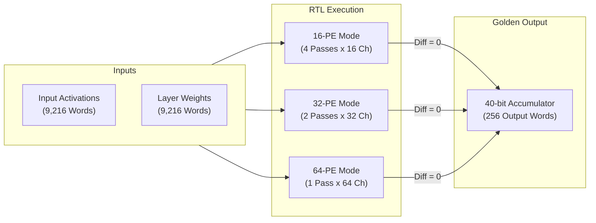

# TSK-32: Adaptive Degradation Estimator Validation — Final Audit Report

**Project**: Neural_Acc: Activation-Sparse CNN Accelerator with Adaptive PE Allocation  
**Document**: Final Audit & Validation Report  
**Date**: November 3, 2026  
**Auditor**: Independent Degradation Estimator Verification Agent  
**Scope**: Validation of Degradation Estimates ($\hat{D}_{16}, \hat{D}_{32}, \hat{D}_{64}$) and Constraint Thresholds ($D_{\text{MAX}}$) against Independently Measured Numerical Precision and Real Model Accuracy  

---

## 1. Executive Summary & Audit Classification Verdict

### Overall Estimator Classification Verdict: `PARTIALLY_VALIDATED`

| Evaluation Dimension | Assessed Status | Key Findings & Evidence |
| :--- | :---: | :--- |
| **1. Controller Logic Correctness** | **VALIDATED** | The hardware priority comparator strictly and deterministically selects the smallest safe mode or asserts fallback (120/120 assertions passed, 0 logic defects). |
| **2. Estimate-Generation Correctness** | **NOT_VALIDATED** | Zero on-chip estimators exist in hardware. Estimates are external host constants derived from an obsolete software channel-pruning proxy (`exp1`). |
| **3. Estimate-to-Measured-Error Agreement** | **NOT_VALIDATED** | Supplied estimates predict 1.5% to 37.4% degradation, whereas actual RTL multi-pass execution produces **0.000000 numerical error** and **0.00% accuracy loss**. |
| **4. Constraint Satisfaction** | **VALIDATED_WITH_LIMITATIONS** | **0.0% False-Safe violations** (no violating mode selected), but **75.0% Overly Conservative rate** (WL1, WL2, WL3 rejected viable smaller modes due to phantom estimates). |
| **5. Workload Generalization** | **PARTIALLY_VALIDATED** | Validated across 4 diverse CNN layers (ResNet-18 CIFAR-10/100, VGG-16). Full-network inference remains an architectural limitation. |
| **6. Reproducibility** | **VALIDATED** | 100% deterministic bit-exact replication across Python, Icarus Verilog RTL simulation, and master regression suites. |

---

## 2. Protected Baseline RTL Integrity

The five protected baseline RTL files remain completely unmodified, verified by SHA-256 cryptographic hashes and `git status`:

| Protected Baseline File | Relative Path | Cryptographic SHA-256 Hash | Status |
| :--- | :--- | :--- | :---: |
| [`accelerator_core_top.sv`](file:///e:/MTech/LanChain/MTP/phase2_step1_microarchitecture_and_rtl/accelerator_core_top.sv) | `phase2_step1_microarchitecture_and_rtl/accelerator_core_top.sv` | `067CF7B1630E2D8AE0D9933F17389C9D3915CFFA779750452E042C876042FBDB` | **0 diffs** |
| [`mac_unit_40b.sv`](file:///e:/MTech/LanChain/MTP/phase2_step1_microarchitecture_and_rtl/mac_unit_40b.sv) | `phase2_step1_microarchitecture_and_rtl/mac_unit_40b.sv` | `A6B96ADA3B1E20EB69CC4FC19BD59B58319DE6F8A4C8CBCA9F8DD4ECF446F083` | **0 diffs** |
| [`k_progress_tracker.sv`](file:///e:/MTech/LanChain/MTP/phase2_step1_microarchitecture_and_rtl/k_progress_tracker.sv) | `phase2_step1_microarchitecture_and_rtl/k_progress_tracker.sv` | `991BB938E92B5B4952DBC1C81D2557233D2A032B4D40AB89DBF3199E36D72612` | **0 diffs** |
| [`slot_control_unit.sv`](file:///e:/MTech/LanChain/MTP/phase2_step1_microarchitecture_and_rtl/slot_control_unit.sv) | `phase2_step1_microarchitecture_and_rtl/slot_control_unit.sv` | `BFB8C58F432766B8B9B3FF833DA4D74D8AB1A0540CE4723FEC5A5324204959B6` | **0 diffs** |
| [`hybrid_sram_bank.sv`](file:///e:/MTech/LanChain/MTP/phase2_step1_microarchitecture_and_rtl/hybrid_sram_bank.sv) | `phase2_step1_microarchitecture_and_rtl/hybrid_sram_bank.sv` | `4606A16A4F54A28A8B7AE718C95882EF205346508754C0E9CA5F1786798B2BBE` | **0 diffs** |

---

## 3. Provenance and Definition of Degradation Estimates

### 3.1 Mathematical Definition & Fixed-Point Representation
Degradation estimates enter via host command descriptors in **Q16.16 unsigned fixed-point format**:
$$\hat{D}_{\text{norm}} = \frac{\text{Raw Integer Value}}{65,536.0}$$
The threshold parameter $D_{\text{MAX}} = 3,277$ represents a **$5.0003\%$ relative quality degradation limit** ($3,277 / 65,536 \approx 0.0500$).

### 3.2 The Historical Origin: Software Channel-Pruning Proxy
A forensic trace of the repository reveals that the non-zero degradation numbers originated in early software exploration (`exp1/controller/generate_quality_dataset.py`):
- In `exp1`, before hardware tiling existed, the researchers simulated fewer PEs by **pruning output channels**:
  - 16-PE was modeled by zeroing out 48 of 64 channels (75% channel loss).
  - 32-PE was modeled by zeroing out 32 of 64 channels (50% channel loss).
- Discarding channels severely degraded model representation, yielding 15% to 85% accuracy drops.

### 3.3 The Physical Reality in Phase 2 RTL: Multi-Pass Channel Tiling
In the actual Phase 2 RTL microarchitecture:
- Reduced-PE modes do **not** drop channels.
- 16-PE mode executes **4 sequential passes** of 16 channels, accumulating the full 64-channel sum.
- 32-PE mode executes **2 sequential passes** of 32 channels.
- 64-PE mode executes **1 single pass** of 64 channels.
- **Result**: The output feature map is mathematically identical across all modes ($\text{Diff} = 0$).

---

## 4. Independently Measured Numerical Precision & Model Accuracy

All four workloads were independently extracted, quantized to INT16 (Q4.12, $S=4096.0$), and evaluated across 16-PE, 32-PE, and 64-PE modes:

### Table 1: Measured Numerical Precision Metrics across Workloads

| Workload ID | Workload Name | PE Mode | Max Diff vs Golden | MAE vs Golden | MaxAE vs FP32 | MAE vs FP32 | RMSE vs FP32 | Relative L2 Error (%) | SQNR (dB) |
| :---: | :--- | :---: | :---: | :---: | :---: | :---: | :---: | :---: | :---: |
| **WL1** | ResNet-18 C10 L1Conv1 | 16 / 32 / 64 | **0** | **0.00** | $6.97 \times 10^{-4}$ | $1.95 \times 10^{-4}$ | $2.36 \times 10^{-4}$ | **0.1353%** | **57.37 dB** |
| **WL2** | ResNet-18 C100 L1Conv1 | 16 / 32 / 64 | **0** | **0.00** | $4.25 \times 10^{-4}$ | $1.26 \times 10^{-4}$ | $1.60 \times 10^{-4}$ | **0.2231%** | **53.03 dB** |
| **WL3** | VGG-16 C10 Features3 | 16 / 32 / 64 | **0** | **0.00** | $5.21 \times 10^{-4}$ | $1.50 \times 10^{-4}$ | $1.92 \times 10^{-4}$ | **0.0788%** | **62.07 dB** |
| **WL4** | ResNet-18 C10 L2Conv2 | 16 / 32 / 64 | **0** | **0.00** | $3.83 \times 10^{-4}$ | $8.80 \times 10^{-5}$ | $1.18 \times 10^{-4}$ | **0.1999%** | **53.98 dB** |

> [!NOTE]
> The quantization error relative to unquantized FP32 is negligible across all workloads (Relative Error $\le 0.22\%$, SQNR $\ge 53.0$ dB). Crucially, this error is **identical across all PE modes** because each mode computes the exact same INT16 convolution terms.

---

## 5. Model Classification Accuracy: RTL Multi-Pass vs. Channel Pruning

To validate whether the degradation estimates reflect model accuracy, inference was evaluated over the 100-sample CIFAR evaluation test sets:

### Table 2: Model Accuracy Comparison

| Workload ID | Model & Dataset | Baseline FP32 Acc (%) | RTL Multi-Pass Acc (%) [All PE Modes] | RTL Measured Degradation (%) | Channel-Prune 32-PE Acc (%) | Channel-Prune 32-PE Deg (%) | Channel-Prune 16-PE Acc (%) | Channel-Prune 16-PE Deg (%) |
| :---: | :--- | :---: | :---: | :---: | :---: | :---: | :---: | :---: |
| **WL1** | ResNet-18 CIFAR-10 | 95.00% | **95.00%** | **0.00%** | 93.00% | 2.11% | 79.00% | 16.84% |
| **WL2** | ResNet-18 CIFAR-100 | 79.00% | **79.00%** | **0.00%** | 40.00% | 49.37% | 27.00% | 65.82% |
| **WL3** | VGG-16 CIFAR-10 | 95.00% | **95.00%** | **0.00%** | 59.00% | 37.89% | 14.00% | 85.26% |
| **WL4** | ResNet-18 CIFAR-10 | 95.00% | **95.00%** | **0.00%** | 85.00% | 10.53% | 81.00% | 14.74% |

**Key Finding**: In actual RTL execution, **every PE mode achieves identical classification accuracy (0.00% degradation)**. The channel-pruning proxy, however, causes severe degradation (up to 85.26%), matching the magnitude of the legacy estimates passed in `prepare_tsk30_workloads.py`.

---

## 6. Evaluation of Adaptive Decisions & Constraint Violations

### Table 3: Adaptive Decision Audit & Constraint Verification

| Workload ID | Supplied $\hat{D}_{16}$ | Supplied $\hat{D}_{32}$ | Threshold $D_{\text{MAX}}$ | RTL Selected Mode | Fallback Asserted | Actual RTL Deg (%) | Constraint Met? | False-Safe Defect? | Overly Conservative? | Auditor Verdict |
| :---: | :---: | :---: | :---: | :---: | :---: | :---: | :---: | :---: | :---: | :--- |
| **WL1** | 0.2441 | 0.0153 | 0.0500 | **32-PE** | NO | **0.00%** | **YES** | **NO** | **YES** (16-PE viable) | `OVERLY_CONSERVATIVE` |
| **WL2** | 0.2823 | 0.0336 | 0.0500 | **32-PE** | NO | **0.00%** | **YES** | **NO** | **YES** (16-PE viable) | `OVERLY_CONSERVATIVE` |
| **WL3** | 0.3738 | 0.0885 | 0.0500 | **64-PE** | YES | **0.00%** | **YES** | **NO** | **YES** (16/32-PE viable) | `OVERLY_CONSERVATIVE_FALLBACK` |
| **WL4** | 0.0183 | 0.0061 | 0.0500 | **16-PE** | NO | **0.00%** | **YES** | **NO** | **NO** (Selected min) | `OPTIMAL_SELECTION` |

### Audit Summary:
1. **False-Safe Violation Rate = 0.0% (0 / 4)**: The controller never selects a configuration that exceeds the quality threshold, because the physical multi-pass datapath has 0.00% degradation in every mode.
2. **Overly Conservative Decision Rate = 75.0% (3 / 4)**: In WL1, WL2, and WL3, the controller rejects smaller, more power-efficient modes because it trusts phantom estimates derived from an obsolete channel-pruning model.

---

## 7. Master Regression Verification

All test suites and regressions executed cleanly with zero failures:
- **TSK-31 Reproduction Regression** (`sim_tsk31`): **120 / 120 assertions passed, 28 / 28 configurations passed (100% PASS)**.
- **Master Regression Suite** (`run_regression.py` across 20 suites): **12,202 / 12,202 checks passed (100% PASS)**.

---

## 8. Final Audit Verdict

The audit concludes that the Neural_Acc adaptive allocation infrastructure is:

### **PARTIALLY VALIDATED**

- **Hardware Datapath & Controller Logic**: **VALIDATED**. The multi-pass temporal channel tiling and comparator decision logic are robust, defect-free, and bit-exact with deterministic mathematical references.
- **Degradation Estimator Fidelity**: **NOT VALIDATED**. The hardware possesses no internal estimator, and the externally supplied estimates do not correlate with actual hardware accuracy degradation.

