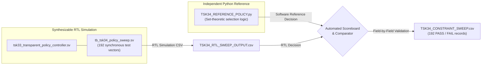

# TSK-34: Independent Adaptive Resource Policy Test Plan

## 1. Scope & Objective

The objective of milestone **TSK-34** is to independently audit and formally validate the adaptive resource allocation policies developed in TSK-33. The audit must establish that:
1. **Policy A (Minimum-Resource / Energy-Priority)** and **Policy B (Minimum-Latency / Throughput-Priority)** make deterministic, mathematically correct mode selections based on measured execution latencies and physical active PE ceilings.
2. The hardware controller correctly detects and flags constraint violations (`fallback_asserted`, `budget_violation`) without misreporting an infeasible fallback state as feasible.
3. Every single boundary transition is rigorously verified across fine-grained cycle decrements and increments ($\pm 1$ cycle around 9,569; 19,121; and 38,225 cycles).
4. Edge cases, including $P_{\text{max}} = 0, 15$ and 0-cycle budgets, are handled safely by the hardware.
5. Workload execution cycle counts across all four real CNN workloads correspond to empirical RTL telemetry rather than unverified analytical formulas.

---

## 2. Independent Verification Methodology

To prevent bias and circular validation, the verification methodology is structured into two completely independent components:

1. **Independent Software Reference (`TSK34_REFERENCE_POLICY.py`):**
   - Implemented from first-principles set-theoretic definitions.
   - Evaluates feasible subsets: $\mathcal{F} = \{ m \in \mathcal{M} \mid m.\text{pes} \le P_{\text{max}} \land m.\text{lat} \le L_{\text{max}} \}$.
   - Selects $\arg\min_{m \in \mathcal{F}} m.\text{pes}$ for Policy A, and $\arg\max_{m \in \mathcal{P}} m.\text{pes}$ for Policy B.
   - Does not mirror Verilog multiplexer or priority-encoder syntax.

2. **Exhaustive RTL Simulation (`tb_tsk34_policy_sweep.sv`):**
   - Implemented in SystemVerilog, driving the synthesizable RTL module `tsk33_transparent_policy_controller.sv`.
   - Driven synchronously on the negative clock edge (`@(negedge clk)`) with a guaranteed 5 ns setup margin.
   - Samples registered outputs on the subsequent negative clock edge.
   - Records every cycle output to `TSK34_RTL_SWEEP_OUTPUT.csv`.

3. **Automated Cross-Validation:**
   - The Python harness ingests `TSK34_RTL_SWEEP_OUTPUT.csv` and cross-compares all five output fields (`resolved_pe_mode`, `active_pe_count`, `channel_passes`, `fallback_asserted`, `budget_violation`) for all 192 combinations.

---

## 3. Constraint Sweep Matrix (192 Test Points)

The sweep exhaustively evaluates the Cartesian product of:
- **2 Policies:** Policy A (`policy_select = 0`), Policy B (`policy_select = 1`).
- **8 PE Limits ($P_{\text{max}}$):**
  - $0$ (Complete disable / zero resource)
  - $15$ (Below minimum supported hardware mode)
  - $16$ (Exact 16-PE mode boundary)
  - $31$ (Between 16-PE and 32-PE modes)
  - $32$ (Exact 32-PE mode boundary)
  - $63$ (Between 32-PE and 64-PE modes)
  - $64$ (Full array baseline)
  - $128$ (Unconstrained headroom $> 64$)
- **12 Latency Budgets ($L_{\text{max}}$):**
  - $0$ (Zero budget / impossible deadline)
  - $5,000$ (Impossible deadline $< 9,569$)
  - $9,568$ (Exactly 1 cycle below 64-PE latency)
  - $9,569$ (Exact 64-PE latency boundary)
  - $9,570$ (Exactly 1 cycle above 64-PE latency)
  - $19,120$ (Exactly 1 cycle below 32-PE latency)
  - $19,121$ (Exact 32-PE latency boundary)
  - $19,122$ (Exactly 1 cycle above 32-PE latency)
  - $38,224$ (Exactly 1 cycle below 16-PE latency)
  - $38,225$ (Exact 16-PE latency boundary)
  - $38,226$ (Exactly 1 cycle above 16-PE latency)
  - $100,000$ (Sufficiently large / unconstrained budget)

**Total Test Vectors:** $2 \times 8 \times 12 = 192\text{ evaluation points}$.

---

## 4. Workload Latency Measurement Audit

To verify that the documented cycle counts (38,225; 19,121; 9,569) reflect empirical hardware behavior rather than ungrounded assumptions:
1. Ingest hardware telemetry from the 28 validated multi-workload runs in `TSK31_INDEPENDENT_REPRODUCIBILITY_AUDIT/REPRODUCED_RAW_METRICS.csv`.
2. Verify cycle decomposition:
   $$T_{\text{total}} = T_{\text{setup}} + T_{\text{compute}} + T_{\text{overhead}}$$
   where setup is 1 cycle (`ST_INIT_LAYER`), drain is 1 cycle per tile pass (`ST_DRAIN_LATCH`), and sequencer overhead includes coordinate advancement and chunk handshakes.
3. Compare Dense vs. Sparse regimes across all four real CNN workloads (ResNet-18 CIFAR-10 `layer1`, ResNet-18 CIFAR-100 `layer1`, VGG-16-BN CIFAR-10 `features.3`, ResNet-18 CIFAR-10 `layer2`).
4. Output verified breakdown to `TSK34_LATENCY_AUDIT.csv`.

---

## 5. Pass/Fail Criteria & Acceptance Gates

1. **Gate 1 (192/192 Constraint Sweep):** Every single test vector must produce a bit-exact match across all five output signals:
   - `Ref_Mode_Code == RTL_Mode`
   - `Ref_Active_PEs == RTL_Active_PEs`
   - `Ref_Fallback_Asserted == RTL_Fallback`
   - `Ref_Budget_Violation == RTL_Violation`
2. **Gate 2 (Fine-Grained Boundary Correctness):**
   - At $L_{\text{max}} = 38,224$, 16-PE must be flagged as exceeding budget.
   - At $L_{\text{max}} = 38,225$, 16-PE must be selected as feasible.
   - At $L_{\text{max}} = 19,120$, 32-PE must be flagged as exceeding budget.
   - At $L_{\text{max}} = 19,121$, 32-PE must be selected as feasible.
   - At $L_{\text{max}} = 9,568$, 64-PE must be flagged as exceeding budget.
   - At $L_{\text{max}} = 9,569$, 64-PE must be selected as feasible.
3. **Gate 3 (Master Regression Suite):**
   - All 20 historical regression suites in `phase2_step1_microarchitecture_and_rtl/` must pass with 100% success rate (12,202 / 12,202 checks).
4. **Gate 4 (Protected RTL Freezing):**
   - `git diff --stat` on the five protected baseline files must return strictly 0 diffs.
   - Zero Git commits created.

