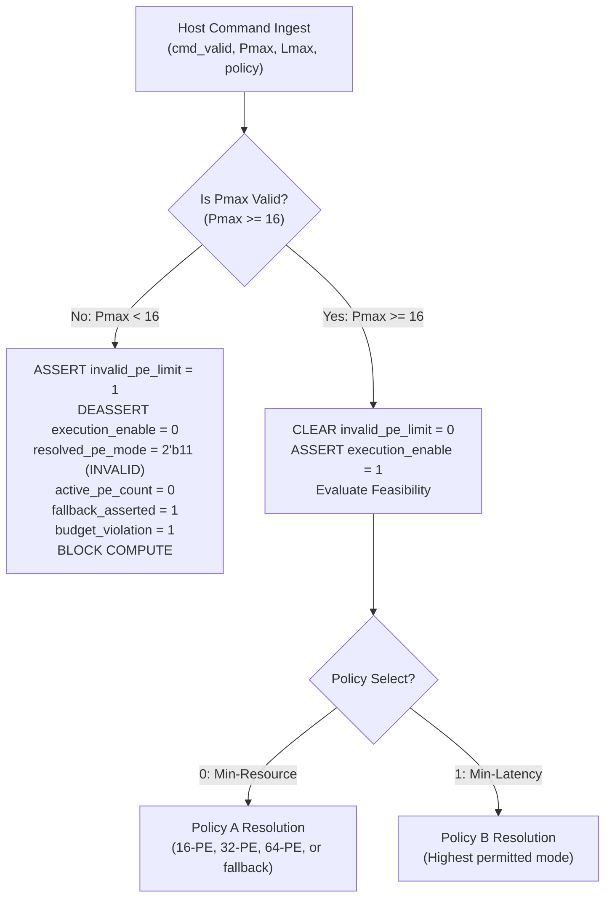

# TSK-35A: Root Cause Analysis & Architectural Safety Correction

## 1. Executive Summary

During milestone TSK-34, independent constraint sweeps across the parameter boundary $P_{\text{max}} < 16$ (specifically $P_{\text{max}} = 0$ and $P_{\text{max}} = 15$) identified an unsafe control behavior in `tsk33_transparent_policy_controller.sv`:
- When presented with a resource cap below the accelerator's minimum physical configuration ($16\text{ PEs}$), the controller asserted `fallback_asserted = 1` and `budget_violation = 1`, but clamped the output mode to `resolved_pe_mode = 2'b00` ($16\text{-PE}$) and `active_pe_count = 16`.
- Because the controller lacked an explicit validity output (`invalid_pe_limit`) and maintained `cmd_ready = 1`, any downstream sequencer that initiated computation without inspecting `fallback_asserted` would execute 16 physical MAC columns, violating the requested power/resource ceiling.

Milestone **TSK-35A** delivers the smallest safe, complete microarchitectural correction:
1. Adds an explicit `invalid_pe_limit` flag asserted whenever $P_{\text{max}} < 16$.
2. Adds an active-high `execution_enable` signal that gates downstream execution initiation.
3. Formally encodes `resolved_pe_mode = 2'b11` (INVALID/BLOCKED) and clears `active_pe_count = 0` during invalid requests, preventing false compliance claims.
4. Demonstrates end-to-end execution blocking via RTL integration testing with `layer_command_sequencer.sv`.

---

## 2. Root Cause Analysis

### 2.1 The Unsafe Fallback Path in TSK-33
In the original TSK-33 controller implementation:
```systemverilog
// Legacy TSK-33 Logic (Vulnerable)
if (policy_select == 1'b0) begin
    if (feas_16) begin ... end
    else if (feas_32) begin ... end
    else if (feas_64) begin ... end
    else begin
        next_fallback  = 1'b1;
        next_violation = 1'b1;
        if (max_active_pe_limit >= 8'd64)      next_pe_mode = 2'b10;
        else if (max_active_pe_limit >= 8'd32) next_pe_mode = 2'b01;
        else                                   next_pe_mode = 2'b00; // Clamped to 16-PE!
    end
end
```
- In this design, the `else` branch conflated two fundamentally different error conditions:
  1. **A valid resource limit whose latency deadline was missed** (e.g. $P_{\text{max}} = 32$, but latency deadline was 5,000 cycles). In this case, running the highest permitted mode (32-PE) is a legitimate best-effort fallback.
  2. **An invalid resource limit that cannot be satisfied by any hardware mode** (e.g. $P_{\text{max}} = 0$ or $15$). Here, clamping to 16-PE violated the upper bound $P \le P_{\text{max}}$, as $16 > 0$ and $16 > 15$.
- Furthermore, `resolved_pe_mode` was driven to `2'b00` (16-PE), so downstream modules receiving `2'b00` had no indication that the PE limit was invalid.

---

## 3. Architectural Safety Correction

The enhanced controller implements a strict hierarchical validation stage before evaluating optimization policies:



### Signal-Level Interface Specifications:

| Port Name | Direction | Width | Behavior under Valid Request ($P_{\text{max}} \ge 16$) | Behavior under Invalid Request ($P_{\text{max}} < 16$) | Behavior under Reset (`!rst_n`) |
| :--- | :---: | :---: | :--- | :--- | :--- |
| `cmd_valid` | Input | 1 | Strobe high to ingest configuration | Strobe high to ingest configuration | Quiescent (0) |
| `cmd_ready` | Output | 1 | High (ready to accept) | High (ready to accept) | High (1) |
| `policy_select` | Input | 1 | 0 = Policy A, 1 = Policy B | Ignored during invalid cap | Don't care |
| `latency_budget_cycles` | Input | 32 | Latency budget ($L_{\text{max}}$) | Diagnostic retention | Reset to 0 |
| `max_active_pe_limit` | Input | 8 | Active PE cap ($P_{\text{max}}$) | Diagnostic retention | Reset to 0 |
| `resolved_pe_mode` | Output | 2 | `2'b00` (16), `2'b01` (32), `2'b10` (64) | **`2'b11` (INVALID/BLOCKED)** | `2'b10` (64-PE default) |
| `active_pe_count` | Output | 8 | 16, 32, or 64 | **`8'd0` (0 active units)** | `8'd64` |
| `channel_passes` | Output | 4 | 4, 2, or 1 | **`4'd0` (0 passes)** | `4'd1` |
| `fallback_asserted` | Output | 1 | 0 (optimal) or 1 (fallback) | **1'b1** | 0 |
| `budget_violation` | Output | 1 | 0 (met) or 1 (exceeded) | **1'b1** | 0 |
| `invalid_pe_limit` | Output | 1 | **1'b0 (Valid limit)** | **1'b1 (Invalid limit)** | **1'b0** |
| `execution_enable` | Output | 1 | **1'b1 (Compute Permitted)** | **1'b0 (Compute Blocked)** | **1'b0 (Quiescent)** |

---

## 4. Downstream Protection & Execution Blocking Mechanism

Downstream execution is protected via two independent hardware safety rings:

```mermaid
sequenceDiagram
    participant Host as System Host
    participant Ctrl as Policy Controller (TSK-33/35A)
    participant Gate as Hardware Enable Gate
    participant Seq as Layer Command Sequencer
    participant DP as Compute Datapath

    Note over Host, DP: Scenario A: Invalid PE Limit (Pmax = 0 or 15)
    Host->>Ctrl: cmd_valid = 1, Pmax = 0
    Ctrl-->>Host: invalid_pe_limit = 1, execution_enable = 0, mode = 2'b11, PEs = 0
    Note over Gate: Safety Ring 1: Hardware Gating
    Gate->>Seq: seq_cmd_valid = 0 (Suppressed by execution_enable)
    Note over Seq: Sequencer remains in ST_IDLE; compute_start NEVER asserts
    Note over Host, DP: Safety Ring 2: Protocol Rejection (If Host forces cmd_valid = 1)
    Host->>Seq: seq_cmd_valid = 1, cmd_pe_mode = 2'b11
    Seq->>Seq: ST_VALIDATE detects mode 2'b11 -> Transition to ST_ERROR (ERR_INVALID_PE_MODE)
    Note over Seq, DP: Sequencer halts in ST_ERROR; compute_start NEVER pulses (0 MAC ops)
```

1. **Safety Ring 1 (Hardware Gating):** The downstream command strobe is qualified by `execution_enable`:
   $$\text{seq\_cmd\_valid} = \text{host\_cmd\_valid} \land \text{execution\_enable}$$
   When $P_{\text{max}} < 16$, `execution_enable = 0`, permanently preventing the command strobe from reaching downstream sequencers.
2. **Safety Ring 2 (Protocol Rejection):** If a host or test harness bypasses `execution_enable` and directly strobes `cmd_valid = 1` with `cmd_pe_mode = resolved_pe_mode`, the downstream `layer_command_sequencer.sv` receives `2'b11`. In `ST_VALIDATE`, the sequencer explicitly checks:
   ```systemverilog
   if (pe_mode_q == 2'b11) begin
       error_flag_d = 1'b1;
       error_code_d = ERR_INVALID_PE_MODE;
       state_d      = ST_ERROR;
   end
   ```
   The sequencer halts in `ST_ERROR` without entering `ST_START_COMP`. `compute_start` is never pulsed, and zero arithmetic operations occur.

---

## 5. Recovery & Quiescence Guarantees

1. **Single-Cycle Recovery:**
   - In cycle $T$, the host presents $P_{\text{max}} = 0$. The controller outputs `invalid_pe_limit = 1, execution_enable = 0, resolved_pe_mode = 2'b11`.
   - In cycle $T+1$, the host presents $P_{\text{max}} = 64$. The controller immediately evaluates feasibility, clears `invalid_pe_limit = 0`, asserts `execution_enable = 1`, and resolves to `2'b10` (or `2'b00`).
   - There is no latch-up, sticky error state, or multi-cycle recovery penalty in the policy controller.
2. **Asynchronous Reset Recovery:**
   - While in an invalid state, asserting `rst_n = 0` immediately clears all internal flip-flops.
   - Upon release of reset, the controller cleanly enters its quiescent state with `execution_enable = 0, invalid_pe_limit = 0, resolved_pe_mode = 2'b10, active_pe_count = 64`.

