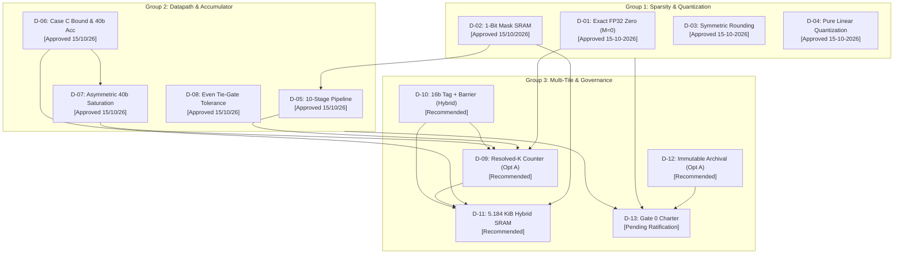

# Phase 1G.5.28: D-09 Through D-13 Decision Resolution Package — Final Report

## 1. Executive Summary

This report delivers the comprehensive engineering decision package for the five outstanding Gate 0 decisions (**`D-09` through `D-13`**) in the `Neural_Acc` accelerator architecture.

Following the Gate 0 Closure Readiness Audit (Phase 1G.5.27), which confirmed that Decisions D-01 through D-08 have documented owner approvals while D-09 through D-13 remained in blank questionnaire templates, this phase provides:
1. **Defensible Engineering Recommendations** for each of the five outstanding decisions.
2. **Explicit Candidate Alternatives and Trade-Off Analyses** without presuming owner concurrence.
3. **Cross-Decision Consistency Mapping** linking progress tracking, generation safety, SRAM budgeting, and archival governance.
4. **An Unexecuted Owner Decision Worksheet** ([`OWNER_DECISION_WORKSHEET.md`](file:///home/cs25m115/Neural_Acc/phase1g_5_28_d09_d13_decision_resolution/OWNER_DECISION_WORKSHEET.md)) ready for direct Project Owner action.
5. **A Proposed Gate 0 Ratification Charter** ([`D13_PROPOSED_GATE0_RATIFICATION_CHARTER.md`](file:///home/cs25m115/Neural_Acc/phase1g_5_28_d09_d13_decision_resolution/D13_PROPOSED_GATE0_RATIFICATION_CHARTER.md)) strictly unratified and unsigned.

### Authoritative Governance State
- **Gate 0**: **`NOT RATIFIED`**
- **Phase 1H Authorization**: **`STRICTLY UNAUTHORIZED`**
- **Phase 2 Authorization**: **`STRICTLY UNAUTHORIZED`**

---

## 2. Technical Evaluation of Outstanding Decisions

### 2.1 Decision D-09: Multi-Tile Progress-Tracking Architecture
*Full Evaluation in [`D09_PROGRESS_ARCHITECTURE_COMPARISON.csv`](file:///home/cs25m115/Neural_Acc/phase1g_5_28_d09_d13_decision_resolution/D09_PROGRESS_ARCHITECTURE_COMPARISON.csv)*

- **Core Problem**: Distributed partial sums arrive asynchronously across the network. How does an accumulator slot know when reduction depth $K=4608$ is fully resolved without premature drain or permanent hang?
- **Candidate Options Evaluated**:
  1. **Option 09-A (Scalar Resolved-K Counter)**: $K_{\text{resolved}} = K_{\text{executed}} + K_{\text{skipped}} == K_{\text{total}}$.
     - *Overhead*: 26 bits (3.25 B) per slot; 832 B per 256-slot tile.
     - *Prerequisite*: Requires hardware-level in-order, exactly-once NoC delivery.
     - *Failure Mode*: Duplicate packet causes premature completion; dropped packet causes permanent hang.
  2. **Option 09-B (Explicit Chunk Scoreboard)**: 288-bit bitmask per slot.
     - *Overhead*: 288 bits (36 B) per slot; 9,216 B (9.0 KiB) per tile.
     - *Advantages*: Order-agnostic; immune to duplicate packets; natively identifies missing chunk indices.
     - *Disadvantages*: Unacceptable silicon area penalty on-chip.
  3. **Option 09-C (Hybrid Counter with 32-Bit Sliding Deduplication Window)**:
     - *Overhead*: 58 bits (7.25 B) per slot; 1,856 B (1.81 KiB) per tile.
     - *Advantages*: Tolerates up to 32 packets of out-of-order jitter; rejects local duplicates.
- **Candidate Recommendation**: **Option 09-A (Scalar Resolved-K Counter)**, provided that the NoC router design guarantees deterministic XY dimension-order routing and in-order delivery per tile pair. If in-order delivery cannot be proven in Phase 1H, Option 09-C serves as the fallback.
- **Governance Status**: **`RECOMMENDED_NOT_APPROVED`** (Awaiting Owner Action).

---

### 2.2 Decision D-10: Accumulator Slot Lifecycle and Generation-Tag Safety
*Full Evaluation in [`D10_GENERATION_SAFETY_OPTIONS.csv`](file:///home/cs25m115/Neural_Acc/phase1g_5_28_d09_d13_decision_resolution/D10_GENERATION_SAFETY_OPTIONS.csv)*

- **Core Problem**: In an 8-bit generation scheme ($G \in [0, 255]$), a delayed packet surviving 256 slot reuse cycles matches the tag of a newly allocated occupant ($G \equiv G + 256 \pmod{256}$), causing silent data corruption.
- **Candidate Remedies Evaluated**:
  1. **REM-10-A (16-Bit Tag Expansion)**: Expands tag space to $G \in [0, 65535]$.
     - *Effect*: Aliasing window expands by $256\times$ to $>2.09 \times 10^6$ cycles at minimum reuse time ($\approx 32$ cycles).
     - *Overhead*: $+1\text{ byte}$ per slot ($+256\text{ B}$ per tile); $+8\text{ bits}$ in packet header.
  2. **REM-10-C (Drain-and-Quiesce Layer Barrier)**: Global hardware synchronization barrier.
     - *Effect*: Halts layer $L+1$ dispatch until all in-flight flits from layer $L$ drain. Mathematically eliminates cross-layer aliasing.
     - *Trade-off*: Introduces minor pipeline bubbles ($<5\%$ runtime overhead with lookahead).
  3. **REM-10-B (Timing Proof on 8-Bit Tag)**: Unfeasible; dynamic DRAM jitter and sparsity prevent proving $T_{\text{transit\_max}} < 256 \times T_{\text{reuse\_min}}$.
- **Candidate Recommendation**: **Option 10-HYBRID (Combined 16-Bit Tag + Layer Drain Barrier)**. Provides redundant, mathematically sound protection: the 16-bit tag prevents intra-layer delay aliasing, while the layer barrier prevents inter-layer aliasing.
- **Governance Status**: **`RECOMMENDED_NOT_APPROVED`** (Awaiting Owner Action).

---

### 2.3 Decision D-11: Schedule S1 On-Chip SRAM Budget Reconciliation
*Full Evaluation in [`D11_SRAM_RECONCILIATION.csv`](file:///home/cs25m115/Neural_Acc/phase1g_5_28_d09_d13_decision_resolution/D11_SRAM_RECONCILIATION.csv)*

- **Core Problem**: Contract Line 83 states a 1.5 KiB total on-chip SRAM cap. This is a mathematical impossibility:
  - Baseline core storage (operands + packed mask + 40-bit accumulators): **2,336 bytes** ($2.28\text{ KiB}$).
  - Single-buffered full tile (core + FIFOs + metadata + NoC queues): **4,128 bytes** ($4.03\text{ KiB}$).
  - Hybrid double-buffered tile (operands doubled; accumulators/metadata single): **5,184 bytes** ($5.06\text{ KiB}$).
  - Fully doubled tile (all structures doubled): **7,568 bytes** ($7.39\text{ KiB}$).
- **Candidate Recommendation**: **Option 11-A (Hybrid Double-Buffered Budget: 5,184 Bytes / 5.06 KiB)**.
  - *Rationale*: Ping-pongs operand loading ($1024\text{ B}$ weights, $1024\text{ B}$ activations, $64\text{ B}$ mask) to hide DRAM latency, while maintaining a single 40-bit accumulator bank ($1280\text{ B}$) with dynamic generation tagging.
  - *Contract Action*: Formally amend Line 83 to replace 1.5 KiB with 5,184 bytes.
- **Governance Status**: **`RECOMMENDED_NOT_APPROVED`** (Awaiting Owner Action).

---

### 2.4 Decision D-12: Historical Checksum Mismatch Disposition & Archival Policy
*Full Evaluation in [`D12_HISTORICAL_ARCHIVAL_POLICY.md`](file:///home/cs25m115/Neural_Acc/phase1g_5_28_d09_d13_decision_resolution/D12_HISTORICAL_ARCHIVAL_POLICY.md)*

- **Core Problem**: 22 checksum mismatches exist across historical Phase 1G.5.11–13 manifests and Phase 1G.5.26 deliverables due to post-manifest modifications of untracked working-tree files.
- **Candidate Recommendation**: **Option 12-A (Permanent Immutable Archival Retention)**.
  - *Principle*: Strictly prohibit retroactive editing of historical manifests. Retain all files as permanent audit evidence. Classify all 22 mismatches as `VERIFIED_MISMATCH_CAUSE_UNKNOWN`.
  - *Future Rule*: Anchor all future phase completions with atomic Git commits on `main`.
- **Governance Status**: **`RECOMMENDED_NOT_APPROVED`** (Awaiting Owner Action).

---

### 2.5 Decision D-13: Consolidated Gate 0 Ratification & Architecture Charter
*Full Draft in [`D13_PROPOSED_GATE0_RATIFICATION_CHARTER.md`](file:///home/cs25m115/Neural_Acc/phase1g_5_28_d09_d13_decision_resolution/D13_PROPOSED_GATE0_RATIFICATION_CHARTER.md)*

- **Core Problem**: Gate 0 brings together all 13 foundational decisions into a single immutable specification.
- **Candidate Recommendation**: Present the charter for explicit owner execution.
  - *Contents*: Integrates D-01 through D-08 owner approvals, D-09 through D-12 recommendations, and Contract Amendments AMD-01 through AMD-07.
  - *Preconditions*: Phase 1H implementation authorization is strictly conditioned on owner signature and Git commit anchoring.
- **Governance Status**: **`NOT_RATIFIED / NOT_AUTHORIZED`** (Awaiting Owner Action).

---

## 3. Cross-Decision Consistency Review

The cross-decision dependency analysis ([`D09_D13_CROSS_DEPENDENCIES.csv`](file:///home/cs25m115/Neural_Acc/phase1g_5_28_d09_d13_decision_resolution/D09_D13_CROSS_DEPENDENCIES.csv)) establishes that the recommended choices form an internally consistent, self-contained architecture:



### Consistency Verifications:
1. **D-09 vs. D-10**: The 16-bit generation tag and layer barrier in D-10 guarantee that stale packets from prior layers or old allocations cannot enter D-09's scalar resolved-K counter.
2. **D-10 vs. D-11**: The 16-bit tag expansion adds 256 bytes per tile, which is explicitly provisioned inside the 5,184-byte budget in D-11.
3. **D-02 / D-06 vs. D-11**: The dedicated 1-bit packed mask SRAM (32 B/64 B) and 40-bit accumulator bank (1280 B) are accounted for bit-exact in D-11.
4. **D-12 vs. D-13**: The archival policy mandates that contract amendments AMD-01..07 are published as an addendum anchored in git, without rewriting historical Phase 1G.5.11 files.

---

## 4. Remaining Technical Blockers

Documented in [`GATE0_REMAINING_BLOCKERS.csv`](file:///home/cs25m115/Neural_Acc/phase1g_5_28_d09_d13_decision_resolution/GATE0_REMAINING_BLOCKERS.csv):
1. **BLK-01 (Owner Action on D-09..D-13)**: Project Owner must execute [`OWNER_DECISION_WORKSHEET.md`](file:///home/cs25m115/Neural_Acc/phase1g_5_28_d09_d13_decision_resolution/OWNER_DECISION_WORKSHEET.md).
2. **BLK-02 (Contract Amendments)**: Formal contract amendment addendum reconciling 6 contradictions must be committed.
3. **BLK-03 (Generation Aliasing Remedy)**: Formal adoption of Option 10-HYBRID (16-bit tag + layer barrier).
4. **BLK-04 (Physical SRAM Budget)**: Formal adoption of Option 11-A (5,184 bytes), followed by commercial macro compilation in Phase 1H.
5. **BLK-05 (Interconnect Deadlock Freedom)**: Formal NoC dimension-order routing specification.
6. **BLK-06 (Archival Integrity Policy)**: Formal adoption of Option 12-A archival retention.
7. **BLK-07 (Consolidated Gate 0 Charter)**: Formal execution and Git commit anchoring of [`D13_PROPOSED_GATE0_RATIFICATION_CHARTER.md`](file:///home/cs25m115/Neural_Acc/phase1g_5_28_d09_d13_decision_resolution/D13_PROPOSED_GATE0_RATIFICATION_CHARTER.md).

---

## 5. Deliverables Manifest and Checksums

All phase deliverables reside in `/home/cs25m115/Neural_Acc/phase1g_5_28_d09_d13_decision_resolution/`:

| Filename | Purpose | Status |
|---|---|---|
| `FINAL_D09_D13_DECISION_PACKAGE.md` | Master decision package and executive summary | Complete |
| `D09_PROGRESS_ARCHITECTURE_COMPARISON.csv` | Evidence-backed comparison of progress tracking options A, B, and C | Complete (4 rows) |
| `D10_GENERATION_SAFETY_OPTIONS.csv` | Evaluation of 6 candidate generation safety remedies | Complete (7 rows) |
| `D11_SRAM_RECONCILIATION.csv` | Memory accounting breakdown, formulas, and feasibility status | Complete (17 rows) |
| `D12_HISTORICAL_ARCHIVAL_POLICY.md` | Formal archival and provenance policy report | Complete |
| `D13_PROPOSED_GATE0_RATIFICATION_CHARTER.md` | Comprehensive proposed charter, explicitly unsigned | Complete |
| `D09_D13_CROSS_DEPENDENCIES.csv` | Decision cross-coupling, criticality, and ordering constraints | Complete (11 rows) |
| `GATE0_REMAINING_BLOCKERS.csv` | Remaining blockers, evidence requirements, and phase impact | Complete (8 rows) |
| `OWNER_DECISION_WORKSHEET.md` | Blank decision questionnaire for Project Owner action | Complete |
| `VALIDATION_AND_AUTHORIZATION_CHECKLIST.md` | Chronological evidence and authorization milestone roadmap | Complete |
| `SHA256SUMS.txt` | Checksum manifest verified clean via `sha256sum -c` | Generated below |

---

## 6. Mandatory Closing Governance Block

```
Gate 0: NOT RATIFIED.
Phase 1H: UNAUTHORIZED.
Phase 2: UNAUTHORIZED.
```

